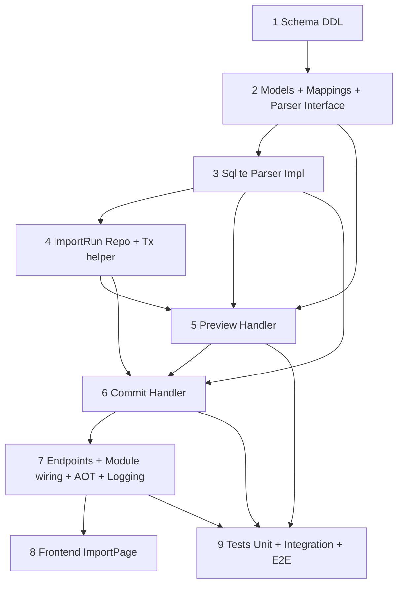

# Implementation Plan — Money Manager (.mmbak) Import

> Spec: `docs/superpowers/specs/2026-08-28-money-manager-import-design.md` (B — dry-run Preview + Commit transaccional)
> SRS refs: `docs/specs/03-domain-ledger-and-split-engine.md`, `04-budgeting-recurring-and-backups.md`, `01-system-architecture-aot.md`, `06-testing-strategy-and-git-conventions.md`, `07-sdd-methodology.md`
> Convenciones: `AGENTS.md` — Clean Architecture + Dapper (SQL solo `Infrastructure/Database`), CQRS Mediator+ErrorOr, `internal sealed` handlers, repos interfaces en Application, `IDbConnectionFactory`, tenancy `UserId`, LoggerMessage source-gen, AOT `BudgieJsonContext`, ValueObjects `Money/CurrencyCode/Name/Percentage/HexColor`.

---

## User Review Required

> [!NOTE]
> Decisiones de spec ya integradas y que condicionan el plan:
> - **Estrategia B confirmada**: `PreviewImport` (dry-run sin writes) + `CommitImport` (transaccional con re-parse) sobre el mismo `.mmbak` SQLite. Parseo se repite; cache solo por `FileHash` en memoria/tmp file tratado con `finally` delete. No se persiste el binario (GDPR).
> - **Mapeos exactos §6.2 fijados**: `CURRENCY→UserSettings.SupportedCurrencies`, `ASSETGROUP.TYPE→AccountType` (1 Checking, 2 Credit, 3 Checking, 4 Savings, 5 Debt, 6 Checking, 11 Cash), `ASSETS ZDATA=0 + filtro NIC_NAME placeholders→Account`, `ZCATEGORY C_IS_DEL=0→Category con resolución ParentId en 2 pasadas`, `INOUTCOME DO_TYPE 0/1/3/7→Transaction (4 deduplicado, 7 IsInitialBalance=true)`, `BUDGET_AMOUNT→Category.MonthlyBudget`, `REPEATTRANSACTION→RecurringTransaction (Frequency conservadora Monthly con warning si ambiguo)`.
> - **Transfer deduplicación**: par `DO_TYPE 3/4` mismo `ZMONEY/WDATE/currencyUid` y `assetUid/toAssetUid` invertidos → importar solo una `Transfer` (tipo `Transfer`, `DO_TYPE=3` canónico). Clave de agrupación `(WDATE, ZMONEY, assetUid, toAssetUid)`.
> - **Idempotencia elegida**: Opción A (spec §6.3): columna `ExternalUid TEXT` en `Accounts/Categories/Transactions` (`UNIQUE` per `UserId`) + tabla `ImportRuns(Id, UserId, FileHash SHA256, FileName, CreatedAt, Counts JSONB)` para `Error.Conflict("Import.AlreadyImported")` si hash repetido y `overwrite=false`. Re-import con `overwrite=true` hace skip por `ExternalUid` ya existente (no duplica). Si se rechaza migración DDL en review, fallback a Opción B (solo `ExternalUid`) sin `ImportRuns`.
> - **Preguntas §8 con defaults del plan**: presupuestos sí a `MonthlyBudget` (max si múltiples, `PERIOD_TYPE=6`); recurrencias sí (5 filas); matching por `ExternalUid` no por nombre (colisión de nombre → sufijo ` (imported)` no requerido si `ExternalUid` distinto — crear con nombre original, unicidad solo por Id); UI en ruta dedicada `/import` enlazada desde Settings; re-import bloqueado con opción `overwrite`.
> - **Límites y validaciones**: max 10 MB upload, extensión `.mmbak/.db/.sqlite`, magia SQLite `SQLite format 3\0`, requiere tablas `INOUTCOME/ASSETS/ZCATEGORY`, máx 5000 tx / 100 cuentas / 200 categorías, `Name`/`Money` validan longitud/positivo, fechas 2000-2100 warn, tenancy `WHERE UserId=@UserId` en todo repo.

Requiere aprobación explícita del plan antes de `implementing` (hard-gate SDD).

---

## Diagrama de dependencias entre slices



Orden de ejecución obligatorio: **1 → 2 → 3 → 4 → 5 → 6 → 7 → 8**. `9` puede solaparse tras `5/6` pero ideal tras `7`.

## Flujo upload → validate → preview → commit

```
Client (multipart file .mmbak, 10MB)
  → POST /api/import/money-manager/preview  [auth]  → ValidateFile(magia, master, tamaño)
  → CopyToTemp + Microsoft.Data.Sqlite readonly → SELECT CURRENCY/ASSETGROUP/ASSETS/ZCATEGORY/INOUTCOME/BUDGET/REPEAT
  → Mappings puros (MoneyManagerMappings) + dedup transfer + categorías 2 pasadas + ExchangeRate calc
  → PreviewResult {counts, dateRange, currencies, warnings, errors}  (200, no writes, delete tmp en finally)
  → UI muestra tabla preview
  → POST /api/import/money-manager/commit {file + overwrite?} → re-parse → BEGIN tx (Dapper)
    a) merge SupportedCurrencies en UserSettings (jsonb)
    b) upsert Accounts por ExternalUid (crear via Account.Create, Balance=0, ControlStartDate=min WDATE por cuenta)
    c) Categories 2 pasadas (padres→hijos) + MonthlyBudget desde BUDGET_AMOUNT max
    d) Transactions ordenadas WDATE,ZDATE (dedup, ctg→null si huérfano, IsInitialBalance, ExchangeRate)
    e) RecurringTransactions (Frequency map)
    f) balances vía Account.ApplyTransaction + IAccountRepository.UpdateBalanceAsync en batch 500
    g) INSERT ImportRuns(FileHash) → COMMIT (o ROLLBACK si archivo corrupto)
  → CommitResult {createdAccounts, createdCategories, createdTransactions breakdown, skipped, warnings}
Idempotencia: FileHash SHA256 + ExternalUid UNIQUE(UserId, ExternalUid) en cada tabla hija.
```

---

## Tareas (una por unidad de implementación)

### 1. Schema DDL + Idempotencia base (Infra/DB)

- **Objetivo**: Añadir columnas `ExternalUid` e `ImportRuns` para idempotencia y trazabilidad del import sin romper `001_initial_schema.sql`.
- **Archivos**:
  - `[NEW] src/apps/Budgie.Api/sql/002_import_runs.sql`
  - `[MODIFY] src/apps/Budgie.Api/Program.cs` — ya itera `*.sql` ordenado; verificar idempotencia `IF NOT EXISTS` (no requiere cambio funcional, solo nota de verificación).
- **Pasos**:
  - Crear `002_import_runs.sql` con `CREATE TABLE IF NOT EXISTS "ImportRuns" ("Id" UUID PRIMARY KEY, "UserId" UUID NOT NULL REFERENCES "Users"("Id") ON DELETE CASCADE, "FileHash" VARCHAR(64) NOT NULL, "FileName" VARCHAR(255), "CreatedAt" TIMESTAMP NOT NULL DEFAULT NOW(), "Counts" JSONB, UNIQUE("UserId","FileHash"))` + `CREATE INDEX IF NOT EXISTS "IX_ImportRuns_UserId"`.
  - `ALTER TABLE "Accounts" ADD COLUMN IF NOT EXISTS "ExternalUid" VARCHAR(100); CREATE UNIQUE INDEX IF NOT EXISTS "IX_Accounts_UserId_ExternalUid" ON "Accounts"("UserId","ExternalUid") WHERE "ExternalUid" IS NOT NULL;` idem para `"Categories"` y `"Transactions"` (en Transactions permite `NULL` para tx manuales).
  - Para `Categories` ya existe `ParentId FK`; no tocar.
  - Usar identificadores doblecomillados y `IF NOT EXISTS` (convención `001_initial_schema.sql`).
  - Añadir `INSERT INTO "_SchemaVersions" ("Version") VALUES ('002_import_runs') ON CONFLICT DO NOTHING;` al final.
  - Verificar en plan que siguiente migración será `003_*` (reservar NN).

### 2. Modelos de dominio import + Mappings puros + Parser interface (Application)

- **Objetivo**: Definir DTOs internos MM y mapeos exactos testeables sin SQL ni I/O.
- **Archivos**:
  - `[NEW] src/core/Budgie.Modules.Finances/Application/Import/MoneyManagerModels.cs` — records `MmCurrency(Iso, Rate, IsMain)`, `MmAsset(Uid, GroupUid, GroupType, CurrencyUid, NicName, ZData, A_Utime)`, `MmCategory(Uid, Name, Type, PUid, C_Is_Del, Status)`, `MmTransaction(Uid, AssetUid, ToAssetUid, CtgUid, ZDate, WDate, ZMoney, InZMoney, AmountAccount, CurrencyUid, ZContent, DoType, Mark)`, `MmBudgetAmount(BudgetUid, Amount)`, `MmBudget(Uid, TargetUid)`, `MmRepeatTransaction(...)`, `MmImportData(...)`, `MmAssetGroup(Type, Name)`.
  - `[NEW] src/core/Budgie.Modules.Finances/Application/Import/Mappings/MoneyManagerMappings.cs` — `static class MoneyManagerMappings` con métodos puros: `MapAssetGroupType(int) → AccountType`, `MapAccount(...)`, `MapCategory(...)`, `MapTransactionType(int) → TransactionType?` (0 Income,1 Expense,3 Transfer,7 Income+flag, 4->null skip), `TryParseDate(string WDATE, string ZDATE)`, `MapAmount(...)` con `ExchangeRate` derivado, `ShouldSkipAsset(MmAsset)`, `ShouldSkipCategory(MmCategory)`. Sin dependencias Dapper/Npgsql.
  - `[NEW] src/core/Budgie.Modules.Finances/Application/Import/IMoneyManagerParser.cs` — `Task<MmImportData> ParseAsync(string tempFilePath, CancellationToken ct)` + `Task<MmImportData> ParseAsync(Stream stream, CancellationToken ct)` overload que persiste a temp (la impl elige).
  - `[NEW] src/core/Budgie.Modules.Finances/Application/Import/IImportRunRepository.cs` — `Task<bool> ExistsByHashAsync(Guid userId, string hash, CancellationToken ct)`, `Task AddAsync(ImportRun run, CancellationToken ct)`, `Task<ImportRun?> GetByHashAsync(...)`.
  - `[NEW] src/core/Budgie.Modules.Finances/Domain/Import/ImportRun.cs` — `public class ImportRun : Entity { Guid Id; Guid UserId; string FileHash; string? FileName; DateTime CreatedAt; string? CountsJson; public ImportRun(){} public static ImportRun Create(...) }` con `internal set`, siguiendo `Account/Category/Transaction` (public paramless ctor, static Create).
- **Pasos**:
  - Ubicar `Import` como feature transversal en `Application/Import` (no bajo `Transactions` para no mezclar). Respetar namespace `Budgie.Modules.Finances.Application.Import` y `...Mappings`.
  - Mapeos: documentar tabla §6.2 inline con comentarios (evitar lógica oculta). Ejemplo `ASSETGROUP.TYPE 1→Checking, 2→Credit, 4→Savings, 5→Debt, 11→Cash`.
  - `MoneyManagerModels.MmTransaction` expone `IsTransferPairCandidate` helper.
  - No referenciar `IDbConnectionFactory` ni SQL aquí.

### 3. Parser SQLite readonly (Infrastructure/Import)

- **Objetivo**: Implementar lectura del `.mmbak` como SQLite sin mutarlo, validando magia y esquema.
- **Archivos**:
  - `[NEW] src/core/Budgie.Modules.Finances/Infrastructure/Import/MoneyManagerSqliteParser.cs` — `internal sealed class MoneyManagerSqliteParser : IMoneyManagerParser` con `Microsoft.Data.Sqlite` + `SQLitePCLRaw.bundle_e_sqlite3`.
  - `[MODIFY] src/core/Budgie.Modules.Finances/Budgie.Modules.Finances.csproj` — añadir `<PackageReference Include="Microsoft.Data.Sqlite" Version="9.*" />` (verificar versión compatible .NET 10; usar `9.0.*` estable). No `System.Data.SQLite`.
  - `[MODIFY] src/core/Budgie.Modules.Finances/Infrastructure/Database/Repositories.cs` — no tocar (solo referencia para estilo Dapper).
- **Pasos**:
  - Validar archivo: `File.Exists`, tamaño >0 y ≤10 MB, magia `SQLite format 3\0` leyendo primeros 16 bytes. Si falla → throw controlado que handler convertirá a `Error.Validation("Import.InvalidFile")`.
  - Abrir `SqliteConnection("Data Source={tempPath};Mode=ReadOnly")`, verificar `sqlite_master` contiene `INOUTCOME`, `ASSETS`, `ZCATEGORY` (`SELECT name FROM sqlite_master WHERE type='table'`).
  - Leer tablas con `SqliteCommand` + `ExecuteReaderAsync` (evitar Dapper aquí; es SQLite no Npgsql). Mapear a `Mm*` models. Queries: `SELECT uid, groupUid, currencyUid, NIC_NAME, ZDATA, A_UTIME FROM ASSETS WHERE ZDATA=0`-like (parser devuelve crudo; filtrado fino en mappings/handler), `SELECT uid, NAME, TYPE, pUid, C_IS_DEL, STATUS FROM ZCATEGORY`, `SELECT uid, assetUid, toAssetUid, ctgUid, ZDATE, WDATE, ZMONEY, IN_ZMONEY, AMOUNT_ACCOUNT, currencyUid, ZCONTENT, DO_TYPE, IS_DEL FROM INOUTCOME WHERE IS_DEL=0`, `SELECT ISO, RATE, IS_MAIN_CURRENCY FROM CURRENCY`, etc.
  - Manejar `ZDATE` epoch ms string → `DateTimeOffset.FromUnixTimeMilliseconds`, `WDATE` `YYYY-MM-DD` → `DateTime.SpecifyKind(..., Unspecified)`, fallback ZDATE si WDATE nulo/inválido.
  - Cerrar y `Dispose` conexión; no dejar file lock.
  - Añadir soporte AOT: `Microsoft.Data.Sqlite` con `bundle_e_sqlite3` es AOT-safe (ver spec §7).
  - Logging via `ILogger<MoneyManagerSqliteParser>` + `LogMessages` (nuevo IDs, ver slice 7).

### 4. Repositorio ImportRuns + helper transaccional (Infrastructure/Database)

- **Objetivo**: Persistir idempotencia y exponer operaciones atómicas de import (accounts/categories/transactions batch).
- **Archivos**:
  - `[NEW] src/core/Budgie.Modules.Finances/Infrastructure/Database/ImportRunRepository.cs` — `internal sealed class ImportRunRepository(IDbConnectionFactory factory) : IImportRunRepository` usando `factory.QuerySingleOrDefaultAsync` / `ExecuteAsync` con SQL double-quoted.
  - `[MODIFY] src/core/Budgie.Modules.Finances/Application/IAccountRepository.cs` — añadir `Task<Account?> GetByExternalUidAsync(Guid userId, string externalUid, CancellationToken ct)` y `Task<List<Account>> GetByUserIdWithExternalUidAsync(Guid userId, CancellationToken ct)` si se prefiere; alternativo: reutilizar `IImportRunRepository` + queries inline en CommitHandler via nuevos métodos (decisión: añadir `GetByExternalUidAsync` a cada repo para no leak SQL al handler).
  - `[MODIFY] src/core/Budgie.Modules.Finances/Application/ICategoryRepository.cs` — añadir `Task<Category?> GetByExternalUidAsync(...)` y `Task<Dictionary<string, Guid>> GetExternalUidMapAsync(Guid userId, CancellationToken ct)`.
  - `[MODIFY] src/core/Budgie.Modules.Finances/Application/ITransactionRepository.cs` — añadir `Task<bool> ExistsByExternalUidAsync(Guid userId, string externalUid, CancellationToken ct)` + `Task AddRangeAsync(IEnumerable<Transaction> txs, CancellationToken ct)` con batch 500 (opcional, puede iterar `AddAsync` en commit si se quiere simplicidad; documentar trade-off perf).
  - `[MODIFY] src/core/Budgie.Modules.Finances/Infrastructure/Database/CategoryRepository.cs` — implementar nuevos métodos (leer archivo real para confirmar clase existente).
  - `[MODIFY] src/core/Budgie.Modules.Finances/Infrastructure/Database/TransactionRepository.cs` — implementar `ExistsByExternalUid`, `AddRangeAsync` con `ExecuteAsync` multi-values (500 por batch) usando Npgsql.
- **Pasos**:
  - SQL: `SELECT "Id" FROM "ImportRuns" WHERE "UserId"=@UserId AND "FileHash"=@FileHash`, `INSERT INTO "ImportRuns"...`.
  - Para `ExternalUid` lookups: `SELECT ... FROM "Accounts" WHERE "UserId"=@UserId AND "ExternalUid"=@ExternalUid`, índice parcial ya creado.
  - Transaccionalidad: CommitHandler abrirá transacción explícita (`factory.CreateConnection()` + `BeginTransactionAsync`), pasar `IDbTransaction` a repos o usar `ExecuteAsync` dentro de `NpgsqlTransaction` (preferir helper `factory.CreateConnection()` y `connection.BeginTransaction()`; seguir patrón existente en `ExportRepository` si usa transacción). Si repos no soportan tx param, encapsular todo en `ImportRunRepository.ExecuteInTransactionAsync(Func<NpgsqlConnection,NpgsqlTransaction,Task>)` — definir en slice 4.
  - Tenancy: todo con `UserId`.

### 5. PreviewMoneyManagerImport — dry-run sin writes (Application)

- **Objetivo**: Validar archivo y retornar `PreviewResult` con conteos, warnings y errores sin tocar DB salvo lecturas de validación.
- **Archivos**:
  - `[NEW] src/core/Budgie.Modules.Finances/Application/Import/PreviewMoneyManagerImport/PreviewMoneyManagerImportCommand.cs` — `public record PreviewMoneyManagerImportCommand(Stream FileStream, string FileName, string ContentType) : IRequest<ErrorOr<PreviewMoneyManagerImportResponse>>` (alternativo `IFormFile` si Presentation lo adapta; preferir `Stream`+`FileName` en Application para no depender de AspNetCore). Definir `PreviewMoneyManagerImportResponse` con `List<PreviewCurrency> Currencies`, `List<PreviewAccount> Accounts` (Name, Type, Currency, ExternalUid), `List<PreviewCategory> Categories` (Name, Type, ParentUid, ExternalUid, MonthlyBudget), `PreviewTransactionsSummary { Income, Expense, Transfer, InitialBalance, Total, DedupedTransfers, DateRange }`, `List<PreviewBudget> Budgets`, `List<PreviewRecurring> Recurrings`, `List<string> Warnings`, `List<string> Errors`, `int SkippedPlaceholders`, `string FileHash`, `bool AlreadyImported`.
  - `[NEW] src/core/Budgie.Modules.Finances/Application/Import/PreviewMoneyManagerImport/PreviewMoneyManagerImportCommandHandler.cs` — `internal sealed class PreviewMoneyManagerImportCommandHandler(IMoneyManagerParser parser, IAccountRepository accountRepo, ICategoryRepository categoryRepo, IImportRunRepository importRunRepo, ICurrentUserProvider currentUser, ILogger<PreviewMoneyManagerImportCommandHandler> logger) : IRequestHandler<...>`.
- **Pasos**:
  - Obtener `userId = currentUserProvider.GetUserId()`.
  - Validar tamaño/extensión/MIME; si `file.Length==0` o >10MB → `Error.Validation("Import.FileTooLarge")` (i18n es/en via `CultureInfo.CurrentUICulture` como en `CreateTransactionCommandHandler`).
  - Copiar `Stream` a `Path.GetTempFileName()` (+ `.mmbak`), calcular `SHA256 FileHash` (para idempotencia preview), `FileStream` → `finally { File.Delete(tempPath) }`.
  - Llamar `parser.ParseAsync(tempPath, ct)`; capturar `SqliteException` → `Error.Validation("Import.InvalidFile")`.
  - Límites: si `assets.Count>100` o `categories.Count>200` o `transactions.Count>5000` → `Error.Validation("Import.LimitExceeded")`.
  - Mapear: filtrar `ASSETS` (`ZDATA=1` + `NIC_NAME` placeholders `11,Cuentas,2 Tarjetas...` → `SkippedPlaceholders`), `ZCATEGORY` `C_IS_DEL=1` skip, `INOUTCOME` `DO_TYPE` 4 skip, dedup transfer: agrupar `DO_TYPE 3` por `(WDATE, ZMONEY, assetUid, toAssetUid)` y si existe espejo `DO_TYPE 4` con invertidos → contar `Deduped=195` y no duplicar; verificar `toAssetUid='-4'` → no transfer.
  - Categorías dos pasadas: construir `Dictionary<string, Guid>` temp para padres; warnings si `pUid` huérfano → `ParentId=null + warning`.
  - ExchangeRate: si `currencyUid` mismatch vs `Account.Currency`, calcular `AMOUNT_ACCOUNT / ZMONEY` else 1.
  - `BUDGET_AMOUNT` join `BUDGET.targetUid` → `MonthlyBudget` max por categoría; si múltiple → warning.
  - `REPEATTRANSACTION`: mapear `REPEAT_TYPE 1 Daily / 8 Monthly / 16 Yearly` (guess) → `RecurringFrequency`; si ambiguo → `Monthly` + warning.
  - Consultar `importRunRepo.ExistsByHashAsync(userId, hash)` → `AlreadyImported=true` warning (no error en preview).
  - Validar cuentas huérfanas: `assetUid` sin match en `ASSETS` → error bloqueante en `Errors` (preview no falla, solo reporta).
  - Retornar `PreviewResponse` con `Warnings` (orphan, placeholder, transferDeduped, futureDate 2028, rate incoherente, emoji truncation not needed) y `Errors` si archivo corrupto.
  - Logging: `LogMessages.MoneyManagerPreviewStarted/Completed` (añadir en slice 7 pero usar desde aquí).
  - No escribir en DB.

### 6. CommitMoneyManagerImport — escribe transaccionalmente (Application)

- **Objetivo**: Re-parsear y persistir Accounts→Categories→Transactions→Recurring de forma idempotente y atómica.
- **Archivos**:
  - `[NEW] src/core/Budgie.Modules.Finances/Application/Import/CommitMoneyManagerImport/CommitMoneyManagerImportCommand.cs` — `public record CommitMoneyManagerImportCommand(Stream FileStream, string FileName, string ContentType, bool Overwrite = false) : IRequest<ErrorOr<CommitMoneyManagerImportResponse>>` con `CommitMoneyManagerImportResponse { int CreatedAccounts, SkippedAccounts, CreatedCategories, SkippedCategories, CreatedTransactions, SkippedTransactions, CreatedRecurring, Warnings, string FileHash }`.
  - `[NEW] src/core/Budgie.Modules.Finances/Application/Import/CommitMoneyManagerImport/CommitMoneyManagerImportCommandHandler.cs` — `internal sealed class CommitMoneyManagerImportCommandHandler(IMoneyManagerParser parser, IAccountRepository accountRepo, ICategoryRepository categoryRepo, ITransactionRepository txRepo, IRecurringTransactionRepository recurringRepo, IImportRunRepository importRunRepo, ICurrentUserProvider currentUser, ILogger<CommitMoneyManagerImportCommandHandler> logger, IDbConnectionFactory factory) : IRequestHandler<...>`.
- **Pasos**:
  - Mismo validate + temp file + `SHA256` que preview.
  - Si `importRunRepo.ExistsByHashAsync` y `!Overwrite` → `return Error.Conflict("Import.AlreadyImported", "...")` (es/en).
  - Re-parse `MmImportData`; si falla → `Error.Validation`.
  - Abrir conexión y `BeginTransactionAsync(IsolationLevel.ReadCommitted)`; todo dentro de try/commit/rollback.
  - **Paso a) Currencies**: cargar `UserSettings` (`SELECT "SupportedCurrencies" FROM "UserSettings" WHERE "UserId"=@UserId` via `factory` o via `IUserSettingsProvider` si existe; si no hay repo, usar `factory.QuerySingleOrDefaultAsync` directamente en handler? **No** — handler no debe tener SQL (AGENTS.md). Por tanto crear `IUserSettingsImportRepository` minimal o reutilizar `IExportRepository`/`IReportRepository`? Mejor añadir método `MergeSupportedCurrenciesAsync(Guid userId, IEnumerable<string> isos)` en `IImportRunRepository` o nuevo `IUserSettingsImportRepository`). Documentar que slice 6 depende de ese método del slice 4.
  - **Paso b) Accounts**: construir `Dictionary<string, MmAsset>` filtrada (`ZDATA=0`), ordenar por `A_UTIME`. Para cada `mmAsset`: si `GetByExternalUidAsync` existe → skip (idempotente); sino `Account.Create(userId, Name.From(nicName,100), currencyIso, 0, MapAssetGroupType(groupUid), creditSettings null, createdAt: A_UTIME, controlStartDate: min WDATE por cuenta)`; `AddAsync` con `ExternalUid=uid` (requiere columna en INSERT — actualizar `AccountRepository.AddAsync` para incluir `ExternalUid` si no null). Recalcular `ControlStartDate` como `Min(WDATE)` de sus transacciones; si no hay TX → `A_UTIME`.
  - **Paso c) Categories**: dos pasadas. Primera crear padres (`pUid` null o padre no existe en lote) con `Category.Create(userId, name, type, parentId:null, monthlyBudget: maxBudget)`. Segunda pasar hijos resolviendo `ParentId` via `ExternalUid->Id` map. `C_IS_DEL=1` skip. `MonthlyBudget` desde `BUDGET_AMOUNT` max. `AddAsync` con `ExternalUid`.
  - **Paso d) Transactions**: ordenar `INOUTCOME` por `WDATE ASC, ZDATE ASC`. Dedup transfer: `Where DO_TYPE !=4` + agrupar transfer canónico. Para cada `mmTx` de tipo `Income/Expense/Transfer/Initial`: resolver `AccountId` via map, si huérfano → warning + skip (no aborta todo); resolver `CategoryId` via map (`-4` o no encontrado → null+warning); parse `Amount` = `AMOUNT_ACCOUNT ?? ZMONEY` decimal, validar `Money.FromPositive` (si ≤0 skip+warning); `Currency` = ISO de `currencyUid`; `ExchangeRate` derivado; `Date` = `WDATE` o `ZDATE`; `Notes` = `ZCONTENT` trimmed 500; `IsInitialBalance = DO_TYPE==7`; crear `Transaction.Create(userId, accountId, categoryId, amount, currency, exchangeRate, date, notes, type, installments:1, isInitialBalance)`; `AddAsync` con `ExternalUid`; batch 500. Si `ExternalUid` ya existe → skip.
  - **Paso e) Recurring**: mapear 5 `REPEATTRANSACTION` a `RecurringTransaction.Create(...)` con `Frequency` conservadora; si ambiguo → `Monthly`+warning; `AddAsync`.
  - **Paso f) Balances**: tras inserts, recalcular `Account.Balance` aplicando `Account.ApplyTransaction` en orden cronológico o hacer `SUM` por cuenta (más simple y consistente). Llamar `IAccountRepository.UpdateBalanceAsync(id, newBalance)` para cada cuenta.
  - **Paso g) ImportRuns**: `INSERT` hash+counts JSONB (`System.Text.Json`).
  - `CommitAsync`; `File.Delete(temp)` en `finally`.
  - Retornar `CommitResponse` con conteos; warnings acumulados (orphan, futureDate, rate fallback, budget max tomado, recurring ambiguity).
  - Errores parciales: saltar fila con warning, no abortar todo; solo aborta si archivo corrupto o tx DB falla.
  - Logging: `LogMessages.MoneyManagerCommitStarted/Completed/Failed`.

### 7. Endpoints + Wiring módulo + AOT + Logging (Presentation / Shared)

- **Objetivo**: Exponer `POST /api/import/money-manager/preview` y `/commit` como `multipart/form-data` con auth y registrar servicios.
- **Archivos**:
  - `[NEW] src/core/Budgie.Modules.Finances/Presentation/Import/PreviewImportEndpoint.cs` — `public static class PreviewImportEndpoint { public static void MapEndpoint(IEndpointRouteBuilder app) => app.MapPost("/money-manager/preview", async (IFormFile file, IMediator mediator, CancellationToken ct) => { using var ms=new MemoryStream(); await file.CopyToAsync(ms, ct); ms.Position=0; var cmd=new PreviewMoneyManagerImportCommand(ms, file.FileName, file.ContentType); var res=await mediator.Send(cmd, ct); return res.Match(Results.Ok, err=>err.ToResponse()); }).RequireAuthorization().DisableAntiforgery().Accepts<IFormFile>("multipart/form-data"); }` Validar `file.Length`, extensión, content-type antes de mediador.
  - `[NEW] src/core/Budgie.Modules.Finances/Presentation/Import/CommitImportEndpoint.cs` — idem con `CommitMoneyManagerImportCommand` y query `?overwrite=true`. Retorna `201 Created` o `200 OK` con `CommitResponse`.
  - `[NEW] src/core/Budgie.Modules.Finances/Presentation/Import/ImportEndpoints.cs` — `internal static class ImportEndpoints { public static IEndpointRouteBuilder MapImportEndpoints(this IEndpointRouteBuilder app) { var g=app.MapGroup("/api/import").RequireAuthorization(); PreviewImportEndpoint.MapEndpoint(g); CommitImportEndpoint.MapEndpoint(g); return app; } }`.
  - `[MODIFY] src/core/Budgie.Modules.Finances/FinancesModule.cs` — añadir `services.AddScoped<IMoneyManagerParser, MoneyManagerSqliteParser>(); services.AddScoped<IImportRunRepository, ImportRunRepository>();` en `AddFinancesModule()` y `ImportEndpoints.MapImportEndpoints(group)` en `MapFinancesEndpoints()` (o `app.MapImportEndpoints()` separado; decidir: grupo `/api/import` separado de `/api/finances`).
  - `[MODIFY] src/core/Budgie.Modules.Finances/Infrastructure/Logging/LogMessages.cs` — añadir 6 entries `[LoggerMessage]` IDs 18-23: `MoneyManagerPreviewStarted`, `MoneyManagerPreviewCompleted`, `MoneyManagerCommitStarted`, `MoneyManagerCommitCompleted`, `MoneyManagerCommitFailed`, `MoneyManagerValidationFailed` con `EventId` únicos y `Message` con `{UserId} {FileName} {Hash}` y counts.
  - `[MODIFY] src/apps/Budgie.Api/BudgieJsonContext.cs` — registrar `PreviewMoneyManagerImportResponse`, `CommitMoneyManagerImportResponse`, `PreviewMoneyManagerImportCommand`, `CommitMoneyManagerImportCommand`, `ProblemDetails` si aplica para AOT (`[JsonSerializable]`).
  - `[MODIFY] src/apps/Budgie.Api/Program.cs` — no cambio (sql auto-aplica), pero verificar `UseStaticFiles` ordering no afecta multipart.
- **Pasos**:
  - Endpoints usan `IFormFile` (requiere `Microsoft.AspNetCore.Http`); no usar `IDbConnectionFactory` en Presentation (solo mediador).
  - Manejar `ErrorOr` → `Results.BadRequest` / `Conflict` / `Ok` con `ToDictionary` como en ejemplos AGENTS.md.
  - `DisableAntiforgery()` necesario para `multipart` sin antiforgery token (minimal API).
  - Añadir `Accepts` y `Produces` para OpenAPI Scalar.
  - Logging: inyectar `ILogger<T>` en handlers y llamar `LogMessages.*`.

### 8. Frontend Import (Budgie.Web — React 19 + Vite + shadcn + TanStack Query)

- **Objetivo**: UI mínima self-service para subir `.mmbak`, ver preview y confirmar commit, mockeada para E2E.
- **Archivos**:
  - `[NEW] src/apps/Budgie.Web/src/features/import/ImportPage.tsx` — página en `/import` con layout `Card` + `Dropzone` + estados `idle/uploading/preview/committing/success` usando `useImport` hook; muestra `Alert` para warnings/errors, `Table` para resumen (cuentas 17→?, categorías ~80, tx 2294→~2099, budgets 46, recurring 5).
  - `[NEW] src/apps/Budgie.Web/src/features/import/components/ImportUpload.tsx` — `shadcn/ui Card, Button, Input type=file` con drag&drop, valida extensión `.mmbak/.db/.sqlite` y tamaño ≤10MB client-side, `accept=".mmbak,.db,.sqlite"`.
  - `[NEW] src/apps/Budgie.Web/src/features/import/components/ImportPreview.tsx` — tablas `shadcn Table` para `accounts/categories/transactions breakdown`, `Badge` para warnings, `Skeleton` mientras carga.
  - `[NEW] src/apps/Budgie.Web/src/features/import/hooks/useImport.ts` — `useMutation` TanStack Query para `preview` (`POST /api/import/money-manager/preview` multipart) y `commit` (`POST /api/import/money-manager/commit?overwrite=`), con `openapi-fetch` typed client; expone `previewData`, `commitData`, `isPending`.
  - `[NEW] src/apps/Budgie.Web/src/features/import/api/importClient.ts` — helpers `previewMoneyManager(file): Promise<PreviewResponse>` y `commitMoneyManager(file, overwrite)` usando `fetch` + `FormData`.
  - `[MODIFY] src/apps/Budgie.Web/src/app/router.tsx` **o** `src/apps/Budgie.Web/src/modules/routes.ts` (verificar real: `src/apps/Budgie.Web/src/App.tsx` actualmente define routes) — añadir `Route path="/import" element={<ImportPage/>} requireAuth`.
  - `[MODIFY] src/apps/Budgie.Web/src/i18n/locales/es.json` — añadir clave `import.*`: `title`, `upload`, `preview`, `commit`, `alreadyImported`, `warnings.*`, `errors.*`, `success`.
  - `[MODIFY] src/apps/Budgie.Web/src/i18n/locales/en.json` — idem en.
  - `[MODIFY] src/apps/Budgie.Web/src/components/layout/*` o `src/apps/Budgie.Web/src/modules/layout/*` — añadir link en Settings/nav a `/import` (no romper IA existente).
  - `[NEW] src/apps/Budgie.Web/e2e/import.spec.ts` — Playwright spec mockeada con MSW (no E2E real contra DB): intercepta `POST /api/import/money-manager/preview` → fixture `preview.json` y `commit` → `commit.json`; verifica upload→preview table→confirm→success. Ubicar junto a `e2e/mocks/` existente.
- **Pasos**:
  - Seguir convención `src/apps/Budgie.Web/src/features/` (ver `modules/` vs `features/` — repo usa `modules/` actualmente; crear `features/import` si no existe, o `modules/import` para consistencia; plan propone `features/import` pero implementer debe verificar `App.tsx` y usar la carpeta real `modules/import` si corresponde).
  - Usar `shadcn/ui` (`Card`, `Table`, `Alert`, `Button`, `Skeleton`, `Badge`) + `sonner` toast para éxito/error.
  - `openapi-typescript` ya genera `api-types.ts`; tras backend, regenerar `bun run api:gen` (no en plan, pero notar).
  - i18n `es` default, `en` fallback (como ValueObjects).
  - E2E usa `fixtures.ts` y `mocks` existentes (`src/apps/Budgie.Web/e2e/mocks`).

---

## Orden de implementación recomendado (para `implementing` skill)

1. Slice 1 (DDL) — 0.5 día, bloquea todo.
2. Slice 2 (Models/Mappings) — 0.5 día, testeable unit sin infra.
3. Slice 3 (Parser) — 1 día, requiere fixture `.mmbak` real (`file` + `sqlite3` validado).
4. Slice 4 (Repos) — 0.5 día, Dapper SQL + tx helper.
5. Slice 5 (Preview) — 1 día, handler dry-run + validaciones + warnings.
6. Slice 6 (Commit) — 1.5 días, transaccional + idempotencia + balances.
7. Slice 7 (Endpoints/AOT/Logging/Module) — 0.5 día.
8. Slice 8 (Frontend) — 1 día.

Total estimado 6—7 días con tests.

---

## Verification Plan

> Hard-gate: todo verde antes de `release` (ver `07-sdd-methodology.md §6`).

### Backend (slices 1—7)

```bash
dotnet build Budgie.slnx --nologo
dotnet test Budgie.slnx --verbosity normal
dotnet test Budgie.slnx --collect:"XPlat Code Coverage"  # ~100% en nuevos handlers/mappings/parser
```

- **Unit**: parser magia/header, `MoneyManagerMappings` (GroupType, DoType, ZDATE/WDATE, ExchangeRate, placeholder/category filters, emoji Name 50), dedup transfer (par 195→195, toAssetUid -4 no transfer), categorías 2 pasadas + MonthlyBudget max, límites 5000/100/200, `PreviewHandler` warnings/errors, `CommitHandler` idempotencia `ExternalUid` + `FileHash` conflict, `overwrite=true` skip.
- **Integration**: `WebApplicationFactory` + PostgreSQL (Testcontainers) sube `.opencode/docs/MMGF(28-08-26-010218).mmbak` real a `/preview` → asserts `accounts 17`, `categories ~80` (92−borradas), `transactions total 2099` (2294−195 dedup), `budgets 46`, `recurring 5`; luego `/commit` → verifica `Accounts` con `ExternalUid` + `ControlStartDate` = min WDATE, `Categories.ParentId` resuelto, `Transactions` con `IsInitialBalance` 10, `Type Transfer` 195, `ExchangeRate` para `PEN_USD`, balances consistentes, re-import mismo hash → `409 Conflict` si `overwrite=false`, `200` con `skipped` si `true`; multi-tenancy: segundo usuario no ve datos del primero.

### Frontend (slice 8)

```bash
cd src/apps/Budgie.Web
bun run typecheck   # tsc -b --noEmit
bun run lint        # eslint .
bun run build       # tsc -b && vite build
bunx playwright test --project=import  # o bunx playwright test e2e/import.spec.ts
```

- `typecheck` debe pasar con nuevos tipos `PreviewResponse/CommitResponse` (AOT `BudgieJsonContext` alineado).
- `lint` sin warnings en `features/import/**`.
- `build` genera `dist/` sin errores.
- `playwright` con MSW mockeando `preview/commit` valida flujo upload→preview→commit→success (selectores por accesibilidad).

### Manual (post-gates)

- Subir `.opencode/docs/MMGF(28-08-26-010218).mmbak` en local/dev y spot-check 10 TX (ej AID 66↔67 transfer, `🍜 Comida` jerarquía, `BCP Soles` currency) contra app original; verificar `Health 200 {status:"healthy"}` sigue verde y `Scalar` OpenAPI expone `/api/import/*`.

### Criterios de fallo

- `dotnet build` rojo → no release.
- `dotnet test` < ~100% en nuevos archivos o falla → no release.
- `bun` gates rojos → no release (no "corrigen" en código si falta `bun` local; se distingue fallo entorno vs regresión).
- Playwright sin `e2e/` → gate `bunx playwright test` puede omitirse si slice 8 no se implementa, pero plan lo incluye.

---

## Trazabilidad final (checklist rápido)

| Spec § | Slice | Archivos clave |
|---|---|---|
| 2.2 INOUTCOME DO_TYPE 0/1/3/4/7 | 2,5,6 | `MoneyManagerMappings.cs`, `Preview/Commit Handlers` |
| 2.2 ASSETS/ZCATEGORY/CURRENCY/BUDGET/REPEAT | 2,3,5,6 | `MoneyManagerModels.cs`, `MoneyManagerSqliteParser.cs` |
| 6.2 Mapeos exactos + ExchangeRate | 2,3,5,6 | `Mappings/MoneyManagerMappings.cs` + handlers |
| 6.3 Flujo validate→preview→commit + idempotencia hash+ExternalUid + tx | 1,4,5,6,7 | `002_import_runs.sql`, `ImportRunRepository.cs`, handlers, `ImportEndpoints.cs` |
| 6.4 Validaciones/límites/logging/tenancy UserId | 5,6,7 | handlers, `LogMessages.cs`, repos `WHERE UserId` |
| 6.5 Frontend `/import` + i18n + MSW | 8 | `ImportPage.tsx`, `useImport.ts`, `es.json/en.json`, `import.spec.ts` |
| 6.6 Temp file + no persist binario | 5,6 | `Path.GetTempFileName` + `finally File.Delete` |

---

## Notas para implementers

- **No implementar hasta aprobación del plan** (SDD hard-gate).
- Backend-implementer toma slices 1—7; frontend-implementer toma slice 8 (depende de 7 para tipos OpenAPI).
- Respetar `AGENTS.md`: SQL solo en `Infrastructure/Database`, handlers dependen de interfaces, `internal sealed` + primary constructor, `LoggerMessage` source-gen, AOT `BudgieJsonContext` sin reflexión.
- `Microsoft.Data.Sqlite` es AOT-safe con `SQLitePCLRaw.bundle_e_sqlite3`; no usar `System.Data.SQLite`.
- Reusar patrones existentes: `CreateTransactionCommandHandler` para `ControlStartDate` validation y `I18n` (`CultureInfo.CurrentUICulture.TwoLetterISOLanguageName`), `AccountRepository` para `Add/UpdateBalance`, `CategoryRepository` para jerarquía.
- Fixture real `.opencode/docs/MMGF(28-08-26-010218).mmbak` debe copiarse a `tests/Budgie.IntegrationTests/Fixtures/` para tests (no commitear el backup completo si >1.3MB; usar subset anonimizado si se prefiere, pero plan asume acceso local).

