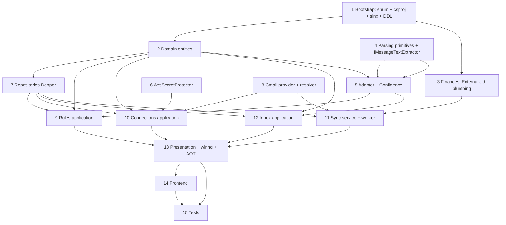

# Implementation Plan — Importación de transacciones por correo

> Spec: `docs/superpowers/specs/2026-10-02-email-import-design.md`
> SRS refs: `docs/specs/01-system-architecture-aot.md`, `02-security-and-onboarding.md`, `03-domain-ledger-and-split-engine.md`, `06-testing-strategy-and-git-conventions.md`, `07-sdd-methodology.md`
> Convenciones: `AGENTS.md` — Clean Architecture + Dapper (SQL solo en `Infrastructure/Database`), CQRS Mediator+ErrorOr, `internal sealed` handlers con primary constructor, repos como interfaces en Application, `IDbConnectionFactory`, tenancy `UserId`, `LoggerMessage` source-gen, AOT `BudgieJsonContext`, i18n vía `CultureInfo.CurrentUICulture`.

---

## User Review Required

> [!NOTE]
> Decisiones de spec ya integradas y que condicionan el plan:
> - **v1 solo `generic.regex`.** El puerto `IBankAdapter` se registra con una única implementación. Los adaptadores `bank.*` son aditivos y fuera de alcance. No hacen falta ejemplos de correo reales para nada de este plan.
> - **Proveedor-neutral obligatorio.** Ni Domain, ni Application, ni Presentation pueden contener la cadena "Gmail". Solo Infrastructure. El enum `EmailProvider` va en `Budgie.Shared/Enums/SharedEnums.cs` con un único miembro `Gmail = 0`.
> - **Doble barrera de idempotencia** (§3.5): `UNIQUE(UserId, MessageId)` en staging + `ExternalUid = "email:{provider}:{messageId}"` en `Transactions` con interpretación de `SqlState 23505` como "ya commiteada".
> - **El cursor se guarda DESPUÉS de procesar el lote**, nunca antes. Sin transacción SQL explícita alrededor de los tres pasos de idempotencia.
> - **El auto-commit despacha `CreateTransactionCommand` vía Mediator**, no escribe en `ITransactionRepository`, para heredar `ControlStartDate`, cuotas, participantes y `TransactionCreatedEvent`.
> - **Dirección de capas en el parseo** (§4.1): MIME/HTML en Infrastructure tras el puerto `IMessageTextExtractor`; los normalizadores puros (`AmountNormalizer`, `DateNormalizer`) en `Application/Parsing/Normalization/`. Razón: `GenericRegexAdapter` es Application y no puede depender de Infrastructure.
> - **`TransactionType` restringido a `Income | Expense`** en las reglas; el dominio rechaza `Transfer/Loan/Repayment` con `Error.Validation` porque el correo no aporta la segunda cuenta ni la persona.
> - **El callback OAuth va sin `[Authorize]`** a propósito (§6): la redirección del proveedor llega sin el JWT de Budgie, así que la autenticación se apoya solo en el `state` firmado, de un solo uso y con caducidad. Es el único endpoint del módulo sin `[Authorize]` y va a destacar en la revisión de código.
> - **Correos sin regla no se persisten**: se loguean y se cuentan en `LastSkippedCount`. Persistirlos exigiría importe y fecha nulables para filas que no son transacciones.
> - **Non-goals** (§13): cuotas automáticas, conversión de divisas, otros proveedores, webhook entrante, backfill histórico, notificaciones.

Requiere aprobación explícita del plan antes de `implementing` (hard-gate SDD).

---

## Diagrama de dependencias entre slices



Orden de ejecución obligatorio: **1 → 2 → 3 → 4 → 5 → 6 → 7 → 8 → 9 → 10 → 11 → 12 → 13 → 14**. `15` (tests) puede solaparse desde que haya slices 5, 7 y 11, pero idealmente tras `14`.

---

## Flujo de sincronización (referencia para los implementers)

```
EmailSyncWorker (BackgroundService, timer N min)
  → abre scope → IEmailSyncService.SyncAllAsync()
      → conexiones SyncEnabled=true
      → IEmailProviderResolver.Resolve(connection.Provider)
      → IEmailProviderClient.ListNewAsync(connection)
          401            → SyncEnabled=false + LastError
          cursor inválido→ reset cursor + ventana 7d
              ⚠ TRAMPA CONOCIDA (ver slice 11): messages.list NO devuelve historyId, así que
                tras el reset el cursor queda null y la conexión releería 7 días en CADA tick.
                El slice 11 debe recuperar el historyId actual vía users/profile tras el reset.
          429/5xx        → backoff, cursor NO se guarda
      → POR CADA mensaje:
          1. INSERT PendingEmailTransaction          (UNIQUE UserId+MessageId → duplicado, descartar)
          2. sin regla que case → LastSkippedCount++, continue
          3. parseo lanzó     → Status=Failed + FailureReason, continue
          4. Confidence >= umbral && regla.AutoCommit
                → mediator.Send(CreateTransactionCommand(ExternalUid))
                → 23505 → Status=Committed
                → Status=Committed + CreatedTransactionId
             si no → queda Pending
      → SyncCursor = nuevo cursor   ← SOLO aquí, después de todo el lote
      → LastSyncAt = now, LastSkippedCount, LastError = null
```

---

## Tareas

> **Estado de avance** (actualizado durante `implementing`):
> - ✅ **Slice 1** — hecho y verificado. `dotnet build` verde. DDL validado aplicando `001`→`002`→`003` sobre un PostgreSQL 18 real, y re-aplicado para confirmar idempotencia.
> - ✅ **Slice 2** — hecho y verificado. Build verde. `MatchesFilters` con matching de dominio bidireccional.
> - ✅ **Slice 3** — hecho y verificado. Build 0 errores, **319 tests unitarios de Finanzas en verde**. `ExternalUid` aplicado solo a la primera cuota del camino de cuotas, con el motivo documentado en el código.
>   - **Ajuste respecto al plan**: `TransactionRepository.AddAsync` **ya insertaba** la columna `"ExternalUid"` (quedó del trabajo de Money Manager), así que el archivo no necesitó cambio. El slice se quedó en 2 archivos modificados de 3. El grep de los demás `INSERT INTO "Transactions"` del módulo confirma que solo queda `ExportRepository.cs`, que inserta `NULL` y por tanto sigue funcionando.
> - ✅ **Slice 4** — hecho y verificado con **41 comprobaciones independientes** (no solo el reporte del implementador): 15 de `AmountNormalizer`, 19 de `DateNormalizer` y 7 de `HtmlToTextConverter`, todas en verde.
>   - **Dos hallazgos en revisión, uno real:**
>     - **Fallo real corregido**: `DateNormalizer` solo aceptaba fechas textuales **día-primero**, así que `"October 2, 2026"` no parseaba — justo la forma en que escribiría un banco en inglés. Añadida rama mes-primero (es/en, coma opcional, reutilizando el diccionario `Months` sin duplicarlo), verificada sin romper los casos día-primero ya buenos.
>     - **No era bug, documentado**: `01/13/2026` no se rechaza, se reinterpreta como 13 de enero por el fallback mes-primero. Es una tensión irresoluble con `25/12/2026`/en (que sí es un caso real de banco español); **el fallback se queda** porque vale más, y queda escrito en el XML doc para que nadie lo lea como error.
>   - Dos "fallos" más resultaron ser **aserciones mías equivocadas**, no defectos: (a) en una tabla de una sola fila el `\n` cae al final y `Trim()` lo quita — correcto; (b) `&lt;script&gt;` **debe** aparecer como texto literal en el plano, y que aparezca es precisamente lo que confirma que el orden "decodificar entidades después de quitar tags" es el correcto.
> - ✅ **Slice 7** — hecho. SQL validado contra PostgreSQL 18 real: 63/63 comprobaciones del implementador, y **yo repetí las críticas por mi cuenta**.
>   - **Verificado por mí**: el `TryAddAsync` deduplica de verdad — 1.er insert `affected=1`, 2.º con `Id` y `Amount` distintos `affected=0`, y la fila original conserva `Amount=10.00` (no se sobrescribe con 99). Esa es la primera barrera de idempotencia del sistema, y funciona.
>   - **Hallazgo del implementador confirmado y corregido**: el DDL declara `UNIQUE("UserId","Provider","Email")`, o sea unicidad del **triple**, no del par. Comprobado que PostgreSQL **acepta** un segundo buzón del mismo proveedor con otro email, y entonces `QuerySingleOrDefaultAsync` de `GetByProviderAsync` **lanzaría**. Mitigado con `LIMIT 1` + `ORDER BY` (documentado por qué), y añadido `ExistsByProviderAsync` que usa `EXISTS` y no puede lanzar. El slice 10 debe usar ese método para el chequeo de "ya conectado".
>   - **Otro hallazgo confirmado**: `jsonb` **normaliza al almacenar** (reordena claves y re-escapa). Medido: enviado `{"zz":"1","amount":"([0-9]+)","aa":"2"}` → leído `{"aa": "2", "zz": "1", "amount": "([0-9]+)"}`. Ningún consumidor puede comparar strings de JSON crudo; hay que comparar JSON parseado. Relevante para el slice 14, que edita las reglas y devuelve el JSON al formulario.
> - ✅ **Slice 6** — hecho y verificado. Round-trip medido: acentos y símbolos correctos, nonce aleatorio (dos `Protect` del mismo texto dan ciphertext distinto), ciphertext manipulado **lanza** `CryptographicException` en vez de devolver basura, clave distinta lanza, y la derivación desde `Jwt:Secret` funciona con warning único.
>   - **Defecto encontrado y corregido en revisión**: el warning de fallback a `Jwt:Secret` se emitía por instancia (estaba en el inicializador de campo) y el plan registraba el protector como `AddScoped`, así que en producción habría un warning por cada scope → spam de log. El test del implementador pasaba porque solo creaba una instancia. Corregido con un flag `Interlocked` estático (invariante local, no depende del lifetime del registro) **y** corrigiendo el plan a `AddSingleton`, que además es lo correcto porque el protector es stateless y recalculaba SHA-256 en cada scope.
> - ✅ **Slice 9** — hecho y verificado: **14/14 comprobaciones**, y la crítica entre ellas: tras **6 previews** distintos (regla guardada, draft válido, sin `amount`, regex rota, cuenta ajena, regla inexistente) hubo **0 escrituras** en los tres repositorios. Un probador que persistiera cada intento llenaría la base de reglas de basura.
> - ✅ **Slice 10** — hecho y verificado: **12/12 pruebas de seguridad**. El nonce se quema (2.º uso del mismo `state` → `false`), firma manipulada rechazada, `userId` alterado en el payload rechazado, caducidad de 10 min, credencial guardada **verbatim** sin doble cifrado, y el DTO de estado no expone credencial.
>   - **Deuda técnica anotada**: `EmailCredentials` no trae la dirección de correo, así que la conexión se guarda con `Email = "connected"`. Consecuencia real: **la UI no puede mostrar qué buzón está conectado** (y `Email` está en el `UNIQUE` de la tabla). No lo arreglé aquí porque requiere tocar `GmailApiClient` (slice 8, ya cerrado y verificado). **Solución**: `users.getProfile` devuelve `emailAddress` + `historyId` y está cubierto por `gmail.readonly`, así que no requiere permisos extra. Resolver antes de dar el frontend por bueno.
> - ✅ **Slice 11** — hecho y verificado: **16/16 comprobaciones**, incluidas las dos invariantes afirmadas **con orden** (`Received.InOrder`: `TryAdd → Send → MarkCommitted → … → UpdateAsync`, una sola persistencia del cursor al final).
>   - **El subagente resolvió la trampa del `historyId`** que le señalé, en dos capas: nuevo puerto `GetCurrentCursorAsync` (neutro, sin vocabulario de proveedor) implementado con `users.getProfile`, y re-anclaje en dos puntos — en `GmailEmailProvider` **antes** de listar la ventana (la ventana es query-based e ignora el cursor, así que anclar antes no la encoge) y en el servicio **después** del reintento (orden invertido a propósito: si anclaras antes, el proveedor vería cursor no-null y el reintento no sería la ventana de 7 días). Sin ventana de solape: un mensaje que llegara entre perfil y listado queda cubierto por ambos caminos.
>   - **Desviaciones que acepto, con motivo**: (a) `ParseOutcome` gana `MatchedRule` — sin él el servicio es imposible, porque `CreateTransactionCommand` necesita `AccountId`/`CategoryId`/`ExchangeRate`/`RuleId` y solo los tiene la regla que casó. (b) `GetIdByExternalUidAsync` añadido a Finanzas — `ExistsByExternalUidAsync` no sirve para marcar `Committed`, y con `Guid.Empty` se violaría el FK de `CreatedTransactionId`, rompiendo la barrera `23505` en producción.
>   - **Desviación que el subagente descubrió y ajustó bien**: el orden "INSERT staging primero, luego parsear" es **imposible** — la fila exige importe (`Money.FromPositive`) y `"Amount" NOT NULL`, y un mensaje que no parsea no tiene importe. Reordenó a parse→Create→`TryAdd`, manteniendo `TryAdd` como **primer write** antes de cualquier intento de commit. Consecuencia aceptada: los duplicados se re-parsean (solo ocurre tras un crash con cursor no persistido). Por lo mismo, un mensaje que lanza al parsearse **no puede marcarse `Failed`** — se cuenta en `EmailSyncResult.Failed`, que es la misma decisión que ya tomaba el plan para los correos sin regla.
> - ✅ **Slice 12** — hecho y verificado: **13/13 comprobaciones**.
>   - **La garantía clave, verificada por comparación de strings**: la clave de idempotencia se construye **byte a byte igual** en las dos rutas — `EmailSyncService.cs:264` y `ApprovePendingCommandHandler.cs:161`, ambas `$"email:{...Provider.ToString().ToLowerInvariant()}:{messageId}"`. Un formato distinto habría permitido importar el mismo correo dos veces (una por el worker, otra por aprobación manual) porque el índice único nunca vería la colisión.
>   - **Aprobación doble bloqueada**: la 2.ª devuelve `NotFound` por el guard de `Status == Pending`, y el mediator se envió **1 sola vez**.
>   - `accessor.Push(userId)` confirmado como **obligatorio** en la ruta manual (sin él, `GetUserId()` lanza dentro del handler de Finanzas), con control negativo que demuestra el fallo.
>   - Un solo camino de aprobación: `PendingApprovalHelper` compartido, usado también por el lote, para que no exista una copia divergente.
>   - Un `Error` del comando marca la fila `Failed` **y** se devuelve al usuario, para que no vuelva a fallar en silencio.
> - ✅ **Slice 13** — hecho y verificado con la **aplicación arrancada de verdad** (Kestrel real contra PostgreSQL, `EmailImport__Enabled` alternando), no solo compilada:
>   - `GET /health` → 200. `GET /api/email-import/rules` sin token → **401**. `GET /connections/gmail/callback` sin token → **302** (no 401: la excepción deliberada). `POST /sync` con worker activo → 400 `EmailImport.SyncAlreadyScheduled`; con `Enabled=false` → 200 con el tally. `POST /authorize` → URL de Google con `access_type=offline` + `state`; sin ClientId configurado → **400** `EmailImport.ProviderNotConfigured` (no 500). DDL `003` aplicado exactamente 1 vez. Scalar expone las rutas. Y **`GET /api/finances/accounts` → 200**, que confirma que sustituir `ICurrentUserProvider` no rompió los módulos previos.
>   - **Tres cosas que solo aparecieron al arrancar** (compilar no las detecta):
>     1. `POST /authorize` devolvía **500** si el proveedor no estaba configurado: `GmailApiClient.ValidateConfigured` lanza `EmailProviderException(NotConfigured)` y el handler no la capturaba. Ahora 400 con código estable.
>     2. **`ILanguageProvider` no estaba registrado en ningún sitio** y `EmailSyncService` lo exige por constructor → `POST /sync` y los ticks del worker fallarían en resolución de DI. Registrado en el módulo dueño (`FinancesModule`).
>     3. Sustituir `ICurrentUserProvider` por `ScopedCurrentUserProvider` dejaba **todos** los endpoints de la app sin usuario → 500 en cada petición. Resuelto con fallback al claim JWT vía `IHttpContextAccessor`, idéntico al `CurrentUserProvider` anterior, con el `Push` del worker teniendo prioridad.
> - ✅ **Slice 14** — hecho y verificado por mí: `tsc -b --noEmit` **0 errores**, `lint` **0 errores** con **0 warnings en el módulo nuevo** (los 4 restantes son preexistentes en `modules/transactions`, archivo no tocado), `vite build` **✓ built in 625 ms**. Claves i18n `emailImport.*` **idénticas en es y en** (8 de primer nivel, 0 discrepancias por script).
>   - **Fallo de entorno, no de código**: `bun run build` falla al vaciar `src/apps/Budgie.Web/dist/assets`, que es de `root` y fecha del **10 de septiembre** (artefacto de la build Docker). Está en `.gitignore`, no entra en el diff. Verificado con `vite build --outDir /tmp/...` → build correcto. **Limpiar `dist/` antes del `release`.**
>   - El subagente añadió 2 componentes shadcn (`collapsible`, `slider`) por CLI y corrigió un `import { cn } from "cn"` que la CLI había generado mal, además de retirar el paquete `cn` que había instalado: `package.json` y `bun.lock` quedan **sin diff**.
>   - **Desviaciones que acepto**: (a) tipos locales en `types.ts` en vez de `api:gen` — la API no es alcanzable desde el entorno; mismo precedente que `modules/import/api/importClient.ts`, con comentario para sustituirlos. (b) `PUT /rules/{id}` devuelve **204**, no `{ id }` como decía el plan: el subagente siguió el código real. (c) `PostgresException`-style: los enums viajan como **números** en el wire (BudgieJsonContext no usa `JsonStringEnumConverter`), y el frontend lo tiene en cuenta.
>   - **Slider del umbral en solo lectura**: el backend **no expone endpoint** para actualizar `AutoCommitMinConfidence` (solo GET/DELETE). El slider muestra el valor actual con descripción explícita. **Deuda a cerrar**: sin ese endpoint, el umbral solo se cambia por base de datos o `.env`.
>   - La "explicación literal de por qué quedó pendiente" **no viene** en `PendingEmailTransactionResponse`: el frontend la pide *on-demand* con `POST /rules/preview` (ruleId + rawBody), por el mismo pipeline que el sync. Correcto y economiza el payload de la lista.
> - ✅ **Slice 15** — hecho y verificado: **547 tests unitarios** + **40 de integración** (PostgreSQL real vía Testcontainers), los tres comandos en verde y los 6 proyectos de test de la solución entera pasando.
>   - **Un bug REAL de producción encontrado y corregido** (el único cambio en `src/`): `RawEmailReader.ExtractMultipartBody` devolvía **las cabeceras MIME como si fueran el cuerpo** cuando una parte `text/plain` venía vacía. `FlushPart` hacía `TrimEnd()`, que se llevaba por delante la línea en blanco separadora; `CollectPart` caía entonces en su rama "no hay separador → todo el parte es el cuerpo" y devolvía `Content-Type: text/plain; charset=utf-8`. Peor: esa parte **ganaba** el `plain` y tapaba a la parte real que venía detrás. Los emisores reales sí emiten un `text/plain` vacío junto a un `text/html` completo, así que no era hipotético. Corregido con una guarda en `FlushPart` que descarta la parte cuando el separador existe pero no le queda cuerpo — sin tocar el resto del recorrido MIME.
>   - **Tres números de la spec §4.5 que NO coinciden con el código** (afirmados contra el código real, con el desvío documentado en el propio test):
>     - `0.98` es inalcanzable. La spec asumía un peso de `0.18` para `merchant`; el de `ConfidenceWeights` es `0.20`, así que un parse perfecto da exactamente `1.00`. Además `merchant` solo puede valer `1.0 / 0.3 / 0.0`, y `0.9` no existe en `GenericRegexAdapter` — ningún input produce `0.98`.
>     - `0.72` es inalcanzable. Con `amount = 0.3` y el resto al máximo la suma real es `0.35*0.3 + 0.20 + 0.20 + 0.15 + 0.10 = 0.755`.
>     - Una surprise útil: `merchant` en boilerplate con todo lo demás perfecto da `0.86`, **por encima** del umbral de `0.85`. Es el margen de auto-commit más estrecho del sistema y queda fijado con un test.
>   - **La aritmética de coma flotante no es un problema** (todo es `decimal`): `0.1 + 0.2 == 0.30` exacto, afirmado.
>   - **La idempotencia, afirmada con orden y no contando llamadas**: `Received.InOrder(TryAdd → Send → MarkCommitted → UpdateAsync)` y `Received.InOrder(TryAdd × 3 → UpdateAsync)`, que es la invariante nº 1 del `EmailSyncService` (el cursor se persiste una vez, al final, nunca dentro del bucle).
>   - **La paridad del `ExternalUid` afirmada con las DOS implementaciones reales**: un solo test corre el `EmailSyncService` de verdad y el `ApprovePendingCommandHandler` de verdad y compara las dos claves capturadas. Si difirieran un byte, el índice único de `Transactions."ExternalUid"` no vería la colisión y el mismo correo se importaría dos veces.
>   - **`PostgresException` no tiene constructor público**: se construye con `RuntimeHelpers.GetUninitializedObject` + el *backing field* de `SqlState` por reflexión, que además documenta por qué el servicio casa por `SqlState` y no por el mensaje.
>   - **La trampa temporal del fixture se resolvió al revés de lo previsto** (documentado en el test): la fecha del fixture no se puede reescribir porque el cuerpo va en **base64** dentro del MIME, y una sustitución de texto no llega. Además "ayer" está **antes** de `ControlStartDate = today`, que es exactamente lo que rechaza `BeforeControlStartDate`. Lo correcto es fijar el `ControlStartDate` de la cuenta a la fecha del fixture (`CreateAccountForFixtureAsync`): el par queda coherente para siempre **y se sigue ejercitando la Ledger Rule real** en vez de esquivarla.
>   - **Dos requisitos del prompt resultaron untrue y están fijados como comportamiento real**, no como lo que se suponía: (a) un fragmento que empieza por `Content-Transfer-Encoding:` **no** se reconoce como fuente MIME cruda (solo cuentan `From/Received/Return-Path/MIME-Version/Content-Type/Delivered-To`) y vuelve verbatim; (b) `&#X20AC;` (hex en mayúscula) no se decodifica, el regex de entidades solo acepta `#x` en minúscula.
>   - **El callback OAuth se cubre entero sin proveedor real**: `POST /authorize` devuelve `{ uri, state }` y el `State` basta; con un `IEmailProviderClient` falso (singleton, `RemoveAll` + `AddScoped`) se prueba el nonce quemado, la firma manipulada, el `userId` alterado y el "state de A no conecta a B".
>   - **Excepciones reales documentadas con tests en vez de "arregladas"**: `RawEmailReader` prefiere el primer `text/plain` aunque sea un adjunto (`Content-Disposition` no se inspecciona); `PendingEmailTransaction` recorta a `""` un `merchant` en blanco en vez de normalizarlo a `null` (el `TrimOrNull` a `null` es de `EmailImportRule`); `&#X20AC;` sin decodificar.
>   - **Verificado por mí de forma independiente**: `dotnet test Budgie.slnx` → **1105 tests en 6 proyectos, 0 fallos** (Shared 101, Relationships 22, **Finances 319 intactos**, Users 24, **EmailImport 547**, Integration 92 con los 40 nuevos). Y confirmé el fix a ojo en `RawEmailReader.cs:154-172`: la guarda en `FlushPart` descarta la parte cuando el separador existe pero `separator.Index + separator.Length >= raw.TrimEnd().Length`, es decir cuando no queda cuerpo tras el separador.
> - ✅ **Slice 15 (E2E)** — hecho y verificado por mí: **`e2e/email-import.spec.ts`, 10 tests en verde** (de un primer intento que fallaba 9/10).
>   - **Tres trampas reales del harness de mocks, ninguna culpa del módulo**:
>     1. `mockApi.handle()` exige que un handler **función** devuelva `{ body }`. Devolver el valor directamente hace que `result.body` sea `undefined` y la API responde **`null`** con status 200 — un fallo silencioso que deja la UI vacía sin error visible. Por eso los fixtures existentes usan objetos literales. Ningún handler existente lo documentaba.
>     2. `mockAccounts[0].id` **no es un GUID válido** (`a1-1111-…`) y `EmailRuleForm` valida `GUID_RE` sobre `accountId`, así que con la fixture el guardado **nunca** pasa la validación. El test declara su propia cuenta con GUID real y sobrescribe el handler de `/api/finances/accounts`.
>     3. El botón `Test` del probador solo se habilita con un origen de regla **elegido explícitamente** (`canRun` exige `selected`), y `selected` se inicializa una vez con `useState` cuando aún no hay borrador — abrir el formulario después no lo selecciona. El trigger sigue mostrando el placeholder hasta que se elige "Form draft" en el desplegable.
>   - Selectores por rol y nombre accesible en los 10 escenarios; ninguna clase CSS.
>   - **Dos fallos de entorno resueltos para poder ejecutar**: `node_modules/.vite/deps` es de `root` (como `dist/`) y Vite no puede arrancar; se levantó el dev server con una config temporal de `cacheDir` fuera del repo, ya eliminada. Playwright lo reutilizó vía `reuseExistingServer`. Todos los temporales y harness fuera del repo: **limpio**.
> - ⬜ Nada pendiente en implementación. Los 15 slices están hechos.

---

## Revisión de código (`code-review`) — resultado

**Veredicto del revisor: no apto para release.** Tres bloqueantes, todos del mismo género: el módulo se verificó contra *stubs* justo donde su contrato es con el mundo real.

### Los 3 bloqueantes, corregidos

**B1 — Las rutas REST de Gmail no funcionarían contra la API real.** `GmailApiClient` llamaba a `users/messages/list`, `users/history/list`, `users/getProfile`. Esos son **identificadores de método RPC**, no URLs: la REST es `gmail/v1/users/{userId}/<resource>` (confirmado en la documentación oficial: `https://gmail.googleapis.com/gmail/v1/users/{userId}/profile`). Toda lectura real habría devuelto **404**. El plan escribió los nombres RPC y la implementación los transcribió como rutas.
Corregido con un helper `MePath(...)` (`users/me/...`) y **4 tests de regresión con un `HttpMessageHandler` de recording** — el tipo de test que faltaba (D1: no había ni un test de la capa HTTP).

**B2 — Una conexión recién conectada nunca anclaba el cursor.** El anclaje al `historyId` solo existía en el `catch` de `CursorExpired`, que en Gmail solo se dispara con cursor **no-null**. Una conexión nueva releía la ventana de 7 días **en cada tick, para siempre**, descartando todo por el `UNIQUE`. El slice 11 afirmaba haberlo resuelto "en dos capas" — la segunda capa es inalcanzable contra Gmail.
Corregido: la rama de cursor null ahora ancla antes de listar la ventana, con helper compartido. **4 tests nuevos**, incluido uno que afirma el orden `profile → list` con `Received.InOrder`. Para poder testearlo tuve que extraer `IGmailMailboxApi`: `GmailApiClient` era `sealed` y NSubstitute no podía proxarlo.

**B3 — La caché de regex no se invalidaba al editar una regla.** Claveada por `rule.Id`, y `UpdateRule` persiste el **mismo Id** con patrones nuevos: un usuario que arreglaba una regex rota seguía recibiendo las 패턴 compiladas antiguas **hasta reiniciar el proceso**. Peor: el test existente "SameRuleTwice compiles once" **fijaba el comportamiento defectuoso**, porque nunca cambiaba los patrones.
Corregido con clave `(RuleId, hash(patterns))` y tope de 256 entradas (los previews con draft creaban claves nuevas sin límite). **3 tests nuevos** que sí cambian los patrones.

### Importantes aplicados

- **I5** — el `catch (Exception)` del dispatch marcaba filas `Failed` con `"A task was canceled"` en **cada parada de contenedor**. Ahora filtra `OperationCanceledException` (en los tres catch del bucle).
- **I6** — la doc decía que el índice único "reconcilia las filas tras cualquier crash". **Falso tal cual**: reconcilia *el dinero*, no *el estado de la fila*. Reescrito con precisión, incluyendo la consecuencia real (la fila queda `Pending` y el usuario la aprueba una vez, lo que vuelve a chocar con la barrera y la marca `Committed`).
- **IMP3** — 7 `LogMessages` declarados y **nunca emitidos**. El peor: `catch (Exception ex) { failed++; _ = ex; }` **descartaba la excepción sin log**, mientras la doc del `IEmailProviderClient` afirmaba "is logged and counted". Los 7 cableados en sus sitios naturales.

### Falsos positivos que el revisor detectó en mis comentarios

- **`ON DELETE CASCADE` limpia "reglas y staging"**: falso. `EmailImportRules` **no tiene FK** a conexiones (cuelga de usuario y cuenta) — de hecho las reglas sobreviven al desconectar, lo cual es correcto. Corregido el comentario y documentada la consecuencia real: desconectar destruye el historial de staging.
- **"Push obligatorio en la ruta HTTP"**: falso. El fallback al claim resuelve el mismo usuario; el `Push` solo es obligatorio fuera de una petición (el worker).
- **`GetByProviderAsync` con `LIMIT 1`**: el revisor lothoqs más grave (leía que el DDL permite N buzones). Confirmé que ya tenía `LIMIT 1` + `ExistsByProviderAsync`.

### No aplicado, con motivo

- **IMP1** (`NpgsqlException` en Application): el revisor tiene razón en que viola AGENTS.md, y su alternativa (excepción neutra en `Budgie.Shared`) es mejor que la mía. **Pendiente de hacer**: es un refactor que toca Finanzas.
- **IMP2** (`IOptions<EmailImportOptions>` en Application): también razón sólida. Mover el POCO de config a Application lo resuelve.
- **I4** (la aprobación usa la moneda de la regla, no la de la fila revisada): **bug real**, no lo había visto. Si la regla se edita entre el staging y la aprobación, la transacción hereda la moneda nueva sobre un importe revisado con la vieja.
- **I7** (`redirect_uri` sin `UseForwardedHeaders`): detrás del proxy TLS de Docker, `request.Scheme` es `http` → `redirect_uri_mismatch` en Google. **Bloqueante para despliegue real**, easy fix.
- **sobre-ingeniería**: `ScopedCurrentUserProvider` reemplazando al del host para todo el árbol; la doble capa de cursor; `Providers` como diccionario nunca leído.

---

## Nota sobre pendientes acumulados (deuda consciente)

Ninguno bloquea el uso, pero conviene resolverlos:

| Deuda | Origen | Impacto |
|---|---|---|
| **No hay endpoint para cambiar `AutoCommitMinConfidence`** | El plan daba el umbral por configurable y no existe ruta de actualización; solo GET/DELETE de conexiones | Hoy el umbral solo se cambia por base de datos. El slider del frontend está en solo lectura |
| **`EmailCredentials` no trae la dirección de correo** | El slice 8 no implementó `users.getProfile` para el email (sí para el `historyId`) | La UI muestra `Email = "connected"` en vez del buzón real; `Email` está en el `UNIQUE` de la tabla |
| **Símbolo de moneda contradictorio da 0.90 → auto-commit** | Los pesos de la spec dan `currency = 0.0` solo una pérdida de 0.10, insuficiente para cruzar el umbral 0.85 | Un correo en `$` con regla EUR se importa asumiendo euros sin avisar. Fijado con test. Subir el peso de `currency` o bajar el umbral es decisión de producto |
| **Los pesos de la spec §4.5 no cuadran** (`0.98`, `0.72` inalcanzables) | Error de aritmética al redactar la spec | Los tests afirman el código real (`1.00`, `0.755`) con el desvío documentado. La spec debería corregirse |

### 1. Bootstrap del módulo, enum y esquema (Shared + Infra/DB)

- **Objetivo**: Que el módulo exista en la solución y las tablas estén en la base, sin una sola clase de comportamiento.
- **Archivos**:
  - `[NEW] src/apps/Budgie.Api/sql/003_email_import.sql`
  - `[MODIFY] src/core/Budgie.Shared/Enums/SharedEnums.cs` — añadir `public enum EmailProvider { Gmail = 0 }` al final del archivo, siguiendo el estilo de los enums existentes.
  - `[NEW] src/core/Budgie.Modules.EmailImport/Budgie.Modules.EmailImport.csproj`
  - `[NEW] tests/Budgie.Modules.EmailImport.UnitTests/Budgie.Modules.EmailImport.UnitTests.csproj`
  - `[MODIFY] Budgie.slnx` — añadir el módulo en la carpeta `/core/` y el proyecto de tests en `/tests/`.
  - `[MODIFY] src/apps/Budgie.Api/Budgie.Api.csproj` — añadir `<ProjectReference Include="..\..\src\core\Budgie.Modules.EmailImport\Budgie.Modules.EmailImport.csproj" />`.
- **Pasos**:
  - `003_email_import.sql`: transcribir literalmente las tres tablas de la spec §3.1, §3.2 y §3.3, con sus dos índices. Todo con `IF NOT EXISTS` e identificadores entrecomillados, siguiendo `001_initial_schema.sql`.
  - Cerrar el script con el registro de versión. **Nota descubierta al implementar**: `"_SchemaVersions"."Version"` no tiene constraint `UNIQUE`, así que la forma `ON CONFLICT DO NOTHING` que usan `001` y `002` es un no-op que añade una fila nueva **en cada arranque**. Usar en su lugar la forma idempotente real:
    ```sql
    INSERT INTO "_SchemaVersions" ("Version")
    SELECT '003_email_import'
    WHERE NOT EXISTS (SELECT 1 FROM "_SchemaVersions" WHERE "Version" = '003_email_import');
    ```
    No se corrigen `001`/`002` (son inmutables y la tabla no se lee para lógica), pero el script nuevo no debe heredar el defecto.
  - **Verificar el DDL contra un PostgreSQL real antes de dar el slice por bueno**, no solo compilar. Levantar `postgres:18-alpine` en un contenedor efímero, aplicar `001`→`002`→`003` con `ON_ERROR_STOP=1`, comprobar las tablas, índices y constraints creados, re-aplicar `003` para confirmar idempotencia, y **eliminar el contenedor al terminar**. Un `CREATE TABLE` que no se ha ejecutado nunca no es un DDL validado.
  - **No** tocar `001_initial_schema.sql` ni `002_import_runs.sql`: son inmutables una vez aplicados.
  - `create-module` **no es la autoridad** en este repo: describe EF Core, `DbContext`, `MediatR` directo y `private set`, todo migrado ya a Dapper + `Mediator` + `internal set`. Usarlo solo para la estructura de carpetas y los nombres; seguir `AGENTS.md` para todo lo demás.
  - `Budgie.Modules.EmailImport.csproj`: copiar la estructura de `Budgie.Modules.Finances.csproj` con `TargetFramework net10.0`, `ImplicitUsings`, `Nullable enable`, `<FrameworkReference Include="Microsoft.AspNetCore.App" />`, `<PackageReference Include="Mediator.Abstractions" Version="3.0.2" />`, `<Using Include="Microsoft.Extensions.Logging" />`, y `ProjectReference` a `Budgie.Shared` **y** a `Budgie.Modules.Finances` (necesario para despachar `CreateTransactionCommand`).
  - `InternalsVisibleTo` para `Budgie.Modules.EmailImport.UnitTests`, `DynamicProxyGenAssembly2` (NSubstitute) y `Budgie.Api`.
  - La dependencia `EmailImport → Finances` es **unidireccional**. Si al compilar aparece un ciclo, significa que se ha metido una referencia de Finanzas a EmailImport: corregir, no romper el ciclo con un `InternalsVisibleTo`.
  - `Budgie.Modules.EmailImport.UnitTests.csproj`: copiar de `Budgie.Modules.Finances.UnitTests.csproj` (xunit, FluentAssertions, NSubstitute, coverlet, `Microsoft.NET.Test.Sdk`), cambiando el `ProjectReference` al módulo nuevo. **Omitir** `Microsoft.EntityFrameworkCore.InMemory` (el proyecto de Finanzas lo referencia pero no se usa en estos tests).
  - `Budgie.slnx`: manter el orden alfabético de las entradas existentes dentro de cada carpeta.
- **Verificación**: `dotnet build Budgie.slnx` verde. Los scripts SQL se aplican solos en el arranque de `Program.cs`; comprobar contra la instancia de desarrollo que `_SchemaVersions` contiene `003_email_import`.

---

### 2. Entidades de dominio (Domain)

- **Objetivo**: Los tres agregados y los records de parseo, con invariantes validadas en el dominio y sin ninguna dependencia de infraestructura.
- **Archivos**:
  - `[NEW] src/core/Budgie.Modules.EmailImport/Domain/Connections/EmailConnection.cs`
  - `[NEW] src/core/Budgie.Modules.EmailImport/Domain/Rules/EmailImportRule.cs`
  - `[NEW] src/core/Budgie.Modules.EmailImport/Domain/Staging/PendingEmailTransaction.cs`
  - `[NEW] src/core/Budgie.Modules.EmailImport/Domain/Parsing/EmailMessage.cs`
  - `[NEW] src/core/Budgie.Modules.EmailImport/Domain/Parsing/EmailParseContext.cs`
  - `[NEW] src/core/Budgie.Modules.EmailImport/Domain/Parsing/ExtractedTransaction.cs`
- **Pasos**:
  - Namespaces `Budgie.Modules.EmailImport.Domain.<Aggregate>`.
  - `EmailConnection : Entity` — `Id, UserId, Provider (EmailProvider), Email, EncryptedCredentials, SyncCursor?, SyncEnabled, AutoCommitMinConfidence, LastSyncAt?, LastError?, LastSkippedCount`, todos `internal set`. Ctor `public EmailConnection()` vacío para Dapper. `static Create(Guid userId, EmailProvider provider, string email, string encryptedCredentials, decimal autoCommitMinConfidence = 0.85m)`. Métodos de comportamiento: `RecordSync(DateTime now, int skippedCount)`, `RecordError(string error)`, `RecordSuccess(DateTime now)`, `Disable()`, `AdvanceCursor(string? cursor)`, `ChangeAutoCommitThreshold(decimal value)`.
  - Invariante de `Email`: no vacía, ≤255. Invariante del umbral: en `[0, 1]`, con dos decimales. Usar `Budgie.Shared.Abstractions.Guard`.
  - `EmailImportRule : Entity` — `Id, UserId, Name, AdapterKey, Priority, IsEnabled, AccountId, CategoryId?, TransactionType, Currency, ExchangeRate?, FromAddress?, SubjectContains?, BodyRegex?, FieldPatternsJson?, AutoCommit`, `internal set`. `static Create(...)` y `Update(...)`.
    - **Validaciones en el dominio** (spec §3.2 y §4.4): `TransactionType` debe ser `Income` o `Expense`; `AdapterKey == "generic.regex"` exige `FieldPatternsJson` no vacío; `Priority >= 0`; todas las regex del JSON y los tres filtros deben **compilar** en el `Create`/`Update` y lanzar si no.
    - La validación de regex en el dominio es intencionada: una regla inválida no debe poder persistirse.
  - `PendingEmailTransaction : Entity` — `Id, UserId, ConnectionId, RuleId?, MessageId, ThreadId?, Subject?, Merchant?, Notes?, Amount (Money), Currency, ExchangeRate, Date, TransactionType, Confidence, FieldConfidenceJson?, RawBody?, Status, CreatedTransactionId?, FailureReason?, CreatedAt, ReviewedAt?`, `internal set`. `static Create(...)`. Comportamiento: `MarkCommitted(Guid transactionId)`, `MarkDismissed()`, `MarkFailed(string reason)`, `ApplyReview(decimal amount, string currency, decimal exchangeRate, DateTime date, string? merchant, string? notes, Guid accountId, Guid? categoryId, TransactionType type)`.
  - Declarar `public enum PendingEmailStatus { Pending = 0, Committed = 1, Dismissed = 2, Failed = 3 }` en el mismo archivo que `PendingEmailTransaction`, siguiendo el precedente de `ExportFormat` y `BudgetThresholdStatus`.
  - `EmailMessage.cs` — `public sealed record EmailMessage(string MessageId, string? ThreadId, string? FromAddress, string? Subject, string Body, DateTimeOffset ReceivedAt)` con un convenience `From(string? rawHeaders)`.
  - `EmailParseContext.cs` — `public sealed record EmailParseContext(EmailMessage Message, string PlainText, EmailImportRule Rule, string LanguageCode)`.
  - `ExtractedTransaction.cs` — `public sealed record ExtractedTransaction(decimal Amount, string Currency, DateTime Date, string? Merchant, TransactionType TransactionType, decimal Confidence, IReadOnlyDictionary<string, decimal> FieldConfidence, bool MultipleAmountCandidates)` más un `public sealed record ParseOutcome(bool Matched, ExtractedTransaction? Value, string? SkipReason)`.

---

### 3. Finances: plumb de `ExternalUid` (Domain + Application + Infra/DB)

- **Objetivo**: Que `CreateTransactionCommand` pueda fijar `ExternalUid`, que es la segunda barrera de idempotencia. Cambio aditivo y mínimo; no cambia el comportamiento de ningún consumidor actual.
- **Archivos**:
  - `[MODIFY] src/core/Budgie.Modules.Finances/Domain/Transactions/Transaction.cs`
  - `[MODIFY] src/core/Budgie.Modules.Finances/Application/Transactions/CreateTransaction/CreateTransactionCommandHandler.cs` — el record `CreateTransactionCommand` está declarado **dentro de este archivo**, no en uno propio. Leerlo antes de editar.
  - `[MODIFY] src/core/Budgie.Modules.Finances/Infrastructure/Database/TransactionRepository.cs`
- **Pasos**:
  - En `Transaction.Create(...)`, añadir `string? externalUid = null` como **último** parámetro opcional (después de `interestRate`) y asignarlo. No cambiar el orden de los existentes: hay llamadas posicionales.
  - En `CreateTransactionCommand`, añadir `string? ExternalUid = null` como último parámetro con valor por defecto.
  - En `CreateTransactionCommandHandler`, pasar `request.ExternalUid` a `Transaction.Create` en **ambos** caminos: `CreateSingleAsync` y `CreateInstallmentsAsync`. En el camino de cuotas, aplicarlo solo a la primera cuota; si no, el índice único `IX_Transactions_UserId_ExternalUid` rechazaría la segunda. Documentarlo con un comentario.
  - En `TransactionRepository.AddAsync`, incluir `"ExternalUid"` en el `INSERT` (con `NULL` cuando no venga). La columna ya existe desde `002_import_runs.sql`.
  - Verificar que ningún otro llamante de `CreateTransactionCommand` rompe: al ser opcional con valor por defecto, no lo hace.

---

### 4. Primitivas de parseo y el puerto `IMessageTextExtractor` (Application + Infra)

- **Objetivo**: Convertir MIME y HTML a texto plano y normalizar números y fechas, con lógica pura y testeable sin mocks.
- **Archivos**:
  - `[NEW] src/core/Budgie.Modules.EmailImport/Application/Abstractions/IMessageTextExtractor.cs`
  - `[NEW] src/core/Budgie.Modules.EmailImport/Application/Parsing/Normalization/AmountNormalizer.cs`
  - `[NEW] src/core/Budgie.Modules.EmailImport/Application/Parsing/Normalization/DateNormalizer.cs`
  - `[NEW] src/core/Budgie.Modules.EmailImport/Infrastructure/Parsing/RawEmailReader.cs`
  - `[NEW] src/core/Budgie.Modules.EmailImport/Infrastructure/Parsing/HtmlToTextConverter.cs`
  - `[NEW] src/core/Budgie.Modules.EmailImport/Infrastructure/Parsing/MessageTextExtractor.cs`
- **Pasos**:
  - `IMessageTextExtractor`: `string ExtractPlainText(EmailMessage message)`.
  - `HtmlToTextConverter` — `public static class` con `Convert(string html)` y un `static readonly GeneratedRegex` para cada transformación. Orden de operaciones: eliminar `<script>...</script>` y `<style>...</style>` **con su contenido**; `<br>` y cierres de bloque → `\n`; `</td>`/`</th>` → `\t`; decodificar entidades (incluidas numéricas decimales y hexadecimales); eliminar el resto de tags; colapsar espacios horizontales múltiples y `[\t ]*\n[\t ]*` a `\n`; `Trim()` final.
    - **No** usar `WebUtility.HtmlDecode` para el paso de entidades si se aplica antes de quitar tags, porque `&lt;script&gt;` se convertiría en un tag real. Decodificar **después** de eliminar los tags.
  - `RawEmailReader` — detectar si la entrada es fuente MIME (empieza por `From:`, `Received:`, `Content-Type:` o `MIME-Version:`) o un cuerpo suelto. Si es MIME: separar cabeceras de cuerpo por la línea en blanco, decodificar `Content-Transfer-Encoding` (`base64`, `quoted-printable`) y separar partes de `multipart/alternative` preferiendo `text/plain` sobre `text/html`. Si es cuerpo suelto: usarlo tal cual.
    - `quoted-printable`: implementar la decodificación a mano (`=XX` → byte, `=` al final de línea → soft break). No añadir paquete.
  - `MessageTextExtractor(IMessageTextExtractor)` — orquesta: `RawEmailReader` → `HtmlToTextConverter` solo si el cuerpo parece HTML (contiene `<` seguido de una letra o `/`). Devuelve el texto plano.
  - `AmountNormalizer` — `public static bool TryParse(string raw, string languageCode, out decimal value)`. Recibe `"es"` o `"en"`.
    - es: `,` es decimal y `.` es millar. en: `.` es decimal y `,` es millar.
    - El caso `1.234` (3 dígitos detrás del último separador) es ambiguo y **el idioma lo resuelve**: en es → `1234`, en en → `1.234`. Implementar mirando el último separador y cuántos dígitos le siguen, no buscando caracteres sueltos.
    - Descartar el símbolo de moneda (`€ $ £`) y espacios (incluye NBSP `\u00A0` y el espacio fino `\u202F`, que algunos correos usan como separador de millar).
    - Aceptar signo `-`/`+`; devolver el valor con signo. Rechazar vacío, no numérico o más de 2 decimales.
  - `DateNormalizer` — `public static bool TryParse(string raw, string languageCode, out DateTime value)`. Reconocer `dd/MM/yyyy`, `dd-MM-yyyy`, `yyyy-MM-dd` y `d MMM yyyy` con nombres de mes en español e inglés. Devolver siempre `DateTimeKind.Unspecified` (igual que `Transaction.GuardDate`).

---

### 5. Adaptador de regex, selección de regla y scorer de confianza (Application)

- **Objetivo**: El motor de parseo puro: elegir regla, extraer campos y puntuar la confianza.
- **Archivos**:
  - `[NEW] src/core/Budgie.Modules.EmailImport/Application/Parsing/IBankAdapter.cs`
  - `[NEW] src/core/Budgie.Modules.EmailImport/Application/Parsing/IBankAdapterRegistry.cs`
  - `[NEW] src/core/Budgie.Modules.EmailImport/Application/Parsing/EmailParser.cs`
  - `[NEW] src/core/Budgie.Modules.EmailImport/Application/Parsing/ConfidenceWeights.cs`
  - `[NEW] src/core/Budgie.Modules.EmailImport/Application/Parsing/ConfidenceScorer.cs`
  - `[NEW] src/core/Budgie.Modules.EmailImport/Application/Parsing/Adapters/GenericRegexAdapter.cs`
  - `[NEW] src/core/Budgie.Modules.EmailImport/Application/Parsing/Adapters/BankAdapterRegistry.cs`
- **Pasos**:
  - `IBankAdapter`: `string Key { get; }` y `ParseOutcome Parse(EmailParseContext context)`. Sin `CanHandle`: la selección la hace la regla (`AdapterKey`), no el adaptador. Así el registro es un `Dictionary<string, IBankAdapter>` trivial.
  - `ConfidenceWeights` — `public static class` con `const decimal Amount = 0.35m, Direction = 0.20m, Merchant = 0.20m, Date = 0.15m, Currency = 0.10m` y `const decimal DefaultAutoCommitThreshold = 0.85m`. Valores exactos de la spec §4.5, en **un solo sitio** para poder ajustarlos con un test.
  - `GenericRegexAdapter` — implementa `Parse` leyendo `Rule.FieldPatternsJson`:
    - Deserializar el JSON en un `record FieldPatternSet(string? Amount, string? Date, string? Merchant, string? Direction, string? Symbol)` usando `System.Text.Json` con `JsonSerializerDefaults.Web`.
    - **Caché de regex por `RuleId`** en un `ConcurrentDictionary<Guid, CompiledRuleSet>`; si no casa, se recalcula. Compilar por mensaje es la diferencia entre ~1 ms y ~40 ms.
    - Aplicar los patrones sobre `context.PlainText` con `RegexOptions.IgnoreCase | RegexOptions.Multiline`.
    - **`amount` es obligatorio**: si el patrón falta o no casa, devolver `ParseOutcome` con `Matched = false` y `SkipReason = "amount-pattern-missing"` / `"amount-not-found"`. Nunca inventar un importe.
    - **Contar coincidencias** del patrón de importe, no solo tomar la primera: 2 coincidencias → score 0.5, 3 o más → 0.3, y `MultipleAmountCandidates = true`. Esto es lo que manda a revisión los correos con "saldo anterior / importe / saldo nuevo".
    - Ignorar el signo del importe: el tipo sale de `direction` o de la regla. Pero un importe negativo explícito (`-45,20 €`) **sí** es una señal fuerte: si el patrón captura `-`, subir el score de `direction` a 1.0.
    - `direction`: si el patrón casa → `TransactionType.Income` y score 1.0. Si no casa → el `TransactionType` de la regla con score 1.0. Si el patrón de `direction` es un caso ambiguo (casa en positivo y en negativo) → score 0.0 y mantener el tipo de la regla.
    - `merchant`: primera coincidencia; score 1.0, 0.3 si está en la lista negra (`Transferencia`, `Payment`, `Bizum`, `Pago`, `Operación`, `Operacion`, `SEPA`, `Recibo`, `Direct Debit`, `Card Payment`), 0.0 si el grupo captura vacío o solo espacios.
    - `date`: score 1.0 si parsea y no es futura; 0.5 si hay 2 o más fechas **distintas** en el mensaje; 0.0 si no parsea. Si no hay patrón de fecha, usar `Message.ReceivedAt` con score 0.5 (es un dato fiable pero con la hora, no el día de la operación).
    - `symbol` / `currency`: si hay símbolo capturado, 1.0 si coincide con `Rule.Currency`, 0.0 si contradice. Si no hay símbolo, 1.0 porque la regla declara la moneda de forma explícita.
  - `ConfidenceScorer` — `public static decimal Compute(IReadOnlyDictionary<string, decimal> fieldScores)` con `Σ (peso del campo × score)`. Además `public static IReadOnlyList<string> Explain(...)` devolviendo el motivo por campo en texto, para que la UI lo muestre y para que los tests afirmen sobre el motivo y no sobre el número.
  - `EmailParser(IMessageTextExtractor, IBankAdapterRegistry, IBudget...)` sin dependencias de infraestructura:
    - `Task<ParseOutcome> ParseAsync(EmailMessage message, IReadOnlyList<EmailImportRule> rules, string languageCode, CancellationToken ct)`.
    - Extraer el texto plano una vez con `IMessageTextExtractor`, y **reusarlo para todas las reglas** (no una vez por regla).
    - Ordenar reglas por `Priority` ascendente; evaluar los tres filtros con AND (`FromAddress` exacto o sufijo de dominio, `SubjectContains` case-insensitive, `BodyRegex` sobre el texto plano). Primera que casa gana.
    - Delegar en el adaptador del `AdapterKey` de la regla.
  - `BankAdapterRegistry(IEnumerable<IBankAdapter>)` — `IReadOnlyDictionary<string, IBankAdapter>` por `Key`. Lanza `InvalidOperationException` en el constructor si hay dos adaptadores con la misma clave.

---

### 6. Protección de secretos (Application + Infra)

- **Objetivo**: Cifrar la credencial OAuth en reposo, sin añadir un gestor de claves externo.
- **Archivos**:
  - `[NEW] src/core/Budgie.Modules.EmailImport/Application/Abstractions/ISecretProtector.cs`
  - `[NEW] src/core/Budgie.Modules.EmailImport/Infrastructure/Security/AesSecretProtector.cs`
- **Pasos**:
  - `ISecretProtector`: `string Protect(string plaintext)` y `string Unprotect(string protectedValue)`.
  - `AesSecretProtector(IConfiguration, ILogger<AesSecretProtector>)` con `IOptions<EmailImportOptions>` para la clave.
  - Clave: 32 bytes desde `EmailImport:EncryptionKey` (base64). Si no está, derivar por SHA-256 de `Jwt:Secret` y emitir **un** warning en el log al construir. Llenar los 32 bytes con SHA-256 también si la clave viene en texto plano, para no exigir base64 estricto.
  - Formato: `v1:<base64(nonce 12)>:<base64(ciphertext)>:<base64(tag 16)>`. El prefijo `v1` permite rotar el algoritmo más adelante sin ambigüedad.
  - `Unprotect` debe lanzar ante: prefijo ausente, número de segmentos incorrecto, base64 inválido, o tag que no valida (fallo de autenticación de GCM). No devolver nunca un string corrupto en silencio.
  - **No** loguear nunca plaintext ni ciphertext de credenciales.

---

### 7. Repositorios Dapper (Application interfaces + Infra/DB)

- **Objetivo**: Persistencia de conexiones, reglas y staging, con tenancy en todas las queries.
- **Archivos**:
  - `[NEW] src/core/Budgie.Modules.EmailImport/Application/Repositories.cs` — las tres interfaces en un solo archivo, siguiendo la convención de `Application/Repositories.cs` de Finanzas.
  - `[NEW] src/core/Budgie.Modules.EmailImport/Infrastructure/Database/EmailConnectionRepository.cs`
  - `[NEW] src/core/Budgie.Modules.EmailImport/Infrastructure/Database/EmailImportRuleRepository.cs`
  - `[NEW] src/core/Budgie.Modules.EmailImport/Infrastructure/Database/PendingEmailTransactionRepository.cs`
- **Pasos**:
  - **Ningún método público acepta solo un `connectionId` sin `userId`.** Todos llevan `Guid userId` como primer parámetro y todas las queries filtran `WHERE "UserId" = @UserId`. Es la barrera de multi-tenancy y va en la firma de la interfaz, no en el SQL.
  - `IEmailConnectionRepository`:
    - `Task<EmailConnection?> GetByIdAsync(Guid userId, Guid id, CancellationToken ct)`
    - `Task<EmailConnection?> GetByProviderAsync(Guid userId, EmailProvider provider, CancellationToken ct)`
    - `Task<List<EmailConnection>> GetEnabledAsync(CancellationToken ct)` ← **única excepción deliberada**: la usa el worker, que no tiene `HttpContext`. Devuelve ya filtradas por `SyncEnabled = TRUE`. Documentar la excepción con un comentario en la interfaz.
    - `Task<List<EmailConnection>> GetAllAsync(Guid userId, CancellationToken ct)`
    - `Task AddAsync(EmailConnection connection, CancellationToken ct)`
    - `Task UpdateAsync(EmailConnection connection, CancellationToken ct)`
    - `Task DeleteAsync(Guid userId, Guid id, CancellationToken ct)`
  - `IEmailImportRuleRepository`: `GetByIdAsync(userId, id)`, `GetByUserAsync(userId)`, `AddAsync`, `UpdateAsync`, `DeleteAsync(userId, id)`.
  - `IPendingEmailTransactionRepository`:
    - `Task<bool> ExistsByMessageAsync(Guid userId, string messageId, CancellationToken ct)`
    - `Task<bool> TryAddAsync(PendingEmailTransaction pending, CancellationToken ct)` ← devuelve `false` si viola `UNIQUE(UserId, MessageId)`. Implementar con `INSERT ... ON CONFLICT ("UserId","MessageId") DO NOTHING` + `ExecuteAsync == 0` para no depender de capturar la excepción.
    - `Task MarkCommittedAsync(Guid userId, Guid id, Guid transactionId, CancellationToken ct)`
    - `Task MarkDismissedAsync(Guid userId, Guid id, CancellationToken ct)`
    - `Task MarkFailedAsync(Guid userId, Guid id, string reason, CancellationToken ct)`
    - `Task UpdateReviewedAsync(PendingEmailTransaction pending, CancellationToken ct)`
    - `Task<PagedResult<PendingEmailTransaction>> GetPendingAsync(Guid userId, int page, int pageSize, CancellationToken ct)` — solo `Status = Pending`.
    - `Task<int> CountPendingAsync(Guid userId, CancellationToken ct)`
    - `Task<List<PendingEmailTransaction>> GetHighConfidenceAsync(Guid userId, decimal threshold, int take, CancellationToken ct)` — para el approve en lote.
    - `Task<List<PendingEmailTransaction>> GetFailedAsync(Guid userId, CancellationToken ct)`
  - Todos los `internal sealed class XxxRepository(IDbConnectionFactory factory) : IXxxRepository` con primary constructor, usando `QueryListAsync<T>`, `QuerySingleOrDefaultAsync<T>`, `QuerySingleAsync<T>` y `ExecuteAsync`.
  - SQL con identificadores entrecomillados: `SELECT "Id","UserId","Provider","Email","EncryptedCredentials","SyncCursor","SyncEnabled","AutoCommitMinConfidence","LastSyncAt","LastError","LastSkippedCount","CreatedAt" FROM "EmailImportConnections" WHERE "UserId"=@UserId AND "SyncEnabled"=TRUE`.
  - `FieldPatternsJson` se persiste como `::jsonb` en `INSERT`/`UPDATE`.
  - `PagedResult<T>` es un record simple `{ IReadOnlyList<T> Items, int Total, int Page, int PageSize }`. Si ya existe uno equivalente en `Budgie.Shared/Dtos`, reutilizarlo; si no, declararlo en `Application/Repositories.cs`.

---

### 8. Puerto de proveedor e implementación Gmail (Application + Infra)

- **Objetivo**: El puerto neutro y su primera implementación, más el registro que resuelve por `EmailProvider`.
- **Archivos**:
  - `[NEW] src/core/Budgie.Modules.EmailImport/Application/Abstractions/IEmailProviderClient.cs`
  - `[NEW] src/core/Budgie.Modules.EmailImport/Application/Abstractions/IEmailProviderResolver.cs`
  - `[NEW] src/core/Budgie.Modules.EmailImport/Application/Connections/EmailAuthorizationUri.cs`
  - `[NEW] src/core/Budgie.Modules.EmailImport/Application/Connections/EmailCredentials.cs`
  - `[NEW] src/core/Budgie.Modules.EmailImport/Infrastructure/Email/Gmail/GmailOptions.cs`
  - `[NEW] src/core/Budgie.Modules.EmailImport/Infrastructure/Email/Gmail/GmailApiClient.cs`
  - `[NEW] src/core/Budgie.Modules.EmailImport/Infrastructure/Email/Gmail/GmailEmailProvider.cs`
  - `[NEW] src/core/Budgie.Modules.EmailImport/Infrastructure/Email/Gmail/GmailMessageMapper.cs`
  - `[NEW] src/core/Budgie.Modules.EmailImport/Infrastructure/Email/Gmail/EmailProviderResolver.cs`
- **Pasos**:
  - `EmailAuthorizationUri(string Uri, string State)` y `EmailCredentials(string AccessToken, string EncryptedRefreshToken, DateTimeOffset ExpiresAt, string? EmailHint)` — records en Application.
  - `IEmailProviderClient` y `IEmailProviderResolver` exactamente como en la spec §2.3. **El resolver** expone `IEmailProviderClient Resolve(EmailProvider provider)`.
  - `GmailOptions` — `ClientId`, `ClientSecret`, `Scopes` (por defecto `["https://www.googleapis.com/auth/gmail.readonly"]`), `BaseAddress`. Enlazar de `EmailImport:Providers:gmail` con `IOptions`.
  - `GmailApiClient(HttpClient, IOptions<GmailOptions>, ILogger<GmailApiClient>)` — `HttpClient` con `BaseAddress` inyectado por nombre (`AddHttpClient<GmailApiClient>`), `Timeout` de 30 s. Tres operaciones:
    - `BuildAuthorizationUri(string redirectUri, string state)` → `https://accounts.google.com/o/oauth2/v2/auth?client_id&redirect_uri&response_type=code&scope&access_type=offline&prompt=consent&include_granted_scopes=true&state`.
      - `access_type=offline` + `prompt=consent` son **imprescindibles**: sin ellos no se emite refresh token.
    - `ExchangeCodeAsync(code, redirectUri)` → `POST https://oauth2.googleapis.com/token` con `grant_type=authorization_code`.
    - `RefreshAsync(refreshToken)` → mismo endpoint con `grant_type=refresh_token`.
    - Refrescar el access token **no requiere ninguna llamada de red**: es un JWT con `exp`. Decodificar el payload `base64url` para saber `ExpiresAt` y refrescar de forma preemptiva cuando falten menos de 60 s.
  - **Sin paquete `Google.Apis.Client`.** Solo `System.Text.Json`. Los DTO de respuesta son records privados con `[JsonPropertyName]`.
  - `GmailMessageMapper` — mapea la respuesta de `users.messages.get?format=full` a `EmailMessage`: `id` → `MessageId`, `threadId` → `ThreadId`, `payload.headers` → `From`/`Subject`/`Date`, y el cuerpo de la parte con `mimeType` que sea `text/plain` o `text/html` (preferir `text/plain`). Si el mensaje es `multipart/...`, recorrer recursivamente `payload.parts`.
  - `GmailEmailProvider(ISecretProtector, GmailApiClient, IEmailImportRepositoryProvider)`:
    - `ListNewAsync(connection)` — si `SyncCursor` es null, listar con `q = newer_than:7d`; si no, `users.history.list?startHistoryId={cursor}` y extraer los `messagesAdded`. Si `history.list` devuelve `404` (historial expirado) → **resetear el cursor a null y reintentar una vez** con la ventana de 7 días, dejando que `UNIQUE` descarte lo ya visto. Cualquier otro error se propaga como `EmailProviderException` con un código tipado (`Unauthorized`, `RateLimited`, `Transient`, `CursorExpired`).
    - `GetAsync(connection, messageId)` — `users.messages.get?format=full&id=...`.
    - `BuildAuthorizationUriAsync` / `ExchangeCodeAsync` / `RefreshAsync` — delegar en `GmailApiClient`.
    - `EmailProviderException` y `EmailProviderError` viven en **Application**, no en la carpeta `Gmail`, porque el servicio de sincronización los captura y debe hacerlo sin conocer el proveedor.
  - `EmailProviderResolver(IEnumerable<IEmailProviderClient>)` — diccionario por `Provider`. `Resolve` lanza `InvalidOperationException` si no hay implementación; el worker captura, registra y salta esa conexión.

---

### 9. Aplicación de reglas + probador (Application)

- **Objetivo**: CRUD de reglas y el endpoint de prueba que permite escribirlas sin ver correos reales.
- **Archivos**:
  - `[NEW] src/core/Budgie.Modules.EmailImport/Application/Rules/GetRules/GetRulesQuery.cs` + `GetRulesQueryHandler.cs`
  - `[NEW] src/core/Budgie.Modules.EmailImport/Application/Rules/CreateRule/CreateRuleCommand.cs` + `CreateRuleCommandHandler.cs`
  - `[NEW] src/core/Budgie.Modules.EmailImport/Application/Rules/UpdateRule/UpdateRuleCommand.cs` + `UpdateRuleCommandHandler.cs`
  - `[NEW] src/core/Budgie.Modules.EmailImport/Application/Rules/DeleteRule/DeleteRuleCommand.cs` + `DeleteRuleCommandHandler.cs`
  - `[NEW] src/core/Budgie.Modules.EmailImport/Application/Rules/PreviewRule/PreviewRuleCommand.cs` + `PreviewRuleCommandHandler.cs`
- **Pasos**:
  - Response DTOs en Application: `EmailImportRuleResponse(Guid Id, string Name, string AdapterKey, int Priority, bool IsEnabled, Guid AccountId, Guid? CategoryId, TransactionType TransactionType, string Currency, decimal? ExchangeRate, string? FromAddress, string? SubjectContains, string? BodyRegex, string? FieldPatternsJson, bool AutoCommit)`.
  - Una carpeta por comando. Handlers `internal sealed class ...Handler(...) : IRequestHandler<...>` con primary constructor, `IMediator` no requerido aquí.
  - `CreateRule` / `UpdateRule`: obtener `userId` de `ICurrentUserProvider`; validar **con el dominio** (que ya valida regex y `TransactionType`); capturar la excepción de dominio y convertirla en `Error.Validation("EmailImport.InvalidRule", ...)` con mensaje **es/en** según `CultureInfo.CurrentUICulture.TwoLetterISOLanguageName`, igual que `CreateTransactionCommandHandler`.
  - `GetRules` → `ErrorOr<List<EmailImportRuleResponse>>` ordenadas por `Priority` asc.
  - `PreviewRule` — el más importante de la unidad:
    - `PreviewRuleCommand(Guid? RuleId, string? RuleDraft, string RawEmail, string? FromAddress, string? Subject)` — o `RuleId` (probar una regla guardada) o `RuleDraft` (probar una en edición, sin guardarla). Cubre el caso "quiero probar antes de crear".
    - `PreviewRuleResponse(string PlainText, IReadOnlyDictionary<string, string?> Fields, IReadOnlyDictionary<string, decimal> FieldConfidence, decimal Confidence, IReadOnlyList<string> Explanation, string? SkipReason)`.
    - Construir un `EmailMessage` sintético a partir de `RawEmail` + `FromAddress` + `Subject` + `DateTimeOffset.UtcNow`, pasarlo por `RawEmailReader`/`HtmlToTextConverter` y por el adaptador, y devolver **el texto plano junto al resultado**. Mostrar el texto plano es lo que revela que el conversor falló con ese correo en concreto.
    - **No escribe nada en la base de datos.**

---

### 10. Aplicación de conexiones + flujo OAuth (Application)

- **Objetivo**: Conectar y desconectar un buzón, con el `state` firmado que hace posible el callback sin `[Authorize]`.
- **Archivos**:
  - `[NEW] src/core/Budgie.Modules.EmailImport/Application/Connections/GetAuthorizationUri/GetAuthorizationUriCommand.cs` + handler
  - `[NEW] src/core/Budgie.Modules.EmailImport/Application/Connections/CompleteConnection/CompleteConnectionCommand.cs` + handler
  - `[NEW] src/core/Budgie.Modules.EmailImport/Application/Connections/DisconnectEmail/DisconnectEmailCommand.cs` + handler
  - `[NEW] src/core/Budgie.Modules.EmailImport/Application/Connections/GetConnectionStatus/GetConnectionStatusQuery.cs` + handler
  - `[NEW] src/core/Budgie.Modules.EmailImport/Application/Connections/OAuthStateService.cs`
- **Pasos**:
  - `OAuthStateService` — `string Issue(Guid userId, string redirectUri)` y `bool TryConsume(string state, out Guid userId, out string redirectUri)`.
    - Serializar `{ userId, nonce, redirectUri, expiresAt }`, firmar con HMAC-SHA256 usando `Jwt:Secret` y `Base64Url` el resultado.
    - `TryConsume` valida firma, caducidad (10 minutos) y **quema el nonce** para que solo sirva una vez. Sin ese consumo, un `code` capturado podría reengancharse.
  - `GetAuthorizationUri` — `userId` de `ICurrentUserProvider`; `redirectUri` derivada del esquema y host de la petición **inyectados en el handler por el endpoint** (Application no puede leer `HttpContext`); si el usuario ya tiene conexión para ese proveedor → `Error.Conflict("EmailImport.AlreadyConnected", ...)`.
  - `CompleteConnection` — `CompleteConnectionCommand(string State, string Code)` → `ErrorOr<Guid>` (el id de la conexión):
    - `TryConsume` el state. Si falla → `Error.Validation("EmailImport.InvalidState", ...)`.
    - El chequeo de "ya hay un buzón para este proveedor" debe usar **`ExistsByProviderAsync`**, no `GetByProviderAsync`. El DDL declara `UNIQUE("UserId","Provider","Email")`: la unicidad es del **triple**, no del par, así que PostgreSQL permite un segundo buzón del mismo proveedor con otro email. `GetByProviderAsync` lleva `LIMIT 1` para no lanzar, pero `EXISTS` no lanza nunca y es lo que responde a "¿ya está conectado?".
    - Resolver `IEmailProviderResolver`, `ExchangeCodeAsync`, cifrar la credencial con `ISecretProtector`, y `AddAsync` de la conexión con `SyncCursor = null`.
  - `DisconnectEmail` — borra la conexión; `ON DELETE CASCADE` limpia reglas y staging asociados. `Results.NoContent`.
  - `GetConnectionStatus` — devuelve **solo** metadatos: `provider, email, syncEnabled, autoCommitMinConfidence, lastSyncAt, lastError, lastSkippedCount`. **Nunca** la credencial, ni cifrada.
  - `ErrorOr` y los `Error.*` con mensajes es/en según el patrón de `CreateTransactionCommandHandler`.

---

### 11. Servicio de sincronización y worker (Application + Infra)

- **Objetivo**: El corazón del sistema. Toda la lógica de sincronización, testeable sin reloj; el worker es solo el temporizador.
- **Archivos**:
  - `[NEW] src/core/Budgie.Modules.EmailImport/Application/Inbox/IEmailSyncService.cs`
  - `[NEW] src/core/Budgie.Modules.EmailImport/Application/Inbox/EmailSyncService.cs`
  - `[NEW] src/core/Budgie.Modules.EmailImport/Application/Inbox/EmailSyncResult.cs`
  - `[NEW] src/core/Budgie.Modules.EmailImport/Application/Inbox/Abstractions/ICurrentUserProviderAccessor.cs`
  - `[NEW] src/core/Budgie.Modules.EmailImport/Infrastructure/Worker/EmailSyncWorker.cs`
- **Pasos**:
  - **El worker necesita el `UserId` para despachar `CreateTransactionCommand`**, que lo toma de `ICurrentUserProvider`. Fuera de una petición HTTP no hay `HttpContext`. Solución: definir `ICurrentUserProviderAccessor` con `IDisposable Push(Guid userId)` que fija el usuario actual durante el bloque, e implementar en Infrastructure un `ScopedCurrentUserProvider` que lo consuma. **Un solo accessor, registrado como scoped**, compartido por el worker y por la petición.
    - `[NEW] src/core/Budgie.Modules.EmailImport/Infrastructure/Identity/ScopedCurrentUserProvider.cs` — envuelve la implementación real de `ICurrentUserProvider`.
    - Esto **no** es solo para el worker: la revisión manual (slice 12) también despacha comandos, y así ambas rutas comparten un único camino.
  - `IEmailSyncService`: `Task<EmailSyncResult> SyncAllAsync(CancellationToken ct)` y `Task<EmailSyncResult> SyncUserAsync(Guid userId, CancellationToken ct)` (la segunda la usa el endpoint `SyncNow`).
  - `EmailSyncResult` — record `{ int ConnectionsProcessed, int MessagesFetched, int AutoCommitted, int Staged, int Skipped, int Failed, IReadOnlyList<string> ConnectionErrors }`.
  - `EmailSyncService(IEmailConnectionRepository, IEmailImportRuleRepository, IPendingEmailTransactionRepository, IEmailProviderResolver, IEmailParser, IMediator, ICurrentUserProviderAccessor, ILanguageProvider, ILogger<EmailSyncService>)`:
    - Obtener conexiones: `SyncUserAsync` → `GetByUserAsync(userId)`; `SyncAllAsync` → `GetEnabledAsync()`.
    - Por conexión, envolver **toda** la operación en `using accessor.Push(connection.UserId)`.
    - Por cada mensaje, exactamente el algoritmo de la spec §5.1. Los puntos no negociables, comentados en el código:
      1. `TryAddAsync` primero; `false` → duplicado, continuar.
      2. Parseo en `try/catch`: una excepción marca la fila `Failed` y **no** propaga.
      3. Un `Error` de `CreateTransactionCommand` marca la fila `Failed` con `error.Description` (por ejemplo `Transaction.BeforeControlStartDate`) y no propaga.
      4. `NpgsqlException` con `SqlState == "23505"` → `MarkCommitted`.
      5. `SyncCursor` se avanza **después** del bucle, nunca dentro.
    - `ListNewAsync` envuelto en `try/catch (EmailProviderException)`:
      - `Unauthorized` → `Disable()` + `RecordError` con mensaje es/en.
      - `CursorExpired` → `AdvanceCursor(null)` y reintentar una vez con la ventana de 7 días.
      - `RateLimited` / `Transient` → `RecordError` y **no** avanzar el cursor.
    - Toda excepción por conexión se aísla: el error se registra en esa conexión y el bucle sigue con la siguiente. Un usuario con un bucle de parseo roto no puede tumbar la sincronización de los demás.
  - `EmailSyncWorker(ILogger<EmailSyncWorker>, IServiceScopeFactory, IOptions<EmailImportOptions>)` : `BackgroundService`:
    - `ExecuteAsync` con `PeriodicTimer` de `EmailImportOptions.SyncIntervalMinutes` (por defecto 10). Sincrónico en `try/catch` para no perder el timer.
    - **Delay inicial de 30 s** al arrancar, para no competir con el arranque de la app.
    - Crear un scope por tick y resolver `IEmailSyncService` dentro. Loguear con `LogMessages.SyncStarted`/`SyncCompleted`.
    - Registrar con `services.AddHostedService<EmailSyncWorker>()`. **Desregistrable por configuración** (`EmailImport:Enabled = false`) para que los tests de integración no se levanten; en los tests se invocará `IEmailSyncService` directamente.

---

### 12. Bandeja de revisión (Application)

- **Objetivo**: Listar, aprobar, descartar y aprobar en lote los borradores pendientes.
- **Archivos**:
  - `[NEW] src/core/Budgie.Modules.EmailImport/Application/Inbox/GetPending/GetPendingQuery.cs` + handler
  - `[NEW] src/core/Budgie.Modules.EmailImport/Application/Inbox/ApprovePending/ApprovePendingCommand.cs` + handler
  - `[NEW] src/core/Budgie.Modules.EmailImport/Application/Inbox/ApproveBatch/ApproveBatchCommand.cs` + handler
  - `[NEW] src/core/Budgie.Modules.EmailImport/Application/Inbox/DismissPending/DismissPendingCommand.cs` + handler
  - `[NEW] src/core/Budgie.Modules.EmailImport/Application/Inbox/SyncNow/SyncNowCommand.cs` + handler
- **Pasos**:
  - `GetPendingQuery(int Page = 1, int PageSize = 50)` → `ErrorOr<PagedResult<PendingEmailTransactionResponse>>`.
  - `PendingEmailTransactionResponse(Guid Id, Guid ConnectionId, Guid? RuleId, string? Subject, string? Merchant, string? Notes, decimal Amount, string Currency, decimal ExchangeRate, DateTime Date, TransactionType TransactionType, decimal Confidence, string? FieldConfidenceJson, string? RawBody, string? FailureReason, DateTime CreatedAt)`. **Incluye `RawBody`** porque la fila de revisión lo necesita para "Ver correo original".
  - `ApprovePendingCommand(Guid Id, decimal? Amount, DateTime? Date, string? Merchant, string? Notes, Guid? AccountId, Guid? CategoryId, TransactionType? Type)` — todos opcionales para que el usuario pueda aprobar sin tocar nada y corregir solo lo que quiera.
  - `ApprovePendingCommandHandler` — reutilizar el **mismo camino de idempotencia que el auto-commit**: `TryAddAsync` no aplica (la fila ya existe), así que hacer `UpdateReviewedAsync` con los campos corregidos y luego `mediator.Send(CreateTransactionCommand(ExternalUid = $"email:{provider}:{messageId}"))` capturando `23505` → `MarkCommitted` con el `Id` ya existente. **Extraer el `ExternalUid` de una fila existente es obligatorio**: es lo que evita que aprobar dos veces la misma fila cree dos transacciones, y es el mismo formato de clave que usa el worker.
    - Si el comando devuelve `Error` (validación de `ControlStartDate`, cuenta inexistente) → devolver ese error al usuario **y** marcar la fila `Failed`, en lugar de dejar una fila `Pending` que volverá a fallar en silencio.
  - `ApproveBatchCommand(decimal MinConfidence, int Take = 100)` → `GetHighConfidenceAsync` + bucle de aprobación con el mismo camino. Devolver `{ approved, failed }`.
  - `DismissPendingCommand(Guid Id)` → `MarkDismissed`. No borra la fila: se conserva para trazabilidad y para que el `MessageId` siga bloqueando la reimportación.
  - `SyncNowCommand` → `IEmailSyncService.SyncUserAsync(userId, ct)`. Requiere que el worker esté desactivado por configuración para evitar que corran los dos a la vez; si `EmailImport:Enabled` es true, devolver `Error.Conflict("EmailImport.SyncAlreadyScheduled", ...)`.

---

### 13. Presentación, wiring, AOT y logging (Presentation + Api)

- **Objetivo**: Exponer los endpoints y registrar todo en el arranque de la aplicación.
- **Archivos**:
  - `[NEW] src/core/Budgie.Modules.EmailImport/Presentation/Connections/GetAuthorizationUriEndpoint.cs`
  - `[NEW] src/core/Budgie.Modules.EmailImport/Presentation/Connections/CompleteConnectionEndpoint.cs`
  - `[NEW] src/core/Budgie.Modules.EmailImport/Presentation/Connections/ConnectionsEndpoints.cs`
  - `[NEW] src/core/Budgie.Modules.EmailImport/Presentation/Rules/RulesEndpoints.cs`
  - `[NEW] src/core/Budgie.Modules.EmailImport/Presentation/Rules/PreviewRuleEndpoint.cs`
  - `[NEW] src/core/Budgie.Modules.EmailImport/Presentation/Inbox/InboxEndpoints.cs`
  - `[NEW] src/core/Budgie.Modules.EmailImport/Presentation/Inbox/SyncNowEndpoint.cs`
  - `[NEW] src/core/Budgie.Modules.EmailImport/EmailImportModule.cs`
  - `[NEW] src/core/Budgie.Modules.EmailImport/Infrastructure/EmailImportOptions.cs`
  - `[NEW] src/core/Budgie.Modules.EmailImport/Infrastructure/Logging/LogMessages.cs`
  - `[NEW] src/core/Budgie.Modules.EmailImport/Infrastructure/EmailProviderException.cs`
  - `[NEW] src/core/Budgie.Modules.EmailImport/Infrastructure/Identity/ScopedCurrentUserProvider.cs`
  - `[MODIFY] src/apps/Budgie.Api/Program.cs`
  - `[MODIFY] src/apps/Budgie.Api/BudgieJsonContext.cs`
  - `[MODIFY] src/apps/Budgie.Api/appsettings.json`
  - `[MODIFY] .env.example`
  - `[MODIFY] docker-compose.yml`
- **Pasos**:
  - `EmailProviderException` va en **Application** (el servicio de sincronización lo captura y no debe conocer Infrastructure). Corregir la ruta del slice 8 si hace falta.
  - `EmailCredentials.EncryptedRefreshToken` ya viene **cifrado** por el provider (es el envelope JSON `{accessToken, refreshToken, expiresAt}` protegido con `ISecretProtector`). `CompleteConnection` lo guarda **verbatim** en `EmailConnection.EncryptedCredentials` — **no lo cifra otra vez**.
  - `EmailImportOptions` — `Enabled` (bool, por defecto true), `SyncIntervalMinutes` (int, 10), `EncryptionKey` (string?), `Providers` (dictionary). Bindear con `services.Configure<EmailImportOptions>(configuration.GetSection("EmailImport"))` y `services.Configure<GmailOptions>(configuration.GetSection("EmailImport:Providers:gmail"))`.
  - `EmailImportModule.cs`:
    ```csharp
    public static IServiceCollection AddEmailImportModule(this IServiceCollection services)
    {
        services.AddScoped<IEmailConnectionRepository, EmailConnectionRepository>();
        services.AddScoped<IEmailImportRuleRepository, EmailImportRuleRepository>();
        services.AddScoped<IPendingEmailTransactionRepository, PendingEmailTransactionRepository>();
        services.AddSingleton<ISecretProtector, AesSecretProtector>();
        services.AddScoped<IMessageTextExtractor, MessageTextExtractor>();
        services.AddScoped<IEmailParser, EmailParser>();
        services.AddSingleton<IBankAdapter, GenericRegexAdapter>();
        services.AddSingleton<IBankAdapterRegistry, BankAdapterRegistry>();
        services.AddScoped<IEmailSyncService, EmailSyncService>();
        services.AddSingleton<OAuthStateService>();
        services.AddHttpClient<GmailApiClient>();
        services.AddScoped<IEmailProviderClient, GmailEmailProvider>();
        services.AddScoped<IEmailProviderResolver, EmailProviderResolver>();   // NO singleton — ver nota
        if (enabled) services.AddHostedService<EmailSyncWorker>();
        return services;
    }
    ```
    **Singletons**: `ISecretProtector` (stateless: clave de solo lectura y un `AesGcm` por llamada; además evita recalcular SHA-256 en cada scope), `IBankAdapter`, `IBankAdapterRegistry`, `OAuthStateService`.
    **Scoped**: los repositorios, los servicios por petición, `GmailEmailProvider` y **`IEmailProviderResolver`**.
    > **Trampa que salió en el slice 8:** `EmailProviderResolver` recibe `IEnumerable<IEmailProviderClient>` por constructor, así que si fuera **singleton** resolvería los clientes desde el root y el arranque fallaría con `Cannot consume scoped service from singleton` bajo `ValidateScopes` (activo en Development). El plan original decía singleton: **cambiado a scoped**. El worker abre su propio scope por tick, así que también lo obtiene bien.
  - `MapEmailImportEndpoints` mapea el grupo `/api/email-import` con `RequireAuthorization()`, salvo el callback, que se mapea **fuera del grupo** y **sin** `RequireAuthorization`. Añadir un comentario en el endpoint que lo recuerde, porque es la excepción.
  - Endpoints: un `public static class` con `MapEndpoint()` por acción y un `internal static class` agrupando las de lectura/escritura, según `AGENTS.md`.
  - `Program.cs` — encadenar `builder.Services.AddUsersModule().AddFinancesModule().AddRelationshipsModule().AddEmailImportModule();` y añadir `app.MapEmailImportEndpoints();` junto a las demás. Leer `EmailImport:Enabled` antes de `AddEmailImportModule` para condicionar el `AddHostedService`.
  - `LogMessages` — `[LoggerMessage]` con `EventId` **1..10** (el módulo tiene su propio espacio de ids; Finanzas usa 1..24): `SyncStarted`, `SyncCompleted`, `MessageSkippedNoRule`, `MessageParseFailed`, `MessageAutoCommitted`, `MessageStaged`, `CommitFailed`, `ProviderAuthFailed`, `KeyDerivedFromJwtSecret`, `ProviderUnavailable`. `KeyDerivedFromJwtSecret` en `LogLevel.Warning`.
  - `BudgieJsonContext` — registrar con `[JsonSerializable]` todos los DTO de respuesta nuevos y los records de `Domain/Parsing` que cruzan la frontera HTTP. Importar los namespaces `Budgie.Modules.EmailImport.Application.*` y `Budgie.Modules.EmailImport.Domain.Parsing`.
  - `appsettings.json` — bloque `EmailImport` con `Enabled`, `SyncIntervalMinutes` y `Providers.gmail` vacío. **Sin secretos en claro.**
  - `.env.example` y `docker-compose.yml` — `EMAILIMPORT_ENABLED`, `EMAILIMPORT_SYNCINTERVALMINUTES`, `EMAILIMPORT_ENCRYPTIONKEY`, `EMAILIMPORT_PROVIDERS_GMAIL_CLIENTID`, `EMAILIMPORT_PROVIDERS_GMAIL_CLIENTSECRET`, con `${VAR:-default}` y comentario explicando que `CLIENTID`/`CLIENTSECRET` salen de Google Cloud Console.
  - Documentar en el endpoint de estado que `SyncIntervalMinutes` es de solo lectura desde la API: lo fija el operador del despliegue.

---

### 14. Frontend (Budgie.Web — React 19 + Vite + shadcn + TanStack Query)

- **Objetivo**: Conectar el buzón, gestionar reglas con probador y revisar pendientes, en `/email-import` + una tarjeta en Ajustes.
- **Archivos**:
  - `[NEW] src/apps/Budgie.Web/src/modules/email-import/pages/EmailImportInbox.tsx`
  - `[NEW] src/apps/Budgie.Web/src/modules/email-import/components/EmailRuleForm.tsx`
  - `[NEW] src/apps/Budgie.Web/src/modules/email-import/components/EmailRuleTester.tsx`
  - `[NEW] src/apps/Budgie.Web/src/modules/email-import/components/EmailRuleList.tsx`
  - `[NEW] src/apps/Budgie.Web/src/modules/email-import/components/PendingTransactionRow.tsx`
  - `[NEW] src/apps/Budgie.Web/src/modules/email-import/components/ConfidenceBadge.tsx`
  - `[NEW] src/apps/Budgie.Web/src/modules/email-import/components/FieldConfidenceBadges.tsx`
  - `[NEW] src/apps/Budgie.Web/src/modules/email-import/components/RawEmailDisclosure.tsx`
  - `[NEW] src/apps/Budgie.Web/src/modules/email-import/components/RuleDraftPrompt.tsx`
  - `[NEW] src/apps/Budgie.Web/src/modules/email-import/components/DeleteRuleDialog.tsx`
  - `[NEW] src/apps/Budgie.Web/src/modules/email-import/hooks/useEmailConnections.ts`
  - `[NEW] src/apps/Budgie.Web/src/modules/email-import/hooks/useEmailRules.ts`
  - `[NEW] src/apps/Budgie.Web/src/modules/email-import/hooks/usePendingEmails.ts`
  - `[NEW] src/apps/Budgie.Web/src/modules/settings/components/EmailImportSettingsCard.tsx`
  - `[MODIFY] src/apps/Budgie.Web/src/modules/settings/pages/Settings.tsx`
  - `[MODIFY] src/apps/Budgie.Web/src/modules/routes.ts`
  - `[MODIFY] src/apps/Budgie.Web/src/App.tsx`
  - `[MODIFY] src/apps/Budgie.Web/src/modules/layout/sidebar-config.ts`
  - `[MODIFY] src/apps/Budgie.Web/src/i18n/locales/es.ts`
  - `[NEW] src/apps/Budgie.Web/src/i18n/locales/en.ts` *(añadir las claves; el archivo ya existe — **no** crearlo de cero)*
  - `[NEW] src/apps/Budgie.Web/e2e/email-import.spec.ts`
- **Pasos**:
  - **Tablas de ruta.** Este repo usa `modules/`, no `features/`. Rutas reales: `src/apps/Budgie.Web/src/modules/routes.ts` (lazy + array `lazyModules`) y `src/apps/Budgie.Web/src/App.tsx` (declaración de `<Route>`). El endpoint de i18n es `.../locales/es.ts` y `en.ts` (TypeScript, no JSON). Verificar sobre el archivo antes de escribir.
  - `routes.ts` — exportar `EmailImportInbox` con `lazy()` **y** añadirlo a `lazyModules`, que es lo que evita el flash de navegación.
  - `App.tsx` — `<Route path="/email-import" element={<EmailImportInbox />} />` dentro del `<Route element={<Layout />}>`.
  - `sidebar-config.ts` — añadir `{ key: 'emailImport', path: '/email-import', icon: Mail }` en `MAIN_NAV_ITEMS` con el icono `lucide-react`, e i18n de la etiqueta.
  - **OAuth en el navegador**: `GetAuthorizationUri` devuelve una URL; el frontend hace `window.location.href = url` y la redirección vuelve al callback. Como Budgie guarda el JWT en `localStorage`, al volver hay que comprobar que sigue el token y, si no, redirigir a `/login`. Manejar el caso "vuelve a otra pestaña y el token cambió".
  - `EmailImportInbox.tsx` — dos pestañas con `Tabs` de shadcn: *Pendientes (N)* y *Reglas*. `N` sale de `CountPendingAsync` vía TanStack Query.
  - `PendingTransactionRow.tsx` — la pieza central:
    - `FieldConfidenceBadges` con **texto además de color** (`variant="default|secondary|destructive"` + etiqueta legible), nunca solo color.
    - Campos editables: cuenta (`Combobox` de cuentas), categoría, importe, fecha (`DatePicker` existente), comercio, notas, tipo.
    - `RawEmailDisclosure` con `Collapsible` de shadcn mostrando `RawBody` en `<pre>` con `whitespace-pre-wrap break-words`.
    - Aprobar / Descartar, y acción de lote con `AlertDialog` de confirmación.
  - `RuleDraftPrompt` — al descartar, diálogo que prellena `EmailRuleForm` con el remitente y el asunto ya capturados.
  - `EmailRuleTester` — `textarea` para pegar el correo, botón "Probar", y resultado con texto plano + campos + confianza por campo + explicación. Es el que hace que la UI sea autosuficiente (spec §7).
  - `EmailImportSettingsCard.tsx` — conectar/desconectar, umbral con `Slider`, última sincronización, `LastError`, `LastSkippedCount`, "Sincronizar ahora". El intervalo se muestra **solo lectura**.
  - Hooks con TanStack Query siguiendo el patrón de `src/apps/Budgie.Web/src/lib/hooks`. El cliente es `src/apps/Budgie.Web/src/lib/api-client.ts` (`openapi-fetch` + `authFetch`), con tipos desde `api-types.ts`.
  - **Regenerar tipos**: tras el backend, `bun run api:spec` (requiere la API en `:5057`) y `bun run api:gen` para actualizar `src/apps/Budgie.Web/src/lib/api-types.ts`. Los tipos nuevos deben aparecer antes de escribir los componentes, o `tsc` fallará.
  - i18n: claves `emailImport.*` en `es.ts` (por defecto) y `en.ts`. Todas las cadenas visibles, incluidos los motivos de confianza.
  - `e2e/email-import.spec.ts` — Playwright con MSW, siguiendo `src/apps/Budgie.Web/e2e/mocks/api.ts` y `fixtures.ts`. Interceptar las rutas de reglas, probador e inbox; verificar conectar → crear regla → probar → sincronizar → badge → aprobar.

---

### 15. Tests (unitarios + integración + E2E)

- **Objetivo**: Cobertura ~100% de lo nuevo, con los casos que, si fallan, provocan duplicados o pérdida de correos.
- **Archivos**:
  - `[NEW] tests/Budgie.Modules.EmailImport.UnitTests/Parsing/HtmlToTextConverterTests.cs`
  - `[NEW] tests/Budgie.Modules.EmailImport.UnitTests/Parsing/RawEmailReaderTests.cs`
  - `[NEW] tests/Budgie.Modules.EmailImport.UnitTests/Parsing/AmountNormalizerTests.cs`
  - `[NEW] tests/Budgie.Modules.EmailImport.UnitTests/Parsing/DateNormalizerTests.cs`
  - `[NEW] tests/Budgie.Modules.EmailImport.UnitTests/Parsing/GenericRegexAdapterTests.cs`
  - `[NEW] tests/Budgie.Modules.EmailImport.UnitTests/Parsing/ConfidenceScorerTests.cs`
  - `[NEW] tests/Budgie.Modules.EmailImport.UnitTests/Parsing/EmailParserTests.cs`
  - `[NEW] tests/Budgie.Modules.EmailImport.UnitTests/Security/AesSecretProtectorTests.cs`
  - `[NEW] tests/Budgie.Modules.EmailImport.UnitTests/Domain/EmailImportRuleTests.cs`
  - `[NEW] tests/Budgie.Modules.EmailImport.UnitTests/Domain/EmailConnectionTests.cs`
  - `[NEW] tests/Budgie.Modules.EmailImport.UnitTests/Domain/PendingEmailTransactionTests.cs`
  - `[NEW] tests/Budgie.Modules.EmailImport.UnitTests/Connections/OAuthStateServiceTests.cs`
  - `[NEW] tests/Budgie.Modules.EmailImport.UnitTests/Inbox/EmailSyncServiceTests.cs`
  - `[NEW] tests/Budgie.IntegrationTests/EmailImportEndpointsTests.cs`
  - `[NEW] tests/Budgie.IntegrationTests/Fixtures/email-sample.es.txt`
  - `[NEW] tests/Budgie.IntegrationTests/Fixtures/email-import-rules.json`
  - `[MODIFY] tests/Budgie.IntegrationTests/Budgie.IntegrationTests.csproj` — `ProjectReference` al módulo nuevo y `<None Include="Fixtures\email-sample.es.txt" CopyToOutputDirectory="PreserveNewest" />`.
- **Pasos — unitarios**:
  - `AmountNormalizerTests` — el caso que manda: `"1.234"` en `es` → `1234`, en `en` → `1.234`. Más `1.234,56`/`1,234.56`, `45,20 €`, `-12.00`, NBSP `\u00A0` y espacio fino `\u202F`, y rechazos (`""`, `"abc"`, `"1.234.567,890"`).
  - `HtmlToTextConverterTests` — tabla de 2x2 → `a\tb\nc\td`; `<br>`; `<script>` y `<style>` eliminados **con su contenido**; entidades nombradas y numéricas; `&lt;script&gt;` **no** se convierte en un tag.
  - `RawEmailReaderTests` — base64, quoted-printable (incluido soft break), `multipart/alternative` prefiere `text/plain`, cuerpo suelto sin cabeceras pasa intacto.
  - `DateNormalizerTests` — `02/10/2026`, `2026-10-02`, `2 oct 2026`, `October 2, 2026`, no parseable, y `DateTimeKind.Unspecified` siempre.
  - `GenericRegexAdapterTests` — cada grupo capturado; `direction` fuerza `Income`; merchant en lista negra → 0.3; sin patrón `amount` → `Matched = false` con `SkipReason`; patrón que no casa → score 0; **3 coincidencias de importe → 0.3 y `MultipleAmountCandidates = true`**; caché: segunda llamada con la misma regla no recompila (afirmar sobre el contador de compilaciones expuesto para test, o sobre `ReferenceEquals` del `CompiledRuleSet`).
  - `ConfidenceScorerTests` — tabla de casos: el ejemplo `0.98` de la spec §4.5, el `0.72` del caso ambiguo, y que el resultado respeta el umbral configurado. **Afirmar sobre `Explain()`**, no solo sobre el decimal.
  - `AesSecretProtectorTests` — round-trip; dos `Protect` del mismo texto dan **distintos** ciphertext (nonce aleatorio); ciphertext manipulado lanza; clave distinta lanza; clave derivada de `Jwt:Secret` funciona cuando `EncryptionKey` está vacía.
  - `OAuthStateServiceTests` — `TryConsume` consume el nonce: **el segundo uso del mismo `state` falla**; estado caducado falla; firma manipulada falla.
  - `EmailImportRuleTests` — `TransactionType = Transfer` rechazado; `generic.regex` sin `FieldPatterns` rechazado; regex inválida en `FieldPatterns` rechazada; `Priority` negativa rechazada; umbral fuera de `[0,1]` rechazado.
  - `EmailSyncServiceTests` con `IEmailProviderClient`, los tres repositorios y `IMediator` sustituidos con NSubstitute:
    - mensaje duplicado → `TryAddAsync` devuelve `false`, `CreateTransactionCommand` **nunca** se despacha.
    - confianza bajo el umbral → no se despacha, la fila queda `Pending`.
    - `NpgsqlException` con `SqlState = "23505"` → `MarkCommitted` llamado y **no** se propaga.
    - `EmailProviderException(Unauthorized)` → `Disable()` + `RecordError`, y la conexión **no** se procesa.
    - `EmailProviderException(RateLimited)` → cursor **no** avanzado.
    - **el cursor se avanza exactamente una vez, al final** → afirmar el orden con `Received.InOrder`.
    - un mensaje que lanza al parsearse marca `Failed` y el **siguiente mensaje se procesa igual**.
    - `Error` de `CreateTransactionCommand` → `MarkFailed` con la descripción.
    - una conexión que lanza no impide procesar la siguiente.
- **Pasos — integración** (`BudgieWebApplicationFactory` + Testcontainers PostgreSQL, siguiendo `ImportMoneyManagerEndpointsTests.cs`):
  - El callback OAuth persiste la credencial cifrada; **assert explícito de que el token en claro no aparece en la base de datos** (leer la fila cruda y buscar la cadena).
  - `state` de un usuario no puede crear conexión para otro.
  - Sync con `Fixtures/email-sample.es.txt`: 3 mensajes → 1 auto-commit, 1 `Pending`, `LastSkippedCount == 1`; la transacción creada tiene `ExternalUid = "email:gmail:<messageId>"`, `Type = Expense` y su cuenta con el saldo actualizado (efecto del `TransactionCreatedEvent`).
  - **Re-ejecutar el sync no crea nada nuevo**: contar `SELECT COUNT(*) FROM "Transactions"` antes y después → idéntico. Es el test más importante del sistema.
  - Aprobar un `Pending` con importes corregidos crea **exactamente una** transacción con los valores editados; aprobar dos veces la misma fila no crea una segunda.
  - `Multi-tenancy`: el usuario B no ve las reglas ni el staging del usuario A (`GET` devuelve vacío; un `POST` con el id ajeno devuelve `404`).
  - Multi-tenancy del worker: `GetEnabledAsync` es la única excepción intencionada; verificar que aun así cada mensaje se persiste bajo su propio `UserId`.
  - Registrar el módulo en la factory con `EmailImport:Enabled = false` para que el `BackgroundService` no arranque durante los tests.
- **Pasos — E2E**: en `email-import.spec.ts`, con MSW: conectar (mock de `authorize` + `callback`), crear regla, probar con el fixture, sincronizar, ver el badge de pendientes, abrir un pendiente de baja confianza, corregir el importe y aprobarlo. Selectores por rol y nombre accesible, no por clase CSS.

---

## Orden de implementación recomendado (para el skill `implementing`)

| # | Slice | Quién | Est. |
|---|---|---|---|
| 1 | Bootstrap + DDL | backend | 0.5 d |
| 2 | Domain entities | backend | 0.5 d |
| 3 | Finances `ExternalUid` | backend | 0.25 d |
| 4 | Primitivas de parseo + `IMessageTextExtractor` | backend | 1 d |
| 5 | Adaptador + scorer de confianza | backend | 1.5 d |
| 6 | `AesSecretProtector` | backend | 0.25 d |
| 7 | Repositorios Dapper | backend | 1 d |
| 8 | Puerto + Gmail provider | backend | 1.5 d |
| 9 | Reglas + probador | backend | 1 d |
| 10 | Conexiones + OAuth | backend | 1 d |
| 11 | Sync service + worker | backend | 1.5 d |
| 12 | Bandeja de revisión | backend | 1 d |
| 13 | Presentation + wiring + AOT + config | backend | 1 d |
| 14 | Frontend | frontend | 2 d |
| 15 | Tests | backend-test-author + frontend-e2e | 2 d |

Backend-implementer toma los slices 1–13; frontend-implementer toma el 14 (necesita los tipos de `api:gen`, que dependen de 13); backend-test-author toma la mitad unitaria de 15 y frontend-e2e la parte E2E. Total estimado **~15 días**.

---

## Verification Plan

> Hard-gate: todo verde antes de `release` (`07-sdd-methodology.md §6`).

### Backend (slices 1–13)

```bash
dotnet build Budgie.slnx --nologo
dotnet test Budgie.slnx --verbosity normal
dotnet test Budgie.slnx --collect:"XPlat Code Coverage"
```

- **Cobertura ~100% en todo lo nuevo**: entidades, normalizadores, conversores, adaptador, scorer, protector, repositorios, handlers y `EmailSyncService`. Los slices 1 y 3 (bootstrap y plumb) no llevan tests nuevos, pero **deben dejar `dotnet test` en verde**, porque tocan código cubierto por tests existentes.
- **Puntos donde un fallo sería un bug de producción, y por tanto deserve un test dedicado**:
  - `1.234` en es vs en.
  - Segundo uso de un `state` OAuth.
  - Re-ejecución del sync sin duplicar.
  - Interpretación de `23505`.
  - Cursor no avanzado ante `RateLimited`.
  - Credencial cifrada nunca en claro en la base de datos.
- **`InternalsVisibleTo`**: los handlers son `internal`, así que el proyecto de tests necesita la entrada ya presente en el csproj del slice 1. Si un test no compila por inaccesibilidad, el problema es el csproj, no el test.

### Frontend (slice 14)

```bash
cd src/apps/Budgie.Web
bun run api:spec   # requiere la API en :5057 con los endpoints nuevos
bun run api:gen
bun run typecheck
bun run lint
bun run build
bunx playwright test e2e/email-import.spec.ts
```

- `api:gen` debe producir tipos nuevos en `src/apps/Budgie.Web/src/lib/api-types.ts` para las rutas de `email-import`; si no aparecen, el backend no está exponiendo los endpoints.
- `lint` sin warnings nuevos. Cuidado con el patrón que ya corrigió un `fix(web)` reciente: nada de *render during render* ni *setState in effect* en `PendingTransactionRow` y `FieldConfidenceBadges`. Los valores editables de una fila deben vivir en estado local del componente, inicializado desde props, no en un `useEffect` que los escriba.
- Accesibilidad verificada en los badges de confianza (**texto además de color**) y en los diálogos de confirmación.

### Manual (post-gates)

- Conectar un buzón real de prueba, pegar un correo real de un banco y recorrer el ciclo completo con la UI: crear regla → probar → guardar → sincronizar → aprobar.
- Comprobar que **el mensaje no queda marcado como leído** en el cliente de correo, que es la garantía del scope `gmail.readonly`.
- Reiniciar el contenedor a mitad de un sync y verificar que el siguiente sync no duplica nada.
- Revocar el acceso desde la consola de Google y comprobar que Ajustes muestra "reconectar" y que **otro** usuario sigue sincronizando.
- Confirmar que `GET /health` sigue en `200 { status: "healthy" }` y que Scalar expone `/api/email-import/*`.

### Criterios de fallo

- `dotnet build` rojo → no release.
- `dotnet test` rojo, o sin cobertura de un slice nuevo → no release.
- Fallo de `IEmailSyncServiceTests` en el caso de re-ejecución o de cursor → **bloqueo absoluto**: son las dos invariantes de las que depende la integridad del saldo del usuario.
- `bun` gates rojos → no release (distinguir fallo de entorno de regresión).
- Playwright sin `e2e/email-import.spec.ts` → gate omitible solo si el slice 14 no se implementó; con slice 14 implementado es obligatorio.

---

## Trazabilidad final (checklist rápido)

| Spec § | Slice | Archivos clave |
|---|---|---|
| §2.2 Estructura y capas | 1, 2 | `Budgie.Modules.EmailImport.csproj`, árbol de `Domain/` |
| §2.3 Neutralidad de proveedor | 1, 8 | `EmailProvider`, `IEmailProviderClient`, `EmailProviderResolver` |
| §2.4 Pipeline y worker tonto | 11 | `EmailSyncService.cs`, `EmailSyncWorker.cs` |
| §2.5 Sin `Google.Apis.Client`, scope lectura | 8 | `GmailApiClient.cs` |
| §3.1–3.3 Esquema | 1 | `003_email_import.sql` |
| §3.2 `TransactionType` restringido | 2, 9 | `EmailImportRule.cs`, `CreateRuleCommandHandler.cs` |
| §3.4 `ExternalUid` en `Transaction` | 3 | `Transaction.cs`, `CreateTransactionCommandHandler.cs`, `TransactionRepository.cs` |
| §3.5 Doble barrera de idempotencia | 7, 11, 12 | `TryAddAsync`, `EmailSyncService.cs`, `ApprovePendingCommandHandler.cs` |
| §4.1 MIME/HTML tras puerto | 4 | `IMessageTextExtractor.cs`, `MessageTextExtractor.cs`, `RawEmailReader.cs`, `HtmlToTextConverter.cs` |
| §4.2 Localización de importes | 4 | `AmountNormalizer.cs`, `DateNormalizer.cs` |
| §4.3 Selección de regla | 5 | `EmailParser.cs` |
| §4.4 `GenericRegexAdapter` + caché | 5 | `GenericRegexAdapter.cs` |
| §4.5 `ConfidenceScorer` + pesos | 5 | `ConfidenceScorer.cs`, `ConfidenceWeights.cs` |
| §5.1 Algoritmo de sincronización | 11 | `EmailSyncService.cs` |
| §5.2 Reutilizar `CreateTransactionCommand` | 11, 12 | ambos handlers |
| §6 Endpoints y `state` firmado | 10, 13 | `OAuthStateService.cs`, `CompleteConnectionEndpoint.cs` |
| §7 Probador de reglas | 9, 14 | `PreviewRuleCommandHandler.cs`, `EmailRuleTester.tsx` |
| §8 Interfaz y accesibilidad | 14 | `EmailImportInbox.tsx`, `FieldConfidenceBadges.tsx`, rutas y `sidebar-config.ts` |
| §9 Errores y resiliencia | 7, 11, 13 | repositorios, `EmailSyncService.cs`, `LogMessages.cs` |
| §10 Configuración | 13 | `EmailImportOptions.cs`, `appsettings.json`, `.env.example`, `docker-compose.yml` |
| §11 Seguridad | 6, 10, 13 | `AesSecretProtector.cs`, `OAuthStateService.cs`, estado sin credenciales |
| §12 Tests | 15 | los tres proyectos |
| §13 No-objetivos | — | ninguno de los slices los implementa; revisar que no se colen |

---

## Notas para los implementers

- **No implementar hasta la aprobación del plan** (hard-gate SDD).
- **La neutralidad de proveedor es revisable con un grep**, aimed at identifiers rather than prose:
  ```bash
  grep -rn "Gmail\|gmail" src/core/Budgie.Modules.EmailImport/{Domain,Application,Presentation}/ \
    | grep -v ":[0-9]*:\s*///"
  ```
  Debe devolver **cero**. Mencionar el proveedor concreto en un comentario XML está bien y es
  recomendable (explica por qué el tipo es neutro); lo que no puede aparecer es un **identificador**.
  Lo mismo aplica al grep de capas: puede decir "Dapper materialization" en un comentario del
  ctor paramless, pero nunca `using Npgsql...`.
- **La dirección de capas también es revisable con un grep**: ningún archivo bajo `Application/` puede mencionar `NpgsqlConnection`, `Dapper` ni `Infrastructure`. Salvo el puerto `IMessageTextExtractor`, que es justamente la costura.
- Respetar `AGENTS.md`: SQL solo en `Infrastructure/Database`, handlers `internal sealed` con primary constructor y dependencias de interfaces, `LoggerMessage` source-gen, `BudgieJsonContext` para AOT, y `ErrorOr` con mensajes es/en vía `CultureInfo.CurrentUICulture.TwoLetterISOLanguageName`.
- Reutilizar patrones ya existentes en el repo: `CreateTransactionCommandHandler` para `ControlStartDate` e i18n, `MoneyManagerSqliteParser` para el estilo de un parser de infraestructura, `ImportMoneyManagerEndpointsTests.cs` para el estilo de los tests de integración, y `import.spec.ts` para el estilo de Playwright con MSW.
- **Los normalizadores son Application, no Infrastructure**, a propósito: `GenericRegexAdapter` es Application y los usa. Es el error de capas más probable de este plan.
- `IBankAdapter` se registra **singleton** (stateless); el resto del módulo es scoped salvo `IEmailProviderResolver` y `OAuthStateService`, que son singletons sin estado por petición.
- Si durante la implementación resulta que `BudgetThresholdStatus` y `ExportFormat` son un mal precedente para `PendingEmailStatus` (por ejemplo, si el enum acaba usándose en Presentation), moverlo a `Budgie.Shared/Enums/SharedEnums.cs` — es un enum persistido y usado por la API, igual que `TransactionType`.
