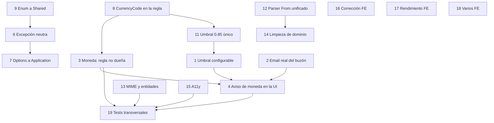

# Implementation Plan — Deuda técnica de la importación por correo

> Spec: `docs/superpowers/specs/2026-10-03-email-import-debt-design.md`
> Spec de la feature: `docs/superpowers/specs/2026-10-02-email-import-design.md`
> Plan de la feature: `docs/plans/03-email-import.md`
> Convenciones: `AGENTS.md`

---

## User Review Required

> [!IMPORTANT]
> **Alcance acordado con el usuario: §2 + §3 + §6 + §7.**
>
> - **§1 — fuera de alcance.** Los cuatro bloqueantes ya están corregidos y con tests (commit `d954267`). La spec los conserva como registro, no como tarea.
> - **§4 — fuera de alcance.** Son candidatos a simplificación, no correcciones. Este plan **no toca** `ScopedCurrentUserProvider`, ni la doble capa de cursor, ni `EmailImportOptions.Providers` como clase, ni la firma de `IEmailProviderClient`. Donde un slice de §3 obliga a tocar algo de §4, se anota explícitamente y se limita al mínimo imprescindible.
> - **§5.1 — fuera de alcance, y no es delegable.** La prueba de humo contra un buzón real requiere un buzón de prueba, consentimiento OAuth interactivo y la Google Cloud Console. Ningún agente puede hacerla. Queda como checklist manual documentado (copiar de la spec §5.1).
> - **§5.3 — sin acción.** Es una observación, no un defecto pendiente.
> - **§8 — no tocar.** Nada de este plan modifica el doble barrera de idempotencia, `OAuthStateService`, `AesSecretProtector`, la dirección de capas del parseo ni la neutralidad de proveedor.

> [!NOTE]
> **§2.3 — decisión de producto ya tomada por el usuario: opción (c).**
> Un símbolo de moneda que **contradice** la moneda declarada por la deja de ser una penalización y pasa a ser un `ParseOutcome` de tipo "esta regla no es la dueña de este correo". Consecuencia directa: **nunca se auto-aprueba**. Ver slice 3 para el matiz importante (símbolo desconocido ≠ contradicción) y para el riesgo de regresión que la opción (c) naïve introduce (que la regla correcta nunca llegue a evaluarse).

> [!NOTE]
> **Verificación independiente obligatoria.** Lección §9.7 de la spec: un subagente que reporta "todo verde" puede tener cifras equivocadas, y §9.2/§9.3 (una aserción floja oculta defectos; un test que no falla al reintroducir el defecto está *fijando* el defecto). Cada slice de este plan nombra explícitamente **el test que fallaría si se reintrodujera el defecto**. Ningún slice se acepta por reporte: se acepta por test rojo→verde.

---

## Diagrama de dependencias entre slices



Orden de ejecución: **8 → 11 → 1 → 2 → 3 → 4 → 5 → 6 → 7 → 9 → 10 → 12 → 13 → 14 → 15 → 16 → 17 → 18 → 19**.

Los slices 9 y 10 son refactors mecánicos y tocan ficheros de many slices; conviene hacerlos **antes** de que los demás creen dependencias nuevas sobre los tipos que mueven (por eso 8 y 9 están al principio aunque el orden lógico sea otro).

Tres slices tocan **Finances** o persisten valores, y por eso hay que aislarlos bien:

- **Slice 7** (§3.1) toca `TransactionRepository.AddAsync`, que también usa el import de Money Manager. Es el slice con más radio de impacto del plan.
- **Slice 9** (§3.3) mueve un enum **persistido**: los valores numéricos no pueden cambiar.
- **Slice 10** (§3.4) cambia el tipo de una propiedad de dominio leída por el repositorio.

Si alguno rompe algo, se revierte **completo**. No se dejan a medias: `ParseOutcome.RuleCannotOwn`, la traducción de la excepción y el nuevo `PUT` de umbral son cambios que tienen sentido todos o ninguno.

---

## Estado de avance (actualizado al cerrar `implementing`)

Los **19 slices están implementados y verificados**. Cifras ejecutadas por el orquestador, no
reportadas por subagentes:

```
dotnet build Budgie.slnx                0 errores
EmailImport unit                        614 tests, 0 fallos
Finances unit                           319 tests, 0 fallos
Shared unit                             117 tests, 0 fallos
Integración (PostgreSQL real)           104 tests, 0 fallos
bun run lint                            0 errores (4 warnings preexistentes)
bun run build                           verde
bunx playwright test                     45 tests, 0 fallos
paridad i18n (claves usadas en código)  171/171 presentes en es y en
```

### Hallazgos que corrigieron al propio plan

- **§9.3, una cuarta vez.** `GenericRegexAdapterTests.Parse_CapturedSymbolContradictingTheRule_ScoresZero`
  afirmaba que un símbolo contradictorio puntuaba 0 y el mensaje se extraía igual: fijaba el
  defecto de §2.3. Reescrito para que afirme el rechazo.
- **El binding de enums no hace lo que decía el plan.** `GET /inbox?status=99` no da 400 por el
  binding (`Enum.TryParse` acepta cualquier entero), sino 200 con página vacía. Cerrado con
  `Enum.IsDefined` en `GetPendingQueryHandler`. Los tests `?status=Failed`/`?status=Committed`
  que el plan daba por existentes **no existían**.
- **Colisión de nombres en el diseño de §2.3.** `ParseOutcome` no puede tener una propiedad y
  un factory ambos llamados `RuleRejected` (`CS0102`). El factory se llama **`RuleCannotOwn`**,
  que además nombra la distinción que el slice quiere expresar.
- **`RuleRejected` es señal, no resultado.** El parser la consume y su salida es **siempre
  terminal**. Leer esa propiedad sobre el resultado de `ParseAsync` es un bug que compila y
  nunca se dispara; queda escrito en el XML doc de `ParseOutcome`.
- **El `0.85` está en 5 sitios, no en 3.** Además de los tres documentados, `HIGH_THRESHOLD`
  (`confidence.ts`) y `DEFAULT_THRESHOLD` (`EmailImportInbox.tsx`). El primero **no** es una
  copia de la política sino el umbral de banda de los badges: se desacopló en lugar de
  "sincronizarlo", porque unir una decisión de presentación a la política de auto-commit es el
  error, no la solución.
- **El frontend tiene una cuarta copia del parser `From`** (`EmailImportInbox.tsx`,
  `extractFromHeader`). No es un duplicado —escanea una cabecera `From:` cruda del MIME, no
  extrae una dirección entre ángulos— pero el nombreebababa a confundirla con las tres de
  backend, así que el slice 12 documenta por qué no se unificó.
- **El helper `FieldError` ya aceptaba `id`** por spread de props: el slice 15 no necesitó
  tocar la primitiva, sólo los call sites.

### Desviaciones conscientes (reversibles con poco coste)

- `AlertDialogCancel` también perdió su `disabled` muerto en los dos diálogos (el plan sólo
  nombraba el `Action`); la misma razón aplica y ahí el `disabled` además impedía cancelar.
- Paginación a `size="lg"`: el design system topa en `h-9` (36 px), por debajo del objetivo
  táctil de 44 px. Anotado como decisión del design system, no de esta página.
- `EmailImportRuleResponse` **no** lleva el umbral de la regla: es read model de la regla y la
  columna no existe ahí. El endpoint del umbral y la query que lo lee son la única vía.

### Sin hacer, a propósito

Reparar filas de reglas con `AdapterKey` inválido ya guardadas (siguen fallando en cada sync
hasta que el usuario las edite) y migrar conexiones con `Email = "connected"` a su dirección
real (se resuelven al desconectar y volver a conectar). Ninguna lleva migración de datos.

---

## Tareas

### 1. §2.1 — Umbral de auto-commit configurable

- **Qué resuelve**: hoy `AutoCommitMinConfidence` solo se cambia por base de datos. El parámetro existe en la tabla, es un argumento de `EmailConnection.Create` y el dominio ya valida `ChangeAutoCommitThreshold`. Falta la ruta.
- **Archivos**:
  - `[NEW] src/core/Budgie.Modules.EmailImport/Application/Connections/UpdateThreshold/UpdateAutoCommitThresholdCommand.cs`
  - `[NEW] src/core/Budgie.Modules.EmailImport/Application/Connections/UpdateThreshold/UpdateAutoCommitThresholdCommandHandler.cs`
  - `[MODIFY] src/core/Budgie.Modules.EmailImport/Presentation/Connections/ConnectionsEndpoints.cs`
  - `[MODIFY] src/apps/Budgie.Api/BudgieJsonContext.cs` — registrar el nuevo request record si la convención del repo lo exige para el binding (comprobar cómo están los demás `*Request` del módulo).
  - `[MODIFY] src/apps/Budgie.Web/src/modules/email-import/hooks/useEmailConnections.ts` — nueva mutación.
  - `[MODIFY] src/apps/Budgie.Web/src/modules/settings/components/EmailImportSettingsCard.tsx` — slider editable.
  - `[MODIFY] src/apps/Budgie.Web/src/i18n/**` (es/en) — claves nuevas.
- **Pasos**:
  - `UpdateAutoCommitThresholdCommand(EmailProvider Provider, decimal Threshold) : IRequest<ErrorOr<Success>>`, en su propia carpeta, siguiendo exactamente la forma de `DisconnectEmail/`.
  - Handler `internal sealed` con primary constructor de `(IEmailConnectionRepository, ICurrentUserProvider)`. Cargar con `GetByProviderAsync(userId, provider)` y devolver `Error.NotFound("EmailImport.NotConnected", …)` si no hay — **mismo código que devuelve `DisconnectEmailCommandHandler`**, no uno nuevo: reutilizarlo evita que los dos mensajes se separen con el tiempo.
  - `connection.ChangeAutoCommitThreshold(request.Threshold)` **envuelto en try/catch de `ArgumentException`** → `Error.Validation("EmailImport.InvalidThreshold", …)` en es/en. El dominio lanza con `ArgumentException` cuando el valor sale de `[0, 1]`; sin el catch, un slider a `1.5` produciría un 500. Este catch es la mitad del contrato del endpoint.
  - `await repository.UpdateAsync(connection, ct)` y `return Result.Success`.
  - Ruta: `PUT /api/email-import/connections/{provider}/threshold`, dentro del grupo `RequireAuthorization`. Reutilizar `GetAuthorizationUriEndpoint.TryParseProvider` / `UnknownProvider` igual que hace el `MapDelete` de la misma clase: el parseo del provider no se duplica.
  - Declarar `public record UpdateAutoCommitThresholdRequest(decimal Threshold)` **en el propio `ConnectionsEndpoints.cs`**, siguiendo el precedente de `ApprovePendingRequest` en `InboxEndpoints.cs`.
  - La respuesta es `Results.NoContent()`.
- **Frontend**:
  - El slider deja de ser de solo lectura. `onValueChange` actualiza estado local; el commit es explícito (o `onValueCommit` con `onBlur`) para no disparar una petición por cada píxel de arrastre.
  - Invalidar `["email-import","connections"]` tras el éxito para que la tarjeta refleje el valor persistido.
  - Optimista con rollback, o estado de error visible: **no** dejar el slider mostrando un valor que el servidor rechazó en silencio.
- **Tests** (el que falla si se reintroduce el defecto):
  - Unit: el handler persiste el valor; devuelve `Validation` con `1.5` y con `-0.1`; devuelve `NotFound` sin conexión; no toca ninguna conexión cuando la validación falla.
  - Unit (**el importante**): el umbral **afecta de verdad** a la decisión de auto-commit en el siguiente sync. Es decir, con umbral `0.85` una fila de confianza `0.90` se auto-aprueba; con el mismo umbral subido a `0.95` esa misma fila **queda `Pending`**. Un test que solo comprueba que el número se guardó no prueba el objetivo de §2.1.
  - Integration: `PUT` persiste y el `GET /connections` posterior devuelve el umbral nuevo.

---

### 2. §2.2 — La dirección real del buzón

- **Qué resuelve**: `CompleteConnectionCommandHandler` guarda `Email = "connected"` porque `EmailCredentials` no trae la dirección. La UI no puede mostrar qué buzón está conectado, y ese placeholder está además dentro del `UNIQUE("UserId","Provider","Email")`.
- **Archivos**:
  - `[MODIFY] src/core/Budgie.Modules.EmailImport/Application/Connections/EmailCredentials.cs`
  - `[MODIFY] src/core/Budgie.Modules.EmailImport/Infrastructure/Email/Gmail/GmailEmailProvider.cs`
  - `[MODIFY] src/core/Budgie.Modules.EmailImport/Application/Connections/CompleteConnection/CompleteConnectionCommandHandler.cs`
  - `[MODIFY] src/apps/Budgie.Web/src/modules/settings/components/EmailImportSettingsCard.tsx`
- **Pasos**:
  - Añadir `string? Email` a `EmailCredentials` como **último** parámetro con valor por defecto `null`, para no romper los constructores posicionales existentes. Documentar en el XML doc que es la dirección del buzón reportada por el proveedor, `null` cuando el proveedor no la expone o la llamada falló.
  - En `GmailEmailProvider.ExchangeCodeAsync`, tras el intercambio del código, llamar a `api.GetProfileAsync(token.AccessToken, ct)` y rellenar `Email` con `profile?.EmailAddress`. **`GmailProfileResponse` ya trae `emailAddress`** (`GmailApiClient.cs:370`) y `gmail.readonly` ya lo cubre.
    - **Corrección al implementar**: aquí el plan (y la spec §2.2) decían "cero llamadas nuevas". Es **una llamada extra por conexión**, no cero: el endpoint de profile ya existe en la clase, pero el anclaje del `historyId` ocurre en el **primer tick** de `ListNewAsync`, es decir *después* del intercambio. No hay endpoint nuevo ni permiso nuevo, y la respuesta trae ambas cosas; pero el número de round trips es dos en vez de uno, y decirlo de otro modo sería una afirmación falsa en la documentación.
  - **La llamada al perfil es best-effort.** Si falla, la conexión **debe completarse** con `Email = null`: el buzón está conectado de verdad, y perder la conexión porque un endpoint informativo falló sería peor que no tener la dirección. Envolver en try/catch de `EmailProviderException` y seguir. Documentarlo, porque un `catch` vacío siempre parece un bug a quien lo lea después.
  - `RefreshAsync` produce `EmailCredentials` desde la credencial almacenada: ahí `Email = null` (la dirección vive en `EmailConnection.Email`, no en la credencial).
  - En `CompleteConnectionCommandHandler`: usar `credentials.Email` cuando no sea null/vacío; si lo es, **conservar el placeholder `ConnectedEmailPlaceholder`**. **Borrar el TODO** que hoy ocupa 20 líneas explicando el hueco: el hueco está cerrado.
  - **No cambiar `ExistsByProviderAsync`**: la invariante de "una conexión por proveedor y usuario" sigue vigente y ahora se apoya además en un email real. Documentarlo, porque un refactor futuro que lo quite abriría la puerta a N conexiones con el mismo `Email = "connected"` bajo este placeholder.
- **Frontend**: la tarjeta de ajustes muestra `connection.email`. Si llega `"connected"` (conexiones creadas antes de este slice) se muestra tal cual — **no** inventar un formato de email que sugiera datos reales.
- **Nota de despliegue**: no hay migración. Las filas existentes siguen con `Email = "connected"` hasta que el usuario desconecte y vuelva a conectar. Decidirlo y decirlo en el mensaje de release; no añadir un UPDATE de datos.
- **Tests**:
  - Unit del provider: el intercambio llama a `getProfile` y devuelve el `emailAddress`; si `getProfile` lanza `EmailProviderException`, `ExchangeCodeAsync` **igual** devuelve credenciales válidas con `Email = null`.
  - Unit del handler: con `Email` informado, `EmailConnection.Email` es ese valor; sin `Email`, es el placeholder.
  - Integration: el `GET /connections` tras conectar devuelve la dirección real.

---

### 3. §2.3 (opción c) — La contradicción de moneda no es una penalización

- **Qué resuelve**: con los pesos de la spec, un correo en `$` con una regla EUR puntúa **0.90** y se auto-aprueba etiquetado EUR. El importe es correcto; la etiqueta de moneda no. Es el único camino del sistema que puede dejar dinero bajo la etiqueta equivocada sin intervención humana.
- **Decisión de diseño (importante, léase antes de codificar)**:

  La lectura naïve de la opción (c) es: *"el adapter devuelve `NoMatch` y el correo se pierde"*. Eso **introduce un bug nuevo**: `EmailParser.ParseAsync` devuelve el resultado del **primer** filtro que casa, sin probar ninguna otra regla. Si la regla A (EUR) rechaza el correo por moneda y la regla B (USD) lo habría parsed bien, un `NoMatch` simple **nunca llega a la regla B** y el correo se descarta silenciosamente. Eso es peor que el defecto original.

  La implementación correcta de la opción (c) es un tipo de resultado distinto de "no matché nada":

  > **`RuleRejected`** — "esta regla corresponde a este correo por sus filtros, pero **no puede ser su dueña** porque un dato duro se lo contradice". El parser **sigue probando la siguiente regla**. Si ninguna regla más puede poseerlo, el correo termina como `NoMatch` con el motivo de la contradicción, y se cuenta en `skipped`.

  Con esto: (a) la contradicción **nunca** auto-aprueba, (b) una regla `$` posterior sigue funcionando, (c) el caso "ninguna regla puede" es un skip documentado, no una pérdida silenciosa.

  **Matiz que hay que decidir con criterio, no por inercia**: hoy `currencyScore = 0.0` cubre **dos** situaciones distintas, y no deben recibir el mismo tratamiento:
  - **Contradicción** — el símbolo se mapea a un ISO conocido (`$` → `USD`) y **no coincide** con la moneda de la regla. → `RuleCannotOwn`. Es exactamente el riesgo que §2.3 describe.
  - **Símbolo desconocido** — el símbolo capturado no está en la tabla (`¥`, `CHF`, `₿`). → **se queda como penalización 0.0** y el correo va a revisión. Aquí **no** sabemos que la moneda sea otra: solo que no sabemos identificarla. Descartar el correo sería tirar away información por una limitación de nuestra tabla, y un usuario con una cuenta en CHF se quedaría sin importaciones sin ningún aviso. La contradicción es un hecho; el símbolo desconocido es una ignorancia nuestra, y se tratan de forma distinta por la misma razón que la spec da para (c).

- **Archivos**:
  - `[MODIFY] src/core/Budgie.Modules.EmailImport/Domain/Parsing/ExtractedTransaction.cs` — `ParseOutcome`
  - `[MODIFY] src/core/Budgie.Modules.EmailImport/Application/Parsing/Adapters/GenericRegexAdapter.cs`
  - `[MODIFY] src/core/Budgie.Modules.EmailImport/Application/Parsing/EmailParser.cs`
  - `[MODIFY] src/core/Budgie.Modules.EmailImport/Infrastructure/Database/EmailImportRuleRepository.cs` — desempate determinista (§6.8)
- **Pasos**:
  - `ParseOutcome` gana un quinto parámetro **`bool RuleRejected = false`** y una factoría que valida el reason como hace `NoMatch`.
    - **Corrección aplicada al implementar**: la factoría se llama **`RuleCannotOwn(string reason)`**, no `RuleRejected`. Una propiedad y un factory no pueden llamarse igual en C# (`CS0102`), y el nombre nuevo expresa mejor lo que afirma: "esta regla no puede ser la dueña de este correo".
    - Documentar en el XML doc del record la diferencia entre los **tres** estados: `Success`, `RuleCannotOwn` (los filtros casaron pero un dato duro lo contradice; el parser **sigue con la siguiente regla**) y `NoMatch` (terminal). Y añadir que `RuleRejected` es una señal **entre adapter y parser**: la salida de `ParseAsync` es siempre terminal, así que leer esa propiedad sobre su resultado es un bug que compila y nunca se dispara.
    - El parámetro nuevo va **al final con valor por defecto** para no romper los constructores posicionales de tests y adaptadores futuros.
  - `GenericRegexAdapter.Parse`: cuando hay símbolo capturado y `MapSymbol(symbol)` devuelve un código **no nulo y distinto** de `context.Rule.Currency`, devolver `ParseOutcome.RuleCannotOwn(CurrencyContradictionReason)` **antes** de construir el `ExtractedTransaction`. Cuando `MapSymbol` devuelve `null`, seguir como hoy con `currencyScore = 0.0`.
    - `CurrencyContradictionReason` es una constante **pública** del adapter (`"currency-symbol-contradiction"`), para que la UI pueda traducirla como cualquier otro motivo de skip y los tests no repitan el literal.
  - Actualizar el comentario del bloque `── currency ──`, que hoy afirma que un símbolo contradictorio "goes to review with 0": ya no es cierto para la contradicción, y un comentario falso aquí es exactamente el modo de fallo que §9.2 describe.
  - `EmailParser.ParseAsync`: al recibir `outcome.RuleRejected`, **registrar el motivo y continuar con el siguiente candidato** en lugar de devolver. Tras el bucle: si hubo algún rechazo, devolver `ParseOutcome.NoMatch(<motivo del último rechazo>)`; si no, `NoMatch("no-rule-matched")` como hoy. Así `skipped` y el log dicen por qué se perdió el correo.
  - **§6.8 en el mismo slice**: `OrderBy(rule => rule.Priority).ThenBy(rule => rule.Id)`. Dos reglas con la misma prioridad hoy dependen del `ORDER BY "CreatedAt" ASC` de la base de datos; al añadir el "seguir con la siguiente regla", esa dependencia pasa a ser **visible** (qué regla rechaza primero decide el resultado). Fijarla con `ThenBy(Id)` lo hace determinista. Reflejarlo también en `EmailImportRuleRepository.GetByUserAsync`: `ORDER BY "Priority" ASC, "Id" ASC`.
  - `ConfidenceScorer.CurrencyReason` sigue dijéndolo bien ("el símbolo capturado contradice la moneda de la regla"): es el texto correcto para el caso de símbolo desconocido que sí llega a revisión. **No** tocarlo.
- **Tests** (los que fallan si se reintroduce el defecto):
  - Adapter: símbolo contradictorio → `RuleCannotOwn` (flag `RuleRejected` a true), **no** un `Success` con confianza 0.90. Este es el test que fija la decisión; sin él, alguien "arregla" el peso de `currency` y vuelve el defecto.
  - Adapter: símbolo **desconocido** → `Success` con `currency = 0.0` y confianza por debajo del umbral. Fijar explícitamente que el caso desconocido **no** se rechaza.
  - Adapter: sin símbolo capturado → `currency = 1.0` (la regla declara la moneda), sin cambio.
  - Parser: **el test de la regresión de la opción (c) naïve** — regla EUR con símbolo `$` + regla posterior USD que sí casa → devuelve el parseo de la USD, no `NoMatch`. Si este test falla, se ha implementado la opción (c) mal.
  - Parser: todas las reglas rechazan → `NoMatch` con el motivo de la contradicción.
  - Parser: dos reglas con la **misma** prioridad → gana la de `Id` menor, en dos llamadas consecutivas. Sin este test, el determinismo es una intención, no una garantía.
  - Sync: un correo con contradicción de moneda **no** llega nunca a `mediator.Send(CreateTransactionCommand)` y **no** crea fila de staging; cuenta en `Skipped`.

---

### 4. §2.4 — La contradicción de moneda se explica en la UI

- **Qué resuelve**: con el slice 3, la contradicción ya no llega a la bandeja de revisión. Lo que **sí** llega es el símbolo desconocido (penalización 0.0), y ese caso merece una advertencia destacada, no una línea más en el desglose de confianza.
- **Archivos**:
  - `[MODIFY] src/apps/Budgie.Web/src/modules/email-import/components/FieldConfidenceBadges.tsx`
  - `[MODIFY] src/apps/Budgie.Web/src/modules/email-import/components/PendingTransactionRow.tsx`
  - `[MODIFY] src/apps/Budgie.Web/src/modules/email-import/components/EmailRuleTester.tsx`
  - `[MODIFY] src/apps/Budgie.Web/src/i18n/**` (es/en)
- **Pasos**:
  - Cuando `fieldConfidence.currency === 0`, renderizar el badge de moneda como **warning** (tono `warning`/`destructive` del design system, icono de alerta, `title` explicativo), no como un badge neutro más.
  - Añadir una línea de aviso visible —no solo el texto del `Explanation`— que diga en es/en que **el símbolo del correo no se pudo identificar como la moneda de la cuenta** y que conviene revisarla a mano.
  - El aviso debe existir **tanto en la fila de revisión como en el probador**, con el mismo texto y las mismas claves i18n. Un mensaje en un solo sitio es la mitad del problema.
  - Cuando la contradicción **sí** se rechaza (slice 3), el probador debe decirlo: hoy el usuario que prueba una regla ve un `NoMatch` genérico sin entender que su símbolo de moneda es el motivo.
- **Tests**: E2E que abra una fila pendiente con `currency: 0` y compruebe que el aviso es visible. Y el caso del probador con símbolo contradictorio.

---

### 5. §2.5 — Un `AdapterKey` mal escrito se rechaza al escribir, no en cada sync

- **Qué resuelve**: el dominio acepta cualquier string ≤ 50 como `AdapterKey`. El probador lo detecta (`EmailImport.UnknownAdapter`), pero una regla ya guardada con una key inventada hace que `registry.Get` lance en **cada tick**, sumando a `Failed` sin explicar por qué.
- **Archivos**:
  - `[MODIFY] src/core/Budgie.Modules.EmailImport/Application/Parsing/IBankAdapterRegistry.cs`
  - `[MODIFY] src/core/Budgie.Modules.EmailImport/Application/Parsing/Adapters/BankAdapterRegistry.cs`
  - `[MODIFY] src/core/Budgie.Modules.EmailImport/Application/Rules/CreateRule/CreateRuleCommandHandler.cs`
  - `[MODIFY] src/core/Budgie.Modules.EmailImport/Application/Rules/UpdateRule/UpdateRuleCommandHandler.cs`
- **Pasos**:
  - Añadir `bool Contains(string key)` al puerto. `true` solo para una key registrada; `false` para null, vacío y desconocidos. **No** lanzar: la pregunta "¿existe?" no es "¿dámelo?".
  - En `CreateRuleCommandHandler` y `UpdateRuleCommandHandler`, validar **antes** de llamar al factory de dominio: si `!registry.Contains(request.AdapterKey)` → `Error.Validation("EmailImport.UnknownAdapter", …)` en es/en, con la lista de keys registradas en la descripción para que el error sea accionable sin abrir documentación.
  - El registro es un singleton construido en el arranque, así que inyectarlo en los handlers es trivial y no cambia nada del ciclo de vida.
  - **El registro no es una frontera de seguridad.** `EmailImportRule.Create` sigue aceptando cualquier string, porque el dominio no conoce el registro y no debe. La validación vive en Application, que sí lo tiene, tal como dice la spec.
  - Las filas ya guardadas con una key inválida **no se reparan aquí**: siguen fallando en el sync hasta que el usuario las edite. El `catch` genérico de `EmailSyncService` ya las aísla. Anotarlo como deuda consciente (§7.3 del plan de la feature lo dejó pendiente) y **no** añadir un comando de migración en este plan.
- **Tests**: `CreateRule`/`UpdateRule` con `"generic.regex "` (espacio), `"GENERIC.REGEX"` (mayúsculas), `"generic.regeX"` (typo) y `""` → `UnknownAdapter`; con `generic.regex` exacta → OK. Y `Contains` con key null/vacía → `false` sin lanzar.

---

### 6. §2.6 — `ApproveBatch` acota `Take`

- **Qué resuelve**: `ApproveBatchCommand.Take` acepta cualquier entero. `take: 100000` hace un bucle de 100 000 aprobaciones, cada una con su dispatch a Finanzas.
- **Archivos**:
  - `[MODIFY] src/core/Budgie.Modules.EmailImport/Application/Inbox/ApproveBatch/ApproveBatchCommandHandler.cs`
- **Pasos**:
  - Sustituir `Math.Max(1, request.Take)` por `Math.Clamp(request.Take, MinBatchSize, MaxBatchSize)`, con `MinBatchSize = 1` y **`MaxBatchSize = 200`** como constantes privadas con nombre.
  - Por qué 200 y no otro número: es un techo de seguridad, no de producto. La UI llama con 100 por defecto. 200 deja margen para un cliente que pida más sin permitir un bucle ilimitado. **Documentar que es un tope defensivo**, no un número mágico de negocio: si mañana alguien lo cambia debe saber que no es un requisito de negocio.
  - Validar también `MinConfidence` en `[0, 1]` → `Error.Validation("EmailImport.InvalidThreshold", …)`, reutilizando el mismo código que el slice 1 introduce. Sin esto, `minConfidence = -1` aprueba **todas** las filas pendientes, que es el mismo agujero por otro lado.
  - La interpolación del `LIMIT @Take` en el repositorio ya es parametrizada (`PendingEmailTransactionRepository.GetHighConfidenceAsync`), así que no hay SQL que tocar: acotar en el handler es suficiente.
- **Tests**: `Take = 0` → 1; `Take = -5` → 1; `Take = 100000` → exactamente `MaxBatchSize` filas (afirmar el número con un `Received(200)` sobre el repositorio de aprobación, no "menos de 100000"); `MinConfidence = 1.5` → `Validation` y **cero** aprobaciones.

---

### 7. §3.1 — `NpgsqlException` fuera de Application

- **Qué resuelve**: `AGENTS.md` prohíbe `Npgsql` en Application. Dos ficheros de EmailImport capturan `PostgresException` para distinguir el `23505` del segundo barrera de idempotencia.
- **Por qué se hizo así**: sin distinguir el código SQL, una transacción ya commiteada se reportaría como fallo y se reintentaría en bucle, duplicando lógica de idempotencia. La objeción es legítima; la solución final no.
- **Precedente que ya existe en el repo**: `Finances/Application/Import/InvalidImportFileException.cs` existe exactamente para no filtrar el tipo de infraestructura. Falta el equivalente para la violación unique.
- **Archivos**:
  - `[NEW] src/core/Budgie.Shared/Exceptions/UniqueConstraintViolationException.cs`
  - `[MODIFY] src/core/Budgie.Modules.Finances/Infrastructure/Database/TransactionRepository.cs`
  - `[MODIFY] src/core/Budgie.Modules.EmailImport/Application/Inbox/EmailSyncService.cs`
  - `[MODIFY] src/core/Budgie.Modules.EmailImport/Application/Inbox/ApprovePending/ApprovePendingCommandHandler.cs`
  - `[MODIFY] tests/Budgie.Modules.EmailImport.UnitTests/Inbox/EmailSyncServiceTests.cs`
  - `[MODIFY] tests/Budgie.Modules.EmailImport.UnitTests/Inbox/ApprovePendingTests.cs`
- **Pasos**:
  - `UniqueConstraintViolationException : Exception` con un `SqlState` de solo lectura. Hereda de `Exception`, **no** de `InvalidOperationException`: a diferencia de `InvalidImportFileException`, aquí no hay ningún `catch` preexistente que preservar, y heredar de `InvalidOperationException` haría que un `catch (InvalidOperationException)` genérico de cualquiera de los dos lados se tragase silenciosamente la barrera de idempotencia. Es el caso donde **no** repetir el precedente.
  - **Único punto de traducción**: `TransactionRepository.AddAsync`, envolviendo la ejecución en `catch (PostgresException ex) when (ex.SqlState == PostgresErrorCodes.UniqueViolation)` → `throw new UniqueConstraintViolationException(ex.Message, PostgresErrorCodes.UniqueViolation)`. Traducir **las dos** ramas (con y sin `IDbTransaction`): la segunda la usa el import de Money Manager.
  - Traducir **toda** violación unique, no solo la de `ExternalUid`. El tipo afirma "una restricción unique se violó", y no dice cuál. Filtrar por nombre de índice en el repositorio sería meter semántica de EmailImport en Finanzas.
  - Verificar antes de tocar nada que **ningún `catch` existente dependa de `PostgresException`**. Grep sobre `src/` y `tests/`: solo los dos handlers de EmailImport, más `Program.cs` y `ExportRepository` (que **usan** Npgsql, no lo capturan) y los helpers de test que fabrican la excepción. Ningún `catch` en Finanzas la captura hoy, así que el cambio de tipo es seguro.
  - Los dos handlers de EmailImport pasan a `catch (UniqueConstraintViolationException)`. Los comentarios que hoy nombran `SqlState 23505` y `NpgsqlException` se reescriben: el segundo barrera sigue siendo exactamente el mismo, solo cambia el tipo que lo anuncia.
  - Los dos helpers de test `UniqueViolation()` dejan de fabricar un `PostgresException` real con `RuntimeHelpers.GetUninitializedObject` y fabrican directamente la excepción neutra. **Menos código frágil y un test más honesto**: el test debe ejercitar el contrato que la aplicación ve, no el del driver.
- **Verificación extra (obligatoria en este slice)**: la barrera de idempotencia es lo que §8 de la spec marca como "lo que está bien y no hay que tocar". Después del refactor, `ExternalUidParity_WorkerAndApproval_BuildTheIdenticalKey` y los dos tests de `23505` deben seguir verdes **sin haberlos cambiado más que en el helper**. Si hay que tocar la lógica de un test para que pase, el refactor ha cambiado comportamiento: parar y revisar.
- **Tests**:
  - `TransactionRepository.AddAsync` con un `ExternalUid` ya presente lanza `UniqueConstraintViolationException` (test de integración contra el PostgreSQL del contenedor, no con un doble: es el comportamiento real del driver lo que se traduce).
  - Un `PostgresException` con **otro** `SqlState` (p. ej. `23503` foreign key) sale como `PostgresException`, no traducido. Sin este test, alguien "optimiza" la traducción y.EmailImport empieza a tragarse errores de FK como si fueran idempotencia.

---

### 8. §3.2 — `EmailImportOptions` a Application

- **Qué resuelve**: `SyncNowCommandHandler` (Application) lee `IOptions<EmailImportOptions>`, que vive en Infrastructure. El comentario que lo justifica equipara `LogMessages` con `Options`; la equiparación es falsa — `LogMessages` es un patrón **sancionado expresamente** por AGENTS.md y ningún handler de Application de Finanzas referencia hoy un tipo `Options` de Infrastructure.
- **Archivos**:
  - `[NEW] src/core/Budgie.Modules.EmailImport/Application/EmailImportOptions.cs`
  - `[DELETE] src/core/Budgie.Modules.EmailImport/Infrastructure/EmailImportOptions.cs`
  - `[MODIFY] src/core/Budgie.Modules.EmailImport/Application/Inbox/SyncNow/SyncNowCommandHandler.cs`
  - `[MODIFY] src/core/Budgie.Modules.EmailImport/Infrastructure/Worker/EmailSyncWorker.cs`
  - `[MODIFY] src/core/Budgie.Modules.EmailImport/EmailImportModule.cs`
- **Pasos**:
  - Mover la clase a `Application/`, con `Enabled`, `SyncIntervalMinutes` y `EncryptionKey`.
  - **`Providers` no se traslada.** Es un `Dictionary<string, GmailOptions>` — trasladarlo Would arrastrar `GmailOptions` (Infrastructure) a Application y reintroducir la violación que este slice elimina. La clave de configuración **no se pierde**: `GmailOptions.SectionName` es literalmente `"EmailImport:Providers:gmail"` (`GmailOptions.cs:23`), así que `docker-compose.yml` y `.env.example` **no se tocan**. Lo único que desaparece es el POCO que declaraba un diccionario que nadie leía (§4.3 de la spec).
  - Documentar en el XML doc de la clase nueva por qué no hay diccionario de proveedores y **dónde vive realmente la configuración de cada proveedor**: en su propia sección, bindeada directamente por su clase de Infrastructure. Sin esa frase, el siguiente que lea `appsettings.json` busca `EmailImport:Providers` en el código y no lo encuentra.
  - Actualizar el `using` de `SyncNowCommandHandler` y **borrar su comentario `<remarks>`**, que es la justificación falsa que la spec señala.
  - Actualizar `EmailImportModule` (el `Configure<>` y la lectura de `EmailImport:Enabled` para el worker).
- **Tests**: el arranque de la aplicación es la prueba (§9.6: "compila" no significa "arranca"). Levantar la API y comprobar que (a) `GET /api/email-import/connections` responde, (b) con `EmailImport:Enabled=true` el hosted service se registra y hace un tick, (c) `SyncNow` responde `SyncAlreadyScheduled` con el worker activo y sincroniza con el apagado.

---

### 9. §3.3 — `PendingEmailStatus` a `SharedEnums.cs`

- **Qué resuelve**: `InboxEndpoints` hace binding del enum de Domain. El plan de la feature decía: "si el enum acaba usándose en Presentation, moverlo a `SharedEnums.cs`". Acabó usándose y no se movió. Es un enum persistido (`Status` es `int` en el DDL) y de API, igual que `TransactionType`.
- **Archivos**:
  - `[MODIFY] src/core/Budgie.Shared/Enums/SharedEnums.cs`
  - `[MODIFY] src/core/Budgie.Modules.EmailImport/Domain/Staging/PendingEmailTransaction.cs`
  - `[MODIFY] src/core/Budgie.Modules.EmailImport/Infrastructure/Database/PendingEmailTransactionRepository.cs`
  - `[MODIFY] src/core/Budgie.Modules.EmailImport/Presentation/Inbox/InboxEndpoints.cs`
  - `[MODIFY] tests/**` — los `using` de `Budgie.Modules.EmailImport.Domain.Staging` que solo servían para el enum.
- **Pasos**:
  - Mover el enum **con los valores numéricos intactos y en el mismo orden** (`Pending = 0, Committed = 1, Dismissed = 2, Failed = 3`). Son valores persistidos: reordenar el enum corrompe datos sin que nada falle en los tests de dominio. Escribirlos explícitamente, no confiar en el orden de declaración.
  - Dejar en `PendingEmailTransaction.cs` solo la entidad.
  - Los valores por defecto del binding de `?status=` en `GET /inbox` no cambian: `PendingEmailStatus?` sigue siendo nullable y el servidor usa `status ?? Pending` donde hoy.
- **Tests**: el de integración de `GET /inbox?status=Failed` y `?status=Committed` cubre que el binding sigue funcionando. Añadir el caso `?status=99` (valor inexistente) → 400, para fijar que no se acepta cualquier entero.

---

### 10. §3.4 — `EmailImportRule.Currency` como `CurrencyCode`

- **Qué resuelve**: el dominio valida con `CurrencyCode.From` y **guarda el string**. `PendingEmailTransaction` sí usa `Money`/`CurrencyCode`. Es inconsistencia dentro del mismo módulo, contra el criterio de AGENTS.md de no esparcir primitivas donde hay un value object.
- **Archivos**:
  - `[MODIFY] src/core/Budgie.Modules.EmailImport/Domain/Rules/EmailImportRule.cs`
  - `[MODIFY] src/core/Budgie.Modules.EmailImport/Infrastructure/Database/EmailImportRuleRepository.cs`
  - `[MODIFY] src/core/Budgie.Modules.EmailImport/Application/Parsing/Adapters/GenericRegexAdapter.cs`
  - `[MODIFY] src/core/Budgie.Modules.EmailImport/Application/Rules/GetRules/GetRulesQueryHandler.cs` y los demás puntos que mapean a `EmailImportRuleResponse`
  - `[MODIFY] tests/Budgie.Modules.EmailImport.UnitTests/**`
- **Pasos**:
  - Cambiar `public string Currency` por `public CurrencyCode Currency`.
  - `Create`/`Update` guardan `CurrencyCode.From(currency).Code` — el VO normaliza, y `Validate` sigue invocando `CurrencyCode.From` para lanzar el `ArgumentException` con el mensaje actual. **No** cambiar el mensaje de error: los tests y el usuario lo reconocen.
  - El DDL (`VARCHAR(3)`) no cambia: el repositorio sigue escribiendo `rule.Currency.Code`. `CurrencyCode` tiene conversión implícita a `string`, así que el binding de Dapper sigue funcionando, pero **escribir `.Code` explícitamente** en el repositorio: no dejar laPersistencia en manos de una conversión implícita que un refactor futuro puede quitar.
  - Lectura: `Currency = CurrencyCode.From(row.Currency)`.
  - `GenericRegexAdapter` pasa de `context.Rule.Currency` a `context.Rule.Currency.Code` (comparación con `MapSymbol`, que devuelve `string?`).
  - `EmailImportRuleResponse.Currency` **se queda en `string`** (es un read model de la API; la conversión implícita funciona). Añadir una línea al XML doc diciendo que la moneda del read model es siempre el código canónico de `CurrencyCode`.
  - Auditar con grep todos los usos de `.Currency` en el módulo antes de dar el slice por bueno: `PreviewRuleCommandHandler`, `GetRulesQueryHandler`, los endpoints de reglas y los tests.
- **Tests**: `CurrencyCode` se persiste y se relee canónico (minúsculas); una moneda inválida sigue dando `EmailImport.InvalidRule`; el mapeo de `EmailImportRuleResponse` emite el `.Code`.

---

### 11. §6.1 — El umbral `0.85` vive en un solo sitio

- **Qué resuelve**: el valor está en `EmailConnection.DefaultAutoCommitMinConfidence`, en `ConfidenceWeights.DefaultAutoCommitThreshold` y en el `DEFAULT 0.85` del DDL. La spec pidió "un solo sitio para poder ajustarlo con un test".
- **Archivos**:
  - `[MODIFY] src/core/Budgie.Modules.EmailImport/Application/Parsing/ConfidenceWeights.cs`
  - `[MODIFY] src/apps/Budgie.Api/sql/003_email_import.sql`
  - `[NEW] tests/Budgie.Modules.EmailImport.UnitTests/Domain/AutoCommitThresholdConsistencyTests.cs`
- **Pasos**:
  - El sitio único es **Domain**: `EmailConnection.DefaultAutoCommitMinConfidence`. Application puede depender de Domain; Domain no puede depender de Application, así que la dirección contraria no es posible.
  - `ConfidenceWeights.DefaultAutoCommitThreshold` pasa a ser `= EmailConnection.DefaultAutoCommitMinConfidence` (referencia, no literal) y su XML doc explica **por qué** el espejo es una referencia y no una constante independiente. Un `const` puede referenciar otro `const`, así que no hay coste en tiempo de compilación.
  - El `DEFAULT 0.85` del SQL **no se puede eliminar**: es DDL. Pero se documenta con un comentario que lo ata a la constante de C#, y —esto es lo importante— **un test lo verifica**.
  - El test lee `src/apps/Budgie.Api/sql/003_email_import.sql` del disco, extrae el `DEFAULT` de `"AutoCommitMinConfidence"` y lo compara con la constante de C#. Si alguien cambia el umbral y olvida el DDL, el test falla. Eso es exactamente el "un solo sitio para poder ajustarlo con un test" que pedía la spec: la fuente es una, y el test es el mecanismo que obliga a que las otras dos la siguan.
  - Localizar el `.sql` desde el test de forma robusta (repo root por navegación de directorios o un `MSBuild` item `CopyToOutputDirectory`). Verificar que funciona cuando el test corre desde el binario, no solo desde el repo: un test que pasa en local por la ruta relativa y falla en CI es peor que no tenerlo.
- **Tests**: el de consistencia (arriba) más `EmailConnection.Create` con umbral por defecto = la constante.

---

### 12. §6.2 — Un solo parser de cabecera `From`

- **Qué resuelve**: la lógica está triplicada en `EmailMessage.GetFromAddress` (`Domain/Parsing/EmailMessage.cs:42`), `EmailImportRule.ExtractAddress` (`Domain/Rules/EmailImportRule.cs:216`) y `GmailMessageMapper.NormalizeFrom` (`Infrastructure/Email/Gmail/GmailMessageMapper.cs:39`). Hoy es benigno; es la clase de bug que aparece en cuanto una de las tres se afina.
- **Archivos**:
  - `[NEW] src/core/Budgie.Shared/Domain/EmailHeader.cs`
  - `[MODIFY] src/core/Budgie.Modules.EmailImport/Domain/Parsing/EmailMessage.cs`
  - `[MODIFY] src/core/Budgie.Modules.EmailImport/Domain/Rules/EmailImportRule.cs`
  - `[MODIFY] src/core/Budgie.Modules.EmailImport/Infrastructure/Email/Gmail/GmailMessageMapper.cs`
- **Pasos**:
  - `public static class EmailHeader` en `Budgie.Shared/Domain/`, con `public static string? ExtractAddress(string? rawHeader)`. Vive en `Shared` porque lo necesitan **Domain** y **Infrastructure**, y en ningún otro sitio cabe sin romper la dirección de capas. `Shared/Domain` (y no `Shared/Abstractions`) porque no es un puerto.
  - Semántica única, documentada: null/vacío/blanco → `null`; `Nombre <a@b.c>` → `a@b.c`; sin ángulos → el valor recortado.
  - **Las tres implementaciones no son idénticas** y eso hay que resolverlo explícitamente, no promediarlas: `NormalizeFrom` devuelve `null` para un header en blanco; `GetFromAddress` devuelve el propio string en blanco. Unificar en **`null`** para entrada en blanco, que es lo correcto, y **actualizar los tests** que fijan el comportamiento viejo si los hay (§9.3: un test que fija un defecto hay que cambiarlo a propósito, no por efecto colateral).
  - Los tres call sites conservan su firma pública; solo delegan.
- **Tests**: un archivo de tests del helper con los casos `null`, `""`, `"   "`, `"a@b.c"`, `"Nombre <a@b.c>"`, `"\"Nombre, raro\" <a@b.c>"`, `"a@b.c (comentario)"`, ángulos sin cerrar, y texto con dos `<`. Este archivo es el que evita que la lógica vuelva a duplicarse: si alguien añade un cuarto parser, no lo hereda, y este test no lo detecta — por eso el XML doc de la clase tiene que decir que es **el** sitio.

---

### 13. §6.4 / §6.5 — MIME: adjuntos y entidades hex en mayúscula

- **§6.4**: `RawEmailReader` prefiere el primer `text/plain` aunque sea un adjunto (`Content-Disposition` no se inspecciona). Un `.txt` adjunto que llega antes eclipsa el cuerpo real.
- **§6.5**: `&#X20AC;` no se decodifica. El regex de entidades es `&(?<code>#[0-9]+|#x[0-9a-fA-F]+|[a-zA-Z]+);` — la `x` es literal minúscula, así que `&#X20AC;` no casa con la segunda alternativa, y tampoco con la tercera (`X20AC` lleva dígitos). El `DecodeEntity` **ya** maneja `code[1] is 'x' or 'X'`: el bug está solo en el regex, y el código de decodificación anticipaba el caso. Peor: **hay un test que fija el defecto** (`HtmlToTextConverterTests.cs:171`, que afirma que `&#X20AC;` debe quedar literal). Es §9.3 en vivo.
- **Archivos**:
  - `[MODIFY] src/core/Budgie.Modules.EmailImport/Infrastructure/Parsing/RawEmailReader.cs`
  - `[MODIFY] src/core/Budgie.Modules.EmailImport/Infrastructure/Parsing/HtmlToTextConverter.cs`
  - `[MODIFY] tests/Budgie.Modules.EmailImport.UnitTests/Parsing/HtmlToTextConverterTests.cs`
  - `[MODIFY] tests/Budgie.Modules.EmailImport.UnitTests/Parsing/RawEmailReaderTests.cs`
- **Pasos**:
  - `HtmlToTextConverter`: cambiar la alternativa a `#[xX][0-9a-fA-F]+`. Es `[GeneratedRegex]`; el source generator se encarga. **Actualizar el test de la línea 171** para que afirme que `&#X20AC;` **se decodifica** a `€`, con un comentario que diga que la aserción anterior fijaba el defecto (§9.3). Añadir el caso `&#X41;` para separar "hex en mayúscula" de "entidad con signo".
  - `RawEmailReader`, en `CollectPart`: leer `Content-Disposition` de las cabeceras de la parte y **omitirla** cuando su tipo de disposición sea `attachment` (o `inline` con `filename`, que es el caso de los adjuntos en línea que los emisores HTML usan para los logos). Aplicarlo **antes** de mirar el media type, para que un `.txt` adjunto no compita con el cuerpo real.
  - No cambiar el resto de la selección de partes: el fallback `plain ?? html` y el tratamiento de la `text/plain` vacía (§5.3, ya corregido) se quedan como están.
- **Tests**:
  - `HtmlToTextConverter`: `&#X20AC;` → `€`; `&#x20AC;` → `€` (no regresión); `&#X41;` → `A`; entidad con nombre en mayúsculas sigue funcionando.
  - `RawEmailReader`: multipart con un `text/plain; name="notas.txt"` marcado `attachment` **antes** del `text/plain` real → devuelve el cuerpo real. Y un mensaje que **solo** tiene adjuntos `text/plain` y ningún cuerpo → cae al `text/html` si lo hay, o devuelve vacío sin romperse.
  - Este es el slice que responde a §5.3: la nota dice que los parsers MIME tienen más casos de los que cubren los tests, y el caso del adjunto es uno más.

---

### 14. §6.3 / §6.6 / §6.7 / §6.8 — Limpieza de dominio y almacenamiento

- **`CurrentUserProvider` muerto** (`src/apps/Budgie.Api/Infrastructure/CurrentUserProvider.cs`): sin registrar en ningún sitio, y su `GetUserId()` lanza `UnauthorizedAccessException` mientras el reemplazo lanza `InvalidOperationException`, sin que nadie capture ninguno. **Borrarlo** tras verificar con grep que no hay referencias. La spec dice "borrarla o dejar un comentario"; borrarla es preferible porque el repositorio ya tiene el reemplaza en `ScopedCurrentUserProvider`, con su XML doc comparando ambos.
- **`merchant` en blanco** (`PendingEmailTransaction`): `Create` y `ApplyReview` hacen `Truncate(merchant?.Trim(), 255)`, que convierte un espacio en `""`. `EmailImportRule` normaliza a `null` con `TrimOrNull`. Unificar en `null`.
- **`GetFailedAsync` materializa todas las filas** (con `RawBody`) para paginar después: la spec lo reporta como deliberado. **No se cambia**. Se refuerza el comentario del método explicando el compromiso (el filtro `Failed` es un subconjunto acotado por el usuario, no un log que crezca sin límite) y que el riesgo asumido es el tamaño de la respuesta. Dejar constancia escrita de que se revisó y se eligió no tocar.
- **`jsonb` normaliza al almacenamiento**: ya está documentado en el XML doc de `EmailImportRuleResponse`. No hay cambio de código; se propaga al frontend del slice 17.
- **§6.8, desempate del parser**: va en el slice 3, con el test de determinismo.

---

### 15. §7 A11y — Que un lector de pantalla verifique lo que ocurre

- **Estado real verificado** (no inferred): el repo tiene **cero** `aria-describedby` en todo `src/**/*.tsx`, un único `role="status"` en toda la app (`modules/import/components/ImportUpload.tsx:106`, ajeno a este módulo) y ningún `aria-live` en email-import. Los `Select` de `EmailRuleForm` **ya** están bien asociados (§7 lo marca como corregido), pero no en todas partes.
- **Archivos**:
  - `[MODIFY] src/apps/Budgie.Web/src/components/ui/field.tsx` — `FieldError`
  - `[MODIFY] src/apps/Budgie.Web/src/components/ui/date-time-picker.tsx` — aceptar `id`
  - `[MODIFY] src/apps/Budgie.Web/src/modules/email-import/components/EmailRuleForm.tsx`
  - `[MODIFY] src/apps/Budgie.Web/src/modules/email-import/components/EmailRuleTester.tsx`
  - `[MODIFY] src/apps/Budgie.Web/src/modules/email-import/components/PendingTransactionRow.tsx`
  - `[MODIFY] src/apps/Budgie.Web/src/modules/email-import/components/EmailRuleList.tsx`
  - `[MODIFY] src/apps/Budgie.Web/src/modules/email-import/pages/EmailImportInbox.tsx`
  - `[MODIFY] src/apps/Budgie.Web/src/modules/settings/components/EmailImportSettingsCard.tsx`
  - `[MODIFY] src/apps/Budgie.Web/src/i18n/locales/es.ts` y `en.ts`
  - `[MODIFY] src/apps/Budgie.Web/e2e/email-import.spec.ts`
- **Pasos**:
  1. **Errores inline asociados.** `FieldError` (`components/ui/field.tsx:174`) acepta un `id` opcional; los tres usos de `EmailRuleForm` (nombre L267, cuenta L286, patrón de importe L394) pasan un id y el `Input` correspondiente lo referencia con `aria-describedby`. Establecer el patrón aquí, porque **no existe en el repo**: es la primera vez que se hace y el resto de formularios se beneficiarán.
  2. **`DateTimePicker` acepta `id`.** Hoy `PendingTransactionRow.tsx:222` renderiza `<Label htmlFor={date-${row.id}}>` y un `DateTimePicker` que **no acepta `id`** (`components/ui/date-time-picker.tsx`), así que el label apunta a la nada. Añadir la prop propagándola al `PopoverTrigger`, como ya se hizo con `CategoryCombobox`.
  3. **`CategoryCombobox` con `id`** en `PendingTransactionRow.tsx:195-200`, donde el `<Label htmlFor={category-${row.id}}>` de L192 hoy está colgando. El componente ya acepta `id` (`modules/categories/components/CategoryCombobox.tsx:30`); solo falta pasárselo.
  4. **Selects sin etiqueta.** `EmailRuleTester.tsx` L97 (`FieldLabel` sin `htmlFor`) + L105 (`SelectTrigger` sin `id`); y el `Select` de estado de `EmailImportInbox.tsx` L183-203, que **no tiene elemento `<label>` en absoluto**. Replicar el patrón correcto ya presente en `modules/accounts/components/CreateAccountForm.tsx:181-185` (`htmlFor` + `id` + `aria-invalid`).
  5. **Anunciar las cargas.** `role="status"` en los esqueletos: `EmailImportInbox.tsx` L213-217, `EmailRuleList.tsx` L81-88, `PendingTransactionRow.tsx` L179, `EmailImportSettingsCard.tsx` L131. La primitiva `Skeleton` (`components/ui/skeleton.tsx`) hace spread de props, así que **no hay que tocar la primitiva**: añadir `role="status"` y un texto accesible (sr-only o `aria-label`) con la clave i18n correspondiente.
  6. **Anunciar los resultados asíncronos.** El `Alert` de "por qué quedó pendiente" (`PendingTransactionRow.tsx` L272-285) y el bloque de resultado del probador (`EmailRuleTester.tsx` L164) + el aviso `needInput` (L160): `role="status"` + `aria-live="polite"`. El bloque del probador **además** debe limpiarse al cambiar de regla (slice 18), o sea que el anuncio no llega a anunciar un resultado que ya no corresponde a lo seleccionado.
  7. **Consecuencia en E2E**: el spec localiza el combobox del probador por texto (`email-import.spec.ts` L255-258, `getByRole("combobox").filter({hasText: /Select a rule or open the form|Form draft/})`). Al asociarlo bien, ese filtro deja de ser fiable y hay que pasarlo a `getByLabel(...)` **en el mismo slice**. Si se cambia el componente y no el spec, el E2E falla —que es lo correcto— pero el fallo debe apuntar al selector, no a la app.
- **Verificación**: `bun run typecheck` y Playwright. Añadir al E2E al menos una aserción de accesibilidad: el aviso de moneda del slice 4 debe ser alcanzable por rol, y el probador por etiqueta.

---

### 16. §7 Corrección — Bugs de comportamiento en la UI

- **16.1 Las 6 regex viajan sin validar.**
  - **Archivos**: `[MODIFY] .../components/EmailRuleForm.tsx`, `[NEW] .../lib/regex-hint.ts`, i18n.
  - Los seis `<Input>` de patrones (L384-438) más `bodyRegex` (L370-376) no se compilan nunca en cliente. El único `new RegExp` del archivo no existe; `GUID_RE` (L45) valida el GUID de la cuenta.
  - Añadir un helper puro que intente `new RegExp(pattern)` y devuelva el error, con las claves i18n nuevas `emailImport.rules.regexHint`.
  - **El aviso es bloqueante, pero el 400 del servidor sigue siendo la autoridad.** La spec avisa de algo real: **la sintaxis JS no es la de .NET**. Hay patrones válidos en .NET que JS rechaza (los modificadores inline `(?n)`, por ejemplo) y patrones que JS acepta y .NET no. Si el aviso bloquea el guardado, se rechazan reglas que el servidor habría aceptado.
    → **Por eso el aviso no bloquea**: se muestra en línea al escribir, y el error real del servidor (`EmailImport.InvalidRule`) se pinta junto al campo que falló cuando vuelve el 400. El cliente da *early feedback*; el servidor sigue siendo el juez. Documentarlo en el propio helper, porque es el tipo de decisión que el siguiente lee como un descuido.
  - Compartir el helper con `EmailRuleTester` si el probador llega a validar algo.
- **16.2 `"1,234,56"` → `NaN`.**
  - **Archivo**: `[MODIFY] .../components/PendingTransactionRow.tsx` (L84).
  - `Number(amount.replace(",", "."))` con `String.replace` de argumento string **sin `g`**: solo se sustituye la primera coma. Con separador de miles el campo devuelve `NaN`, el botón queda deshabilitado y el error es invisible salvo por el mensaje `amountInvalid`.
  - Extraer un helper puro a `src/lib/` que normalice el separador: quitar los separadores de grupo y tratar el **último** separador que quede como punto decimal. Así funcionan `1.234,56` (es-ES), `1,234.56` (en-US) y `1234.56`. Es el caso de uso que la spec señala ("usuarios en formato es-ES con miles") y no se arregla con un `replace(",", ".")` global, que rompería el formato en-US.
  - Cubrir con E2E los dos formatos. **Aviso**: la app web **no tiene ningún test unitario** (los únicos specs de `Budgie.Web` están en `e2e/`). Por eso este helper, que es pura lógica, solo se puede cubrir por E2E o abriendo un runner. Abrir un runner de unit tests es una decisión de tooling que este plan **no** toma; se deja anotada como recomendación, porque es también la razón por la que slipped estas regresiones.
- **16.3 Dos convenciones de fecha que divergen.**
  - **Archivos**: `[MODIFY] .../components/PendingTransactionRow.tsx` (L157), `[MODIFY] .../settings/components/EmailImportSettingsCard.tsx` (L184), `[MODIFY] e2e/email-import.spec.ts`.
  - La fila usa `format(parseDbDate(row.createdAt), "PPp", …)`; la tarjeta de ajustes usa `format(new Date(connection.lastSyncAt), "PPp", …)`. Con un timestamp `Z`, `parseDbDate` quita la `Z` y construye una fecha **local**, mientras `new Date` interpreta el `Z` en UTC: divergen.
  - Unificar en `parseDbDate` (`src/lib/date-locale.ts`), que es la convención de `Transactions` y la que devuelve la fecha tal como el backend la guardó (naive, sin zona).
  - **Arreglar el test que no lo detectaba**: los fixtures del E2E usan fechas sin `Z` (`lastSyncAt: "2024-05-01T10:00:00"`, `createdAt: "2024-01-15T10:31:00"`). Añadir al menos un fixture con `Z` **antes** de cambiar el código, y comprobar que falla; luego arreglar. Si se cambia el código primero, el test pasa sin haber probado nada (§9.2).
- **16.4 Ventana de doble clic al aprobar.**
  - **Archivo**: `[MODIFY] .../components/PendingTransactionRow.tsx` (L88, L295-307) y `hooks/usePendingEmails.ts` (L40-47).
  - `busy` cubre `approveMutation.isPending`. React Query pone `isPending = false` en cuanto resuelve la mutación, **antes** de que aterrice el refetch de `invalidateInbox` (L45). La fila sigue en `inbox.items` y el botón se rehabilita: un segundo clic manda un `POST /inbox/{id}/approve` de un id ya consumido y recibe un 400.
  - **Gravedad: UX, no integridad.** El segundo barrera del servidor ya impide la transacción duplicada; el usuario ve un error. No subir la prioridad por eso, pero tampoco dejarlo.
  - Fix: mantener el botón de esa fila deshabilitado hasta que el refetch de la bandeja termine, derivando `isFetching` de la query de inbox. Pequeño y contenido; no sincronizar estado manual con la respuesta.

---

### 17. §7 Rendimiento

- **17.1 `parsePatterns` en cada render.**
  - `EmailRuleForm.tsx:167`: `const initialPatterns = parsePatterns(rule?.fieldPatternsJson ?? null);` se evalúa en cada render y su valor solo se consume en el `useState` de L168.
  - Fix: inicializador perezoso `useState<FieldPatterns>(() => parsePatterns(rule?.fieldPatternsJson ?? null))`.
  - **Dependencia que hay que respetar**: el padre monta el formulario con `key={formKey}` (`EmailImportInbox.tsx:282`) y lo remonta al cambiar de regla, así que el inicializador perezoso sigue viendo la regla correcta. Dejar un comentario que lo diga: sin él, el siguiente "optimiza" esto y el formulario deja de reflejar la regla editada.
- **17.2 Re-render de toda la página en cada keystroke.**
  - `EmailImportInbox.tsx:68` — `useState<EmailRuleDraftBody | null>` a nivel de página. Cada `onDraftChange` (que `EmailRuleForm` dispara en **cada** cambio de campo y de patrón, L197 y L203) vuelve a renderizar la página entera: las N `PendingTransactionRow`, la tabla de reglas y el probador.
  - El borrador solo lo consumen el formulario y el probador, y **los dos están dentro de la pestaña "Reglas"**.
  - Fix: extraer un componente `RulesTab` que sea dueño de `ruleDraft` y `formKey`, de modo que escribir en el formulario no re-renderice la bandeja de revisión. Es el arreglo real; envolver el tester en `React.memo` **no** sirve, porque `draft` es precisamente la prop que cambia en cada tecla. Con el estado dentro de `RulesTab`, `React.memo` sobre `EmailRuleTester` sí pasa a ser una segunda barrera útil, pero no es lo que arregla el problema.
  - No extraer el estado "a un nivel más arriba" para tapar el síntoma.
- **17.3 `EmailRuleForm` tiene 570 líneas y tres componentes.**
  - Los tres son `EmailRuleForm` (L134-494), `AccountSelect` (L496-533) y `TypeSelect` (L535-570).
  - **Partir el archivo no reduce la complejidad**, y hacerlo solo porque "570 líneas es mucho" produce tres archivos igual de complicados. Lo que sí reduce coste real: extraer `AccountSelect` y `TypeSelect` (que son campos reutilizables) y dejar el formulario con la validación y la construcción del body, que es lo que de verdad tiene.
  - `AccountSelect`/`TypeSelect` son patrones "campo del formulario de regla", no componentes de dominio: candidatos a `modules/email-import/components/rule-fields.tsx` junto con `FieldPatterns`/`EMPTY_PATTERNS`.
  - La validación (`validate()` L206-212) y la construcción del body (`handleSave` L214-248) **se quedan** donde están: son el corazón del componente y partirlas las haría más difícil de seguir, no más fácil.

---

### 18. §7 Varios

- **18.1 Feedback muerto en `AlertDialogAction`.**
  - `EmailImportInbox.tsx` L320-322 (aprobar en lote) y `EmailImportSettingsCard.tsx` L279-285 (desconectar) llevan `disabled={isPending}` sobre `AlertDialogAction`. La primitiva (`components/ui/alert-dialog.tsx:142`) es un `Button` normal y **cierra el diálogo al hacer clic**, así que el estado nunca se ve. Código muerto con falsa sensación de feedback: quien lo leajurará que hay un spinner.
  - **Quitar el `disabled` muerto**, no "arreglarlo": la confirmación de un clic ya produce un toast de resultado (`emailImport.pending.approveBatchResult`), que es el feedback real. `DeleteRuleDialog.tsx:43-50` sí tiene el par `disabled` + `Loader2` funcionando, pero porque usa `Dialog` y **no** `AlertDialog` — no copiar ese patrón aquí sin cambiar de primitiva. Un spinner en el sitio equivocado da sensación de robustness y da pena al usuario.
  - No añadir un `Loader2` a un `AlertDialogAction`: seguiría sin verse.
- **18.2 El probador conserva el resultado de otra regla.**
  - `EmailRuleTester.tsx`: `setResult` solo se llama en `onSuccess` (L79); `onValueChange` (L101-103) cambia `selected` y **no limpia `result`**. Se muestra el desglose de confianza de la regla anterior bajo el nombre de la nueva.
  - Además, `selected` puede quedar en `DRAFT_VALUE` cuando `draft` pasa a `null`: el item del borrador desaparece de la lista (L65) pero `selected` conserva el centinela, así que `canRun` es `false` (L60) y el trigger sigue enseñando "Form draft" sin que exista.
  - Fix: limpiar `result` en `onValueChange`, y derivar la etiqueta del trigger de un valor efectivo (`draft == null && selected === DRAFT_VALUE → sin selección`) en vez de leer un `selected` obsoleto.
  - Con el aviso `role="status"` del slice 15, un resultado que no se limpia es además un anuncio engañoso.
- **18.3 `window.location.replace("/login")`.**
  - `hooks/useEmailImportNotice.ts:60` usa `replace`; `lib/api-client.ts:84` usa `href`. Inconsistentes.
  - **No unificar a ciegas.** Aquí `replace` es lo correcto: la sesión se perdió y dejar la entrada en el historial permite volver a una página muerta con el botón atrás. Dejar el código y añadir el comentario que explique por qué difiere del de `api-client.ts`. La spec lo marca como aceptable; hacerlo explícito cuesta una línea y evita que el siguiente lo "corrija" al revés.
- **18.4 Botones de paginación de 28 px.**
  - `EmailImportInbox.tsx` L239-248 y L252-261 usan `size="sm"`, que en `components/ui/button.tsx:26` es `h-7` = 28 px, por debajo del objetivo táctil de 44 px, en la página principal de revisión.
  - El design system **no tiene** un tamaño de 44 px: `sm` h-7, `default` h-8, `lg` h-9 (36 px). Subir a `lg` se acerca pero no llega.
  - **Decisión de design system, no de esta página**: subir estos botones a `lg` y dejar anotado que el techo del sistema (36 px) está por debajo del objetivo de 44 px. Añadir un tamaño `xl` de 44 px al sistema solo para esta página sería una decisión de plataforma, y este plan no la toma.
- **18.5 El estado (pestaña, página, filtro) no vive en la URL — NO SE HACE.**
  - Consciente. El repo hace lo mismo en otras páginas, así que hacerlo aquí sin el resto produce una inconsistencia nueva en lugar de quitar una. Anotado en la spec como deuda menor; queda para una ronda que lo aplique a toda la app.

---

### 19. Tests transversales que cierran los huecos de la spec

- **19.1 (§5.2 D4) Cancelación a mitad del dispatch.**
  - El fix de `OperationCanceledException` (`EmailSyncService.cs` L117, L190, L331 y `ApproveBatchCommandHandler` L48) no tiene test, y la spec lo señala: una parada de contenedor en mitad del lote **no debe manchar filas `Failed`**.
  - Test: el dispatch lanza `OperationCanceledException` → se afirma que **no** se llama a `MarkFailedAsync` y que la cancelación se propaga. Con el `catch (Exception ex) when (ex is not OperationCanceledException)` actual, `MarkFailedAsync` no se llama… pero nada lo verifica, y un refuture quequite ese filtro no rompería ningún test.
- **19.2 (§5.2 D5) El umbral de moneda deja de ser un caso ambiguo.**
  - Con el slice 3, la contradicción deja de ser "0.90 → auto" y pasa a ser un comportamiento consciente y **probado** (§3 lista los tests). Los casos que quedan fijados: contradicción → rechazada; símbolo desconocido → revisión con 0.0.
  - Actualizar la tabla de la spec §2.3 para que refleje el comportamiento nuevo, o_Un link al slice 3. Una spec que describe un comportamiento que ya no existe es la "aritmética que envejece" de §9.8.
- **19.3 E2E: fixtures con `Z` (slice 16.3) y selectores por etiqueta (slice 15).**
  - Añadir el fixture con `Z` **antes** de cambiar el formateo, comprobar que falla, y solo entonces arreglar. Un test que se añade después del arreglo pasa sin haber probado el defecto (§9.2).
- **19.4 E2E nuevo**: edición del umbral desde la tarjeta (slice 1), visualización del buzón real (slice 2), aviso de moneda (slice 4), importes con separador de miles (slice 16.2).
  - **Aserciones estrictas**: la lección §9.2 es que `getByText(/automatic/i)` se satisfacía con el badge de la tarjeta, que aparece antes en el DOM, y el test pasaba sin comprobar el toast que decía comprobar. Cada aserción nueva tiene que fallar cuando lo que dice su nombre no ocurre.
- **19.5 Paridad de claves i18n contra las claves *usadas en código***.
  - §9.4: comparar `es` y `en` entre sí **no valida la tercera**. Las dos verificaciones anteriores de este módulo dejaron pasar `emailImport.rules.patternRequired`, que no existía en ninguno de los dos catálogos. Este plan añade claves nuevas en es y en (§1, §4, §15, §16).
  - Verificación: extraer las claves **usadas en el código** (`t("…")` dentro de `modules/email-import/**` y `EmailImportSettingsCard`) y comprobar que existen en los dos locales. Es un script de una pasada, no un test de runtime; dejarlo en el repositorio para que las siguientes rondas lo ejecuten.
  - Comprobar también que no quedan **claves huérfanas** (definidas en los locales y no usadas), que es el mismo catálogo visto desde el otro lado.

---

## Lo que este plan deja sin hacer, a propósito

| Ítem | Por qué |
|---|---|
| §5.1 prueba de humo contra un buzón real | Requiere buzón, consentimiento OAuth y Google Cloud Console. No es delegable a un agente. Checklist en la spec. |
| §4.1 `ScopedCurrentUserProvider` | La preocupación es del host, no del módulo. Mover la decisión al registro de `Program.cs` toca el arranque de la aplicación entera. |
| §4.4 firma de `IEmailProviderClient` | Cambiar el puerto obliga a tocar el provider de Gmail y su factory de URI. Coste alto, beneficio de legibilidad. |
| §4.3 `EmailImportOptions.Providers` como clase | Se resuelve **por el slice 8** (el diccionario desaparece al mover la clase a Application, porque arrastraría `GmailOptions` a Application). La ruta de configuración no cambia: `GmailOptions.SectionName` sigue siendo `EmailImport:Providers:gmail`. |
| §7 estado en la URL (18.5) | Consciencia: requiere hacerlo en toda la app. |
| Runner de tests unitarios en el frontend | Decisión de tooling. Se recomienda, no se toma aquí (ver 16.2). |
| Migrar conexiones con `Email = "connected"` | Sin migración: se resuelven al desconectar y volver a conectar. Decisión consciente. |
| Reparar reglas con `AdapterKey` inválido ya guardadas (slice 5) | Decisión consciente: se aíslan en el sync y el usuario las edita. |

---

## Verificación

Todo verde antes de `release`:

```
dotnet build Budgie.slnx
dotnet test tests/Budgie.Modules.EmailImport.UnitTests
dotnet test tests/Budgie.Modules.Finances.UnitTests
dotnet test tests/Budgie.IntegrationTests
bun run typecheck && bun run lint && bun run build
bunx playwright test
```

Además, por slice, la verificación que **no** es un test:

- **Slice 7** (§3.1): la barrera de idempotencia contra el PostgreSQL real del contenedor, no contra un doble.
- **Slice 8** (§3.2): arrancar la API (§9.6). Un tipo de opciones no registrado en DI no lo ve ningún test unitario.
- **Slice 11** (§6.1): el test del DDL tiene que pasar **desde el binario**, no solo desde el repo.
- **Todos**: §9.1 — "verificado con stubs" y "verificado contra el mundo real" son cosas distintas. Este plan sube la primera, no la segunda. El hueco de §5.1 sigue abierto.

## Fuera de alcance de este plan

- La prueba de humo contra un buzón real (§5.1). Checklist manual en la spec §5.1.
- Toda la §4 de la spec: `ScopedCurrentUserProvider` como preocupación del host, la firma de `IEmailProviderClient` que pide un `EmailConnection` de mentira, `IBankAdapter` con una sola implementación.
- Reparar filas de reglas ya guardadas con un `AdapterKey` inválido (slice 5, consciente).
- Migrar conexiones existentes de `Email = "connected"` a su dirección real (slice 2, consciente).
- El test de cancelación a mitad del dispatch (§5.2 D4), salvo que se añada explícitamente en el slice 19.