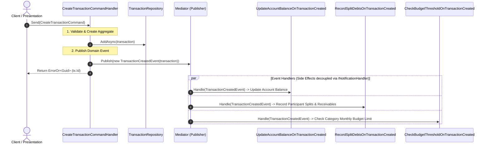

# 01 — System Architecture & Native AOT Backend

## 1. Solution Architecture & Module Boundaries

Budgie is architected as a **Modular Monolith** adhering strictly to **Clean Architecture** principles. The backend runs on **.NET 10** with **C# 14**, compiled as a **Native AOT** binary.

```
src/
  apps/
    Budgie.Api/                        # Minimal API Host, OpenAPI, Middlewares, AOT Type Contexts
    Budgie.Web/                        # React SPA (Vite, Bun, Tailwind v4, Base UI / shadcn/ui)
  core/
    Budgie.Shared/                     # Core base classes, Enums, Value Objects, IDbConnectionFactory
    Budgie.Modules.Users/              # Auth, User management, Registration policy, Settings
    Budgie.Modules.Finances/           # Accounts, Transactions, Categories, Goals, Budgets, Reports
    Budgie.Modules.Relationships/      # Persons, Tags, Photo management
```

### Module Structure

Every module is isolated and follows this internal structure:

```
Budgie.Modules.<ModuleName>/
  <ModuleName>Module.cs                # Extension methods: Add<Module>() and Map<Module>Endpoints()
  Application/                         # Use cases, Commands/Queries (Records), DTOs (Records), Interfaces
    <Feature>/
      <Action>Command.cs               # public record : IRequest<ErrorOr<T>>
      <Action>CommandHandler.cs        # internal sealed class : IRequestHandler<...> (Uses Repository interfaces only)
      <Action>Query.cs                 # public record : IRequest<ErrorOr<T>>
      <Action>QueryHandler.cs          # internal sealed class : IRequestHandler<...> (Uses Repository interfaces only)
    Repositories.cs                    # Repository Interfaces (NO SQL, NO DB dependencies)
  Domain/                              # Entities, Value Objects, Domain Events
    <Aggregate>/
      <Entity>.cs                      # Extends Entity base, parameterless ctor for Dapper, internal setters
  Infrastructure/                      # Dapper SQL Implementations, JWT, Logging, External Services
    Database/
      <Aggregate>Repository.cs         # Concrete Dapper Repositories (ONLY place SQL strings exist)
  Presentation/                        # Minimal API Endpoints
    <Feature>/
      <Action>Endpoint.cs              # Endpoint definition with OpenAPI metadata
```

---

## 2. Strict Layer Dependency Rules

| Layer | Can Depend On | Must NEVER Contain |
|---|---|---|
| **Domain** | `Budgie.Shared` (Value Objects, Entity base, Enums) | SQL, Dapper, Npgsql, DTOs, HTTP/Framework types |
| **Application** | `Domain`, `Budgie.Shared`, Repository **Interfaces** | SQL strings, `IDbConnectionFactory`, Npgsql, Dapper, HTTP contexts |
| **Infrastructure** | `Domain`, `Budgie.Shared`, `Application` (Interfaces), Dapper, Npgsql | Business logic, direct presentation concerns |
| **Presentation** | `Application` (Commands/Queries/DTOs), Mediator | SQL, `IDbConnectionFactory`, Repository implementations |

> [!IMPORTANT]
> **Strict Dapper Isolation**: Application handlers MUST NEVER contain raw SQL strings or reference `IDbConnectionFactory`. They interact solely with repository interfaces (`IAccountRepository`, `ITransactionRepository`, etc.) defined in the Application layer. All SQL queries, mappings, and Dapper calls live strictly in `Infrastructure/Database/`.

---

## 3. Native AOT Compliance Specifications

To achieve instant startup (<10ms), sub-30MB memory footprints, and standalone binary deployment:

1. **Compilation Flag**: `<PublishAot>true</PublishAot>` enabled in `Budgie.Api.csproj`.
2. **Zero Dynamic Reflection**:
   - Dynamic reflection-based serializers and mappers are prohibited.
   - Dapper uses compile-time source generation (`Dapper.AOT`).
3. **JSON Serialization Context (`System.Text.Json`)**:
   - All DTOs, request payloads, response records, error models, and OpenAPI schemas are registered in `BudgieJsonContext : JsonSerializerContext` with `[JsonSerializable(typeof(T))]`.
4. **Npgsql AOT Configuration**:
   - `NpgsqlDataSource` configured with pooled connections and static type handlers.

---

## 4. CQRS Architecture with C# Record Types

All write actions and read operations use immutable C# `record` types:

### Command Pattern (Write)
```csharp
// Application/Accounts/CreateAccount/CreateAccountCommand.cs
namespace Budgie.Modules.Finances.Application.Accounts.CreateAccount;

public record CreateAccountCommand(
    string Name,
    string Currency,
    decimal InitialBalance,
    AccountType Type,
    DateTime ControlStartDate,
    decimal? CreditLimit = null,
    CreditConsumptionMode? CreditConsumptionMode = null,
    int? BillingCycleDay = null,
    int? PaymentDueDay = null,
    decimal? AnnualInterestRate = null) : IRequest<ErrorOr<Guid>>;
```

### Query Pattern (Read)
```csharp
// Application/Accounts/GetAccounts/GetAccountsQuery.cs
namespace Budgie.Modules.Finances.Application.Accounts.GetAccounts;

public record GetAccountsQuery : IRequest<ErrorOr<List<AccountResponse>>>;

public record AccountResponse(
    Guid Id,
    string Name,
    decimal Balance,
    string Currency,
    AccountType Type,
    DateTime ControlStartDate,
    CreditCardSettingsDto? CreditCardSettings);
```

---

## 5. Event-Driven Command Handlers & Domain Events (via Mediator)

To enforce the **Single Responsibility Principle (SRP)** and keep Command Handlers focused strictly on their primary aggregate mutation, Budgie implements an **Event-Driven Architecture** powered by the compile-time source-generated `Mediator` library (`INotification` / `INotificationHandler<T>`).



### Key Event-Driven Design Rules

1. **Strict Command Handler Scope (SRP)**:
   - A Command Handler's sole responsibility is validating the command, applying business invariants to the aggregate root, persisting it via its repository, and publishing the corresponding Domain Event.
   - Command Handlers **MUST NOT** execute multi-aggregate side effects (e.g., updating secondary accounts, calculating interest tables, sending notifications, or tracking participant sub-ledgers) directly within the command handler body.

2. **Domain Event Notification Records**:
   - Every state change publishes an immutable Domain Event record implementing `INotification`:
     ```csharp
     public record TransactionCreatedEvent(
         Guid TransactionId,
         Guid UserId,
         Guid AccountId,
         Guid? CategoryId,
         decimal Amount,
         string Currency,
         decimal ExchangeRate,
         DateTime Date,
         TransactionType Type,
         List<TransactionParticipantDto>? Participants) : INotification;
     ```

3. **Decoupled Notification Handlers (`INotificationHandler<T>`)**:
   - Secondary side effects are handled by dedicated notification handlers:
     ```csharp
     internal sealed class UpdateAccountBalanceOnTransactionCreated(
         IAccountRepository accountRepository)
         : INotificationHandler<TransactionCreatedEvent>
     {
         public async ValueTask Handle(TransactionCreatedEvent notification, CancellationToken ct)
         {
             var delta = notification.Type switch
             {
                 TransactionType.Income or TransactionType.Repayment => notification.Amount,
                 _ => -notification.Amount
             };
             await accountRepository.AdjustBalanceAsync(notification.AccountId, delta, ct);
         }
     }
     ```

4. **Zero-Reflection AOT Performance**:
   - Using the compile-time `Mediator` source generator eliminates reflection at runtime, allowing instant event dispatching while maintaining 100% Native AOT compatibility.

---

## 6. Internationalization (i18n) & Localization Architecture

### Request Culture Middleware
1. Backend inspects the HTTP `Accept-Language` header on every request.
2. Supported cultures: Spanish (`es`) and English (`en`).
3. Default fallback: Spanish (`es`).
4. Selected culture sets `CultureInfo.CurrentCulture` and `CultureInfo.CurrentUICulture` for the request scope.

### Localized Error Handling with ErrorOr
Validation rules, domain checks, and business errors dynamically resolve messages using localized resource strings or dictionary mappings based on the active culture:

```csharp
// Example localized error creation
public static class FinanceErrors
{
    public static Error TransactionBeforeControlStartDate(DateTime controlStartDate) =>
        CultureInfo.CurrentUICulture.TwoLetterISOLanguageName == "en"
            ? Error.Validation("Transaction.BeforeControlStartDate", $"Transaction date cannot precede the account control start date ({controlStartDate:yyyy-MM-dd}).")
            : Error.Validation("Transaction.BeforeControlStartDate", $"La fecha de la transacción no puede ser anterior a la fecha de control de la cuenta ({controlStartDate:yyyy-MM-dd}).");
}
```

---

## 7. Observability (OpenTelemetry / OTLP)

Budgie backend includes comprehensive OpenTelemetry instrumentation:
- **Tracing**: ASP.NET Core request traces, Database query spans, Mediator pipeline activities via `ActivitySource("Budgie")`.
- **Metrics**: Request rates, endpoint latencies, transaction throughput via `Meter("Budgie")`.
- **Logs**: Structured JSON logs using compile-time source-generated `[LoggerMessage]`.
- **Exporting**: OTLP exporter targets `OTEL_EXPORTER_OTLP_ENDPOINT` (e.g. Jaeger, Grafana Tempo, SigNoz, OpenTelemetry Collector).

---

## 8. OpenAPI 3.1 & Scalar Documentation

1. ASP.NET Core `AddOpenApi()` generates strict OpenAPI 3.1 specifications.
2. Scalar API Reference is mounted at `/scalar/v1` for development and documentation exploration.
3. Explicit endpoint typing: Every endpoint specifies `.Produces<TResponse>(StatusCodes.Status200OK)` and appropriate error schemas.
