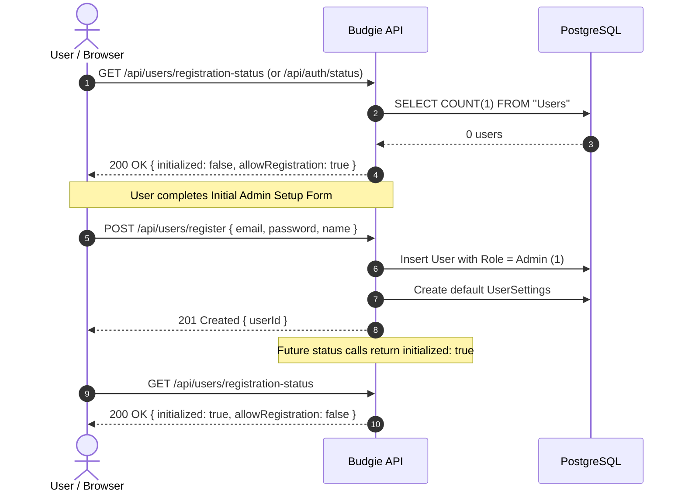

# 02 — Security, Auth & Zero-Trust Onboarding

## 1. Zero-Trust System Initialization Workflow

Budgie follows a zero-trust initialization lifecycle. When deployed on a fresh instance with an empty database:

### Initialization States

| System State | `initialized` | `allowRegistration` | Description |
|---|---|---|---|
| **Empty Database** | `false` | `true` | System requires first-run setup. First user becomes Admin. |
| **Active (`ENABLE_PUBLIC_REGISTRATION=false`)** | `true` | `false` | Public registrations rejected (403 Forbidden). Only Admin can provision or invite users. |
| **Active (`ENABLE_PUBLIC_REGISTRATION=true`)** | `true` | `true` | Public registration is open for any new user. |

---

## 2. User Roles & Permission Model

1. **Roles**:
   - `Admin` (Role ID `1`): Full system control, user provisioning, invitation generation, system category seeding, server backup downloads.
   - `User` (Role ID `2`): Standard tenant. Has isolated access only to their own accounts, transactions, categories, budgets, and relationships.

2. **Multi-Tenancy Isolation**:
   - The verified JWT token provides the caller's `UserId`.
   - Every database query for tenant data applies `WHERE "UserId" = @UserId` at the Dapper repository layer.

---

## 3. User Onboarding Policies (When Public Registration is Disabled)

When `ENABLE_PUBLIC_REGISTRATION=false`, new users are onboarded using two mechanisms:

### Method A: Token-Based Invitation Links
1. **Admin Generates Invite**:
   - Endpoint: `POST /api/users/invites`
   - Payload: `{ email: "maria@example.com", expiresInHours: 48 }`
   - Backend generates a cryptographically secure random token (stored with hash and expiration).
   - Generates invite URL: `https://budgie.local/register?token=inv_9f83...`
2. **User Completes Registration**:
   - Invited user navigates to `/register?token=...`.
   - System validates token validity and pre-populates email.
   - User provides Name and Password to complete registration.
   - The invite token is marked as consumed.

### Method B: Direct Administrator Provisioning
1. **Admin Creates User**:
   - Endpoint: `POST /api/users/admin/create-user`
   - Payload: `{ email: "carlos@example.com", name: "Carlos Perez", initialPassword: "TempPassword123!" }`
   - Creates the user in the database with standard `User` role.
   - Initializes default user settings.

---

## 4. Authentication Mechanism & Token Lifecycle

### Short-Lived Access Token (JWT)
- **Lifetime**: 15 minutes.
- **Payload Claims**:
  - `sub` / `NameIdentifier`: User UUID.
  - `email`: User email address.
  - `name`: User display name.
  - `role`: User role (`Admin` / `User`).
  - `exp`, `iat`, `iss`, `aud`.
- **Transmission**: Sent by the client in HTTP header: `Authorization: Bearer <jwt>`.

### Long-Lived Secure Refresh Token
- **Lifetime**: 30 days (sliding expiration).
- **Storage**: Stored in the `RefreshTokens` PostgreSQL table as a SHA-256 hash with revocation tracking.
- **Delivery**: Set via `Set-Cookie` header:
  - `HttpOnly: true` (Prevents XSS extraction).
  - `SameSite: Strict` (Mitigates CSRF).
  - `Secure: true` (When on HTTPS or reverse proxy).
  - `Path: /api/users/refresh`.
- **Automatic Token Rotation**:
  - Calling `POST /api/users/refresh` invalidates the submitted refresh token and generates a new refresh token + new access token.
  - If a revoked token is used, all active refresh tokens for the user are immediately revoked (compromise detection).
