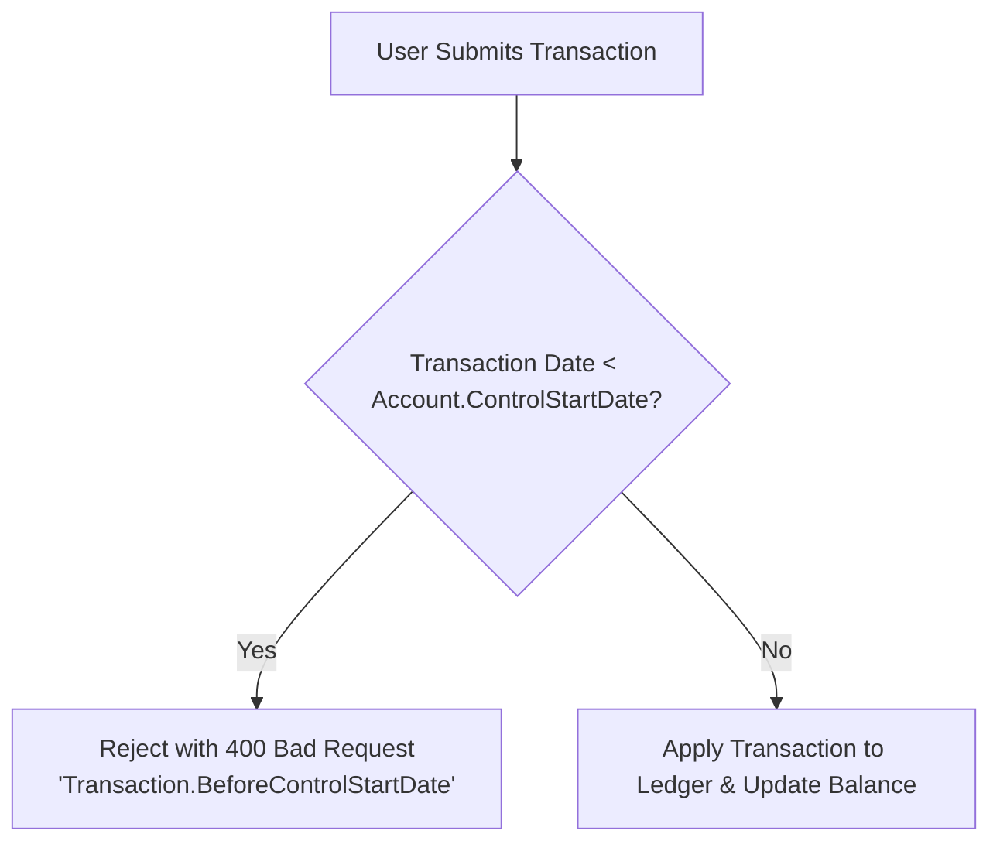
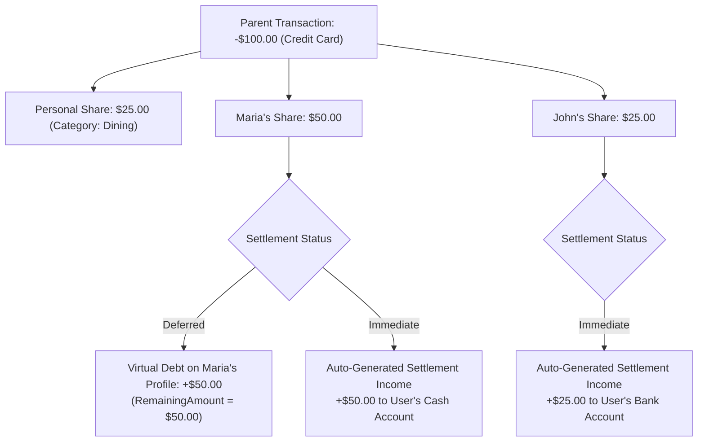

# 03 — Domain Ledger, Accounts & Split-Expense Engine

## 1. Account Types & Strict Ledger Rules (F2)

### Supported Account Types

| Type Enum | Code | Description | Special Fields |
|---|---|---|---|
| `Checking` | `0` | Standard bank checking account | `ControlStartDate` |
| `Savings` | `1` | High-yield or standard savings account | `ControlStartDate` |
| `Credit` | `2` | Revolving credit card with statement cycles | `CreditLimit`, `BillingCycleDay`, `PaymentDueDay`, `AnnualInterestRate`, `CreditConsumptionMode` |
| `Cash` | `3` | Physical wallet / cash on hand | `ControlStartDate` |
| `Debt` / `Loan` | `4` | Personal loan, formal mortgage, borrowed money | `ControlStartDate`, `AnnualInterestRate` |

---

### Strict Ledger Rule: `ControlStartDate`

Every account establishes a strict `ControlStartDate` when created.

1. **Transaction Date Constraint**:
   - The system **MUST NOT** allow recording or editing any transaction with a date earlier than the target account's `ControlStartDate`.
   - Violation produces an `Error.Validation("Transaction.BeforeControlStartDate", "...")` localized error.

2. **Initial Balance Handling**:
   - If `InitialBalance != 0` is specified during account creation, an automatic initial balance transaction is registered:
     - `Date = ControlStartDate`
     - `IsInitialBalance = true`
     - `CategoryId = SystemCategoryIds.InitialBalance`
     - `Type = TransactionType.Income` (or `Expense` for credit / debt balances)

3. **`ControlStartDate` Modification Rule**:
   - Updating an account's `ControlStartDate` is **only permitted** if there are no existing transactions prior to the new proposed date.
   - If prior transactions exist, the update is rejected.

---

## 2. Credit Card Billing Cycles & Settlement Modes

Credit accounts track billing periods automatically:
- **`BillingCycleDay` (Statement Closing Day)**: Day of month when statement closes (e.g. 15th).
- **`PaymentDueDay`**: Day of month when payment is due (e.g. 5th of next month).
- **Credit Consumption Mode**:
  - `Total`: Full amount immediately reflects in credit balance consumption.
  - `Partial`: For multi-installment purchases, installments consume credit per monthly cycle.
- **Period Filter Engine**:
  - Filters allow viewing ledger items by: Current Statement Cycle, Specific Statement Cycle, Calendar Month, Calendar Year, or Custom Date Range.

---

## 3. Multi-Party Split-Expense Engine (F3)

When an expense is shared among multiple people (e.g. User pays $100 for dinner with Maria and John):

### Split Calculation Modes
1. **Exact Amount**: User specifies exact currency amount for each participant.
2. **Equal Fractions (1/N)**: System divides total amount equally across selected participants and the user.
3. **Percentage (%)**: User allocates percentages (e.g. User 25%, Maria 50%, John 25%).

---

## 4. Debt & Receivable Lifecycle ("Settle Debt")

1. **Virtual Receivable Balances**:
   - Every participant in a transaction with `RemainingAmount > 0` contributes to that Person's total receivable balance.
   - Person's net balance is queryable via `GET /api/finances/persons/summary` and `GET /api/finances/persons/{id}/debts`.

2. **Settlement Actions**:
   - **Specific Settlement**: Settle one or more specific pending split transactions.
   - **Lump-Sum Settlement**: Enter a global repayment amount (e.g. Maria pays $40 of her $50 debt):
     - Applies to oldest unpaid debts first (FIFO) or to selected items.
     - User selects the **Destination Account** (e.g. Bank Account or Cash).
     - Generates a linked `Repayment` transaction (+ Income to destination account).
     - Decrements `RemainingAmount` on the participant record.
     - When `RemainingAmount == 0`, debt is marked fully settled.

---

## 5. Dashboard & Financial Insights (F1)

The Dashboard aggregates:
- **Net Worth Widget**: Total liquid assets (Bank + Cash) minus liabilities (Credit Card balances + Debts/Loans).
- **Monthly Cash Flow**: Total Income vs Total Expenses for the selected period with net savings rate.
- **Category Spending Breakdown**: Donut / Bar charts displaying expenditure grouped by category hierarchy.
- **Upcoming Bill Due Dates**: Credit card payment due dates and recurring subscriptions scheduled in the next 15/30 days.
- **Historical Trend Chart**: Monthly asset vs debt progression over 6/12/24 months.
