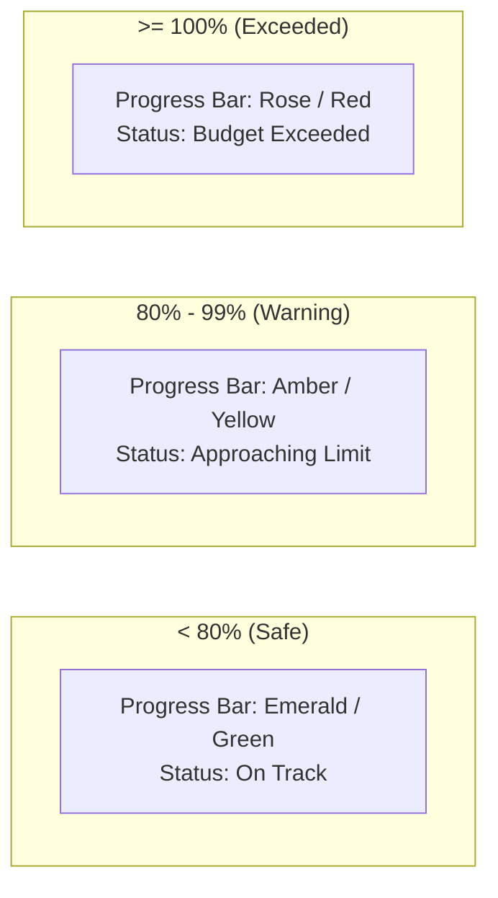

# 04 — Budgeting, Recurring Engine, Multi-Currency & Backups

## 1. Budgeting & Spending Limits (F4)

Budgie provides category-level budgeting with real-time threshold monitoring.

### Budget Model
- **Monthly Limit**: Each category can specify an optional `MonthlyBudget` amount in the user's primary currency.
- **Fixed Monthly Calculation**: Every calendar month measures expenses categorized under that category (including sub-categories) against the monthly cap.

### Visual Threshold Indicators

| Spent % | Visual Treatment | Badge / Indicator |
|---|---|---|
| `< 80%` | Emerald / Green progress bar | `Normal` — Remaining budget displayed |
| `80% - 99%` | Amber / Yellow progress bar | `Warning` — Visual alert tag in Dashboard & Category list |
| `>= 100%` | Destructive / Red progress bar | `Exceeded` — Pulsing badge, overspend amount highlighted |

---

## 2. Recurring Transactions Engine

Automates recurring bills, subscriptions, and regular income streams.

### Configuration Parameters
- **Frequency**: `Daily`, `Weekly`, `Biweekly`, `Monthly`, `Yearly`, `Custom` (every $N$ days).
- **Applicability Modes**:
  - `Automatic`: Engine automatically generates the transaction when `NextDueDate` is reached.
  - `Template`: Stored as a quick template for manual one-click execution.
  - `Manual`: Prompts user with a due notification to review and confirm execution.
- **End Conditions**: `Never`, `AfterCount` ($N$ occurrences), or `OnDate` (specific expiration date).
- **Split Support**: Recurring transactions can define predefined split participants.

---

## 3. Multi-Currency Support & Exchange Rates

1. **Base Currency**:
   - Configured in `UserSettings.MainCurrency` (e.g. `USD`, `EUR`, `MXN`, `COP`).
   - All dashboard aggregates and net worth calculations convert to base currency.

2. **Transaction Exchange Rates**:
   - Accounts can operate in any supported ISO-4217 currency.
   - When a transaction currency differs from the account's base currency, an `ExchangeRate` is applied.
   - Users can manually override the exchange rate per transaction.
   - Historical exchange rates are cached in the `ExchangeRates` table.

---

## 4. Export & Portable JSON Backup Snapshots

Budgie provides zero-lock-in data portability and backup capabilities.

### 1. Transaction Logs Export (CSV / JSON)
- **Endpoint**: `GET /api/finances/export/transactions?format=csv&from=...&to=...&accountId=...`
- **Output**: Formatted CSV with UTF-8 BOM (compatible with Excel/Sheets) or JSON array.
- **Fields**: Date, Account, Category, Type, Amount, Currency, Exchange Rate, Notes, Participants, Settlement Status.

### 2. Full Account JSON Snapshot (Backup & Restore)
- **Endpoint (Export)**: `GET /api/finances/export/snapshot`
- **Endpoint (Restore)**: `POST /api/finances/export/snapshot`
- **Snapshot Contents**: Complete multi-entity JSON package:
  - User Settings & Preferences
  - Accounts (including `ControlStartDate` and Credit Card configurations)
  - Categories & Sub-categories (with Monthly Budgets)
  - Persons, Tags & Tag Associations
  - Transactions, Splits & Repayments
  - Recurring Transactions & Goals
- **Safety & Validation**:
  - Restoring a snapshot validates JSON schema integrity before applying within a single database transaction.
