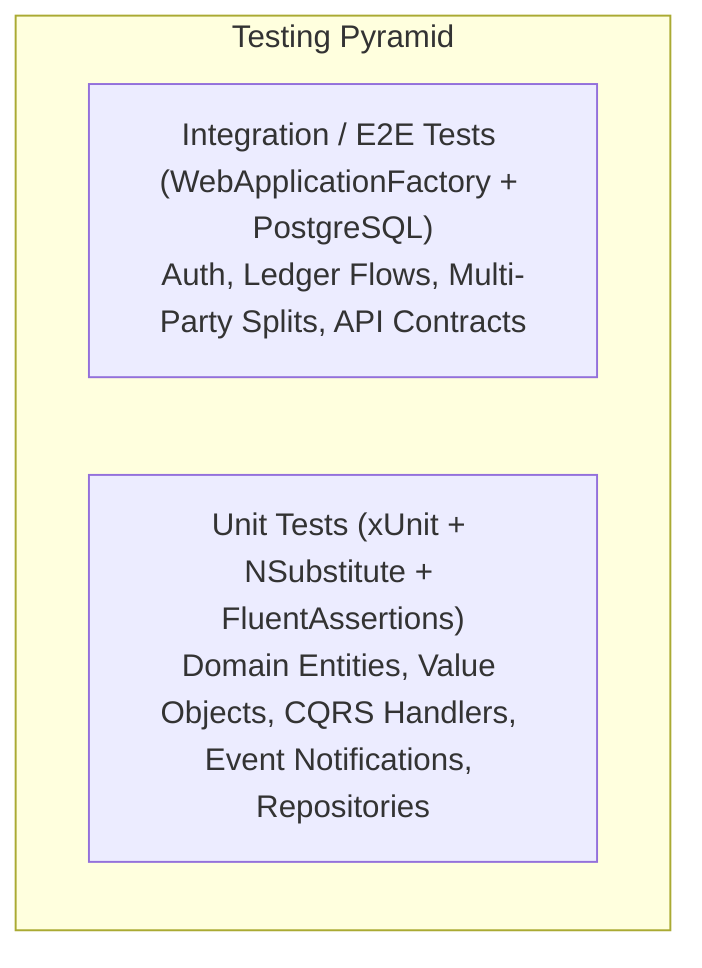

# 06 — Testing Strategy, ~100% Code Coverage & Git Conventions

## 1. Testing Philosophy & Near-100% Coverage Mandate

To guarantee system stability, prevent regression bugs, and ensure seamless Native AOT runtime behavior, Budgie establishes a **high-rigor testing strategy targeting ~100% code coverage** across all modules and layers.



---

## 2. Test Architecture & Structure

Test projects mirror the modular architecture:

```
tests/
├── Budgie.Shared.UnitTests/                 # Value Objects (Money, CurrencyCode, Name, Email, HexColor, etc.)
├── Budgie.Modules.Users.UnitTests/          # Login, Register, Invites, Policies, Settings, Token Services
├── Budgie.Modules.Finances.UnitTests/       # Accounts, ControlStartDate, Splits, CC Cycles, Budgets, Recurring
├── Budgie.Modules.Relationships.UnitTests/  # Persons, Tags, Multi-Person Allocations
└── Budgie.IntegrationTests/                 # Full-stack API integration with WebApplicationFactory & PostgreSQL
```

### 1. Unit Testing Guidelines (`xUnit`, `NSubstitute`, `FluentAssertions`)
- **Domain Aggregates & Value Objects**:
  - Test all factory methods (`From`, `FromPositive`, `FromNonNegative`).
  - Test boundary conditions, invalid formats, negative amounts, and custom validation rules.
- **Command & Query Handlers**:
  - Mock repository interfaces (`IAccountRepository`, `ITransactionRepository`, etc.) via `NSubstitute`.
  - Assert that business rules return precise `ErrorOr` failures (e.g. `Error.Validation`, `Error.NotFound`, `Error.Conflict`).
  - Verify that successful commands publish corresponding `INotification` Domain Events.
- **Event Notification Handlers (`INotificationHandler<T>`)**:
  - Test each notification handler independently for isolated side-effect execution (e.g. balance adjustment on transaction creation).
- **Internationalization (i18n) Error Validation**:
  - Test error messages under both `es` (Spanish default) and `en` (English) `CultureInfo.CurrentUICulture` scopes to ensure 100% bilingual coverage.

### 2. Integration Testing Guidelines (`Budgie.IntegrationTests`)
- Runs against an active PostgreSQL instance (via Testcontainers or test DB connection).
- Verifies:
  1. **Zero-Trust Initialization**: Clean DB state -> status check -> first user admin registration -> public registration locking.
  2. **Strict Ledger Enforcement**: Creating an account with `ControlStartDate` and asserting that attempting to insert transactions prior to `ControlStartDate` yields `400 Bad Request`.
  3. **Multi-Party Split & Settle Flow**:
     - User creates $100 expense with Maria ($50 deferred) and John ($25 immediate to Cash).
     - Verifies parent transaction, child virtual receivables, Maria's profile debt summary, and balancing cash settlement.
     - Executes "Settle Debt" and verifies loan clearance.
  4. **Category Budgets**:
     - Registering expenses and verifying that summary endpoints correctly compute spent percentages, remaining budgets, and threshold status (`Normal`, `Warning`, `Exceeded`).
  5. **Snapshot Export & Import**:
     - Exporting a user snapshot to JSON, purging user records, re-importing the snapshot, and verifying exact ledger parity.

---

## 3. Coverage Verification & Quality Gates

1. **Automated Coverage Tooling**:
   - Coverage measured via `coverlet.collector` / `dotnet test --collect:"XPlat Code Coverage"`.
2. **Pre-Commit / CI Quality Gate**:
   - All tests in `Budgie.slnx` must pass with zero warnings and zero failures.
   - Any new feature, handler, or domain logic must include comprehensive unit and integration tests prior to merge.

---

## 4. Git Conventions & Conventional Commits

All git commit messages MUST strictly adhere to the **Conventional Commits 1.0.0** specification with descriptive scopes:

### Commit Format
```
<type>(<scope>): <short description in imperative mood>

[optional body explaining motivation and context]

[optional footer(s)]
```

### Commit Types

| Type | Description | Example |
|---|---|---|
| `feat` | A new feature or business capability | `feat(finances): implement ControlStartDate transaction date validation` |
| `fix` | A bug fix | `fix(auth): correct sliding refresh token cookie expiration` |
| `test` | Adding or updating unit/integration tests | `test(splits): add comprehensive multi-party split settlement unit tests` |
| `refactor` | Code restructuring without changing behavior | `refactor(finances): migrate dapper queries from application to repository` |
| `perf` | Performance or Native AOT optimization | `perf(aot): register new DTO records in BudgieJsonContext` |
| `docs` | Documentation and specification updates | `docs(specs): add testing strategy and conventional commit standards` |
| `chore` | Dependency updates, tooling, build scripts | `chore(deps): update vite and tailwind v4 plugins` |

### Approved Scopes

- `users`: User authentication, onboarding, registration policy, settings, invites, profile.
- `finances`: Accounts, transactions, categories, budgets, recurring transactions, goals.
- `relationships`: Persons, tags, person photo avatars.
- `ledger`: Strict ledger rules, `ControlStartDate`, balance calculation engine.
- `splits`: Multi-party expense split allocation, virtual debt balances, debt settlements.
- `api`: Minimal API host, middlewares, i18n culture routing, OpenAPI schemas, AOT contexts.
- `web`: Frontend SPA, routes, components, UI primitives, TanStack Query hooks, i18n dictionaries.
- `shared`: Base entities, value objects, enums, `IDbConnectionFactory`.
