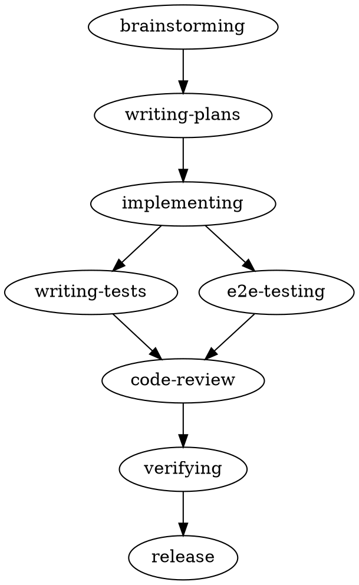

# 07 — Specification-Driven Development (SDD) Methodology

## 1. Principio rector

Budgie se desarrolla **spec-first**: ningún código se escribe sin (1) un design spec aprobado y
(2) un implementation plan aprobado. El ciclo está definido en `AGENTS.md` y se orquesta con la
skill `sdd`. Este documento es la referencia técnica completa: ciclo, roles (sub-agents), grupos
backend/frontend, trazabilidad y gates.

## 2. Ciclo completo

### Artefactos por paso

| Paso | Entrada | Artefacto | Ubicación |
|------|---------|-----------|-----------|
| brainstorming | idea | design spec | `docs/superpowers/specs/YYYY-MM-DD-<topic>-design.md` |
| writing-plans | design spec aprobada | implementation plan | `docs/plans/<nn>-<feature>.md` |
| implementing | slice de plan | código | `src/**` |
| writing-tests | código backend | tests | `tests/**` |
| e2e-testing | código frontend | specs Playwright | `src/apps/Budgie.Web/e2e/` |
| code-review | diff | reporte de revisión | (en pantalla) |
| verifying | código | reporte PASS/FAIL | (en pantalla) |
| release | verde | commit convention + tag | git |

## 3. Roles: sub-agents

Los sub-agents se delegan vía `task` para mantener el contexto del agente principal pequeño
(eficiencia de tokens/recursos). Viven en `.opencode/agent/`.

### Transversales

| Agent | Entrada | Salida | Permisos |
|-------|---------|--------|----------|
| `plan-writer` | design spec aprobada | plan con trazabilidad `[MODIFY]/[NEW]` | read + edit (`docs/plans/`) |
| `verify` | código | reporte PASS/FAIL de gates | read + bash (build/test/lint/playwright) |

### Grupo backend (C# / .NET 10 / Native AOT / Dapper)

| Agent | Entrada | Salida | Reglas clave |
|-------|---------|--------|--------------|
| `backend-implementer` | slice de plan | código en `src/core/**`, `src/apps/Budgie.Api/**` | SQL solo en `Infrastructure/Database`; handlers usan interfaces de repo; AOT en `BudgieJsonContext` |
| `backend-reviewer` | diff | reporte vs `AGENTS.md`, `dotnet-best-practices`, `dotnet-design-pattern-review` | `edit: deny` |
| `backend-test-author` | código backend | tests unit/integration ~100% cobertura | xUnit, NSubstitute, FluentAssertions, WebApplicationFactory + PostgreSQL |

### Grupo frontend (React / shadcn/ui / UI / UX / Playwright)

| Agent | Entrada | Salida | Reglas clave |
|-------|---------|--------|--------------|
| `frontend-implementer` | slice de plan | código en `src/apps/Budgie.Web/**` | shadcn/ui + Base UI; cliente OpenAPI; i18n es/en; TS estricto |
| `frontend-reviewer` | diff | reporte vs `react-best-practices`, `web-design-guidelines` | `edit: deny` |
| `frontend-e2e` | código frontend | specs Playwright | API mockeada (MSW/OpenAPI); determinista; selección por accesibilidad |

## 4. Enrutamiento backend vs frontend

Decidido por las **rutas tocadas** por el slice:

- **Backend** → `src/core/**`, `src/apps/Budgie.Api/**`, `tests/Budgie.*.UnitTests/`,
  `tests/Budgie.IntegrationTests/` → agentes `backend-*`.
- **Frontend** → `src/apps/Budgie.Web/**` → agentes `frontend-*`.
- **Transversal** → `docs/**`, `AGENTS.md` → agente primario, o `plan-writer`/`verify`.

Si un cambio toca ambos grupos, se divide en dos slices (backend primero, luego frontend).

## 5. Trazabilidad

Todo artefacto enlaza su spec y las rutas de código reales:

- Los **design specs** referencian módulos/features y las decisiones tomadas.
- Los **plans** (`[MODIFY]/[NEW]`) apuntan a rutas completas del repositorio.
- Los **tests** referencian el handler/entidad que cubren.
- Cada capa del módulo (Domain/Application/Infrastructure/Presentation) tiene convenciones
  estrictas de dependencia (ver `AGENTS.md`).

## 6. Quality gates

Todos en verde antes de `release` (successor de `harness/verify.sh`):

1. `dotnet build Budgie.slnx` — si hubo backend.
2. `dotnet test Budgie.slnx` — si hubo backend/tests.
3. `tsc --noEmit` + `bun lint` + `bun build` — si hubo frontend.
4. `bunx playwright test` — si hubo `e2e/`.

Un fallo de entorno (sin `bun`, deps, Postgres) se distingue de una regresión y no se "corrige"
en código. Rojo = no release.

## 7. Convenciones de commits (spec 06)

Conventional Commits 1.0.0. Tipos: `feat`, `fix`, `docs`, `style`, `refactor`, `perf`, `test`,
`build`, `ci`, `chore`, `revert`. Scopes: `users`, `finances`, `relationships`, `ledger`,
`splits`, `api`, `web`, `shared`. SemVer: `major` = breaking, `minor` = `feat`, `patch` = resto.
